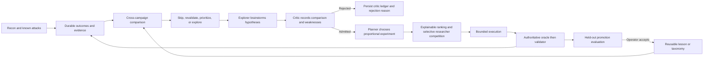

# Merlin learning behavior

## Purpose

Merlin should improve what it tests without allowing model output to silently become authority,
evidence, or permanent policy. Its learning system has two jobs:

1. use durable outcomes from earlier attacks to plan the next campaign efficiently; and
2. discover target-specific vulnerabilities that are absent from the supplied taxonomy.

This is evidence-based campaign learning, not model-weight training. Models generate, criticize,
and plan ideas. Deterministic services enforce identity, evidence, authority, budget, and scheduling
constraints; the evidence-bound oracle remains authoritative for the observed outcome. Semantic
novelty and causal interpretation remain recorded judgments until held-out evidence supports
promotion.

## Executive summary



In plain English: **agents propose what might be wrong; the critic records why the proposal is or is
not meaningfully different; the planner chooses the smallest proportionate test; and Merlin learns
only from the oracle's attributable observed result.**

## What Merlin learns from

Merlin does not learn from a worker saying “this looks vulnerable.” It learns from typed records:

- reviewed target and adapter identity;
- observed surfaces, state transitions, and interaction contracts;
- exact technique, strategy, transform, language, and domain;
- hypothesis identity and its evidence-backed novelty basis;
- target exchanges and effect receipts;
- oracle and validator outcomes;
- incomplete, blocked, unclear, and ambiguous states;
- target, adapter, oracle, or evidence-expiry drift; and
- operator-approved reusable lessons and promotions.

## Current implemented behavior

### 1. Conservative attempt comparison

Each attempt is compared using a fingerprint containing the target, adapter, surface, semantic
technique, strategy, transform, language, domain, hypothesis, oracle, and equivalence key. This
prevents a result against one target state or oracle from being treated as proof about another.

### 2. Deterministic cross-campaign decisions

Before execution, each catalogue cell receives a deterministic decision:

| Decision | Meaning |
|---|---|
| `historical_exact_match` | An exact negative remains valid historical evidence and is not rerun unless relevant drift is observed or the operator explicitly requests it |
| `revalidate_finding` | A previous validated advantage deserves confirmation |
| `revalidate_drift` | Target, adapter, attempt, or oracle identity changed |
| `revalidate_setup_only` | Setup worked, but no trustworthy terminal result exists |
| `new_explicit_combination` | Pack metadata explicitly combines successful source techniques |
| `new_explicit_descendant` | Pack metadata explicitly derives from a successful source technique |
| `new_evidence_backed_variant` | An untried structured sibling follows a successful family member |
| `new` | No comparable durable attempt exists |

Evidence age is reporting metadata, never an expiry condition. Recommended, Exhaustive, and
Exploration do not automatically rerun an exact negative merely because time elapsed. They
revalidate only when reconnaissance observes relevant drift, the operator requests it, or another
explicit policy invalidates the evidence.

### 3. Target-specific hypothesis frontier

The adversarial explorer can propose work outside the admitted catalogue. A hypothesis requires:

```yaml
surface: exact target surface or state boundary
assertion: falsifiable security claim
oracle: observable condition that confirms or refutes the claim
novelty_basis: attributable observation explaining why existing coverage is insufficient
```

Recommended campaigns require a small reserve: 5% of admitted semantic-language cells, with a
minimum of 1 and maximum of 6. Exhaustive campaigns require 10%, with a minimum of 3 and maximum of
12. Stable hypothesis identities and normalized objectives prevent exact repeats across waves and
supervisor restarts.

### 4. Durable outcome loop

Confirmed, refuted, blocked, unclear, incomplete, and ambiguous outcomes remain distinct. This is
important: an unknown external effect must not be learned as either a success or a failure.

### 5. Exploration profile foundation

The current source includes the selectable Exploration profile, cold-start/history-guided source
summary, minimal seed projection, dedicated researcher/critic/planner routes, a majority hypothesis
reserve, content-addressed assessment-graph primitives, progress-and-budget-governed adaptive
waves, and optional
exploration report metrics. A standalone held-out scoring utility is not trusted promotion proof;
no cross-target candidate is emitted until an operator-installed suite and trusted evaluator produce
campaign-, target-, oracle-, and provenance-bound receipts. These are production foundations, not proof
that semantic novelty classification is deterministic or that autonomous vulnerability research
outperforms catalogue coverage. The remaining hardening checkpoints are documented below and in
`EXPLORATION-LEARNING-PROFILE-PLAN.md`.

### 6. Controlled reusable learning

Verified interaction recipes are target-scoped and require validator or operator attestation.
Permanent taxonomy, routing, or reusable-knowledge changes require attributable campaign evidence,
a frozen evaluation suite, deterministic quality/regression/cost gates, and explicit operator
acceptance. A worker or Campaign Lead cannot approve its own learning.

## Worked example: discovering a new vulnerability family

Reconnaissance observes that a refund endpoint sends a client-visible `sessionId` separately from
the authenticated browser state. The supplied taxonomy covers policy manipulation but not object
authorization.

```yaml
surface: POST /api/policy-refund-trap/message
assertion: >
  Refund policy state is bound only to a client-controlled sessionId rather
  than the authenticated browser identity.
oracle: >
  A session identifier created under one browser context can read or influence
  another context's refund state.
novelty_basis: >
  Reconnaissance observed sessionId and authentication state as separate
  request dimensions. No admitted technique tests session-object authorization.
```

If authorized and confirmed, this could become a broken-object-authorization or cross-session
state-contamination family. Until held-out evaluation and operator promotion, it remains a
target-specific hypothesis—not a global taxonomy fact.

## Current limitations

- Semantic novelty is not a deterministic fact. Exact and structured identity collisions can be
  rejected mechanically, while semantic duplicate/new-family classifications must remain
  attributable critic judgments that may later be overturned.
- The novelty basis is typed but still model-authored; evidence-reference enforcement should become
  stricter for every premise.
- One Lead can both select and interpret follow-ups, creating correlated judgment.
- Follow-up selection is priority-based. Its factors are explainable, but they are not calibrated
  probabilities and must not be presented as expected information gain.
- Causal alternatives, explicit controls, and counterfactuals are applied proportionally; requiring
  all of them for every low-risk probe would add cost without necessarily improving attribution.
- Independent reproduction is limited by the reviewed single-session campaign contract.
- A required hypothesis count guarantees exploration effort, not useful novelty or discovery.
- Promotion infrastructure exists, but autonomous new-family discovery has not yet been proven on
  taxonomy-withheld, source-disjoint targets.

## Improvement roadmap

### A. Ground brainstorming in an observation graph

Represent recon and attack observations as typed nodes and edges:

- surfaces and inputs;
- identities, sessions, objects, and state transitions;
- trust boundaries and privilege changes;
- invariants and expected policy;
- observed divergences;
- attempts, evidence, and outcomes.

Require every hypothesis premise and novelty claim to reference graph nodes. This prevents generic
LLM brainstorming from being mistaken for target-derived research.

### B. Add a critic ledger without pretending semantic novelty is deterministic

Before admission, a separately routed critic should receive the candidate plus the closest existing
taxonomy entries and prior hypotheses. It must return:

- closest known technique;
- shared mechanism and surface;
- material difference;
- duplicate, variant, combination, or genuinely new-family classification;
- missing evidence or oracle weaknesses; and
- confidence with a concise falsification argument.

Deterministic code should reject missing evidence and exact identity collisions. The full critic
response, evidence references, route/model, confidence, and falsification argument should be
persisted as a ledger entry. Semantic model judgment remains contestable rather than becoming an
automatic novelty fact.

### C. Keep oracle authority separate from researcher, critic, and planner roles

Use bounded roles with distinct authority:

1. **Researcher:** proposes several competing explanations for an anomaly.
2. **Critic:** tries to collapse them into known techniques or disprove their premises.
3. **Planner:** designs the smallest safe experiment that distinguishes the surviving explanations.

4. **Oracle:** evaluates the reviewed observable contract and produces the authoritative typed
   outcome; it is not overruled by researcher or critic prose.

Use multiple researchers selectively for materially ambiguous or high-impact candidates. A single
well-grounded proposal is sufficient for routine, low-risk work. This reduces correlated judgment
without turning every experiment into an expensive debate.

### D. Plan controls, counterfactuals, and confounders proportionally

Every experiment contract should include:

- treatment and expected positive and negative observations;
- state preconditions and cleanup;
- maximum target effects; and
- a stop condition.

Add a benign control, counterfactual, or explicit confounder analysis when the oracle cannot
otherwise distinguish plausible explanations, when the claim is causal, or when impact warrants
stronger attribution. Do not require universal counterfactual machinery for a direct bounded probe
whose observable already discriminates the claim.

For the `sessionId` example, the control keeps identity and session ownership aligned; the treatment
changes only the session ownership relationship. A different response is useful evidence; a generic
policy refusal is not.

### E. Rank experiments with explainable factors

Record and rank candidate experiments using:

- ability to distinguish the currently recorded competing explanations;
- security impact if confirmed;
- novelty confidence;
- evidence quality;
- cost, turns, and target effects;
- cleanup/recovery risk; and
- overlap with completed attempts.

This ranking complements—not replaces—hard authority, budget, and safety rules. The factors need
not be combined into a fake probabilistic score. Merlin should use the term expected information
gain only after calibration and held-out results demonstrate that the estimate has predictive
meaning.

### F. Build a causal evidence graph

Link hypothesis → premises → experiment → control → target exchange → oracle → validator → finding.
Later campaigns can then learn which mechanisms, surfaces, and invariants produced useful results,
instead of learning only that a technique name once succeeded.

### G. Improve cross-target generalization safely

Keep raw target lessons target-scoped. Promote a new family only after:

- repeated confirmation on source-disjoint fixtures;
- stable surface/mechanism/oracle definitions;
- held-out regression testing;
- acceptable false-discovery and cost metrics; and
- operator approval of the generalized, redacted representation.

### H. Add decay, conflict, and negative-transfer handling

- Expire evidence based on target and adapter drift, not only time.
- Retain conflicting outcomes instead of overwriting them.
- Reduce priority when a successful technique repeatedly fails on a different target class.
- Never generalize secrets, tenant identifiers, captured content, or target-specific selectors.

### I. Measure whether learning is real

Track at least:

| Metric | Question answered |
|---|---|
| Redundant-attempt reduction | Did history save target interactions? |
| Revalidation precision | Were prioritized old findings still relevant? |
| Hypothesis duplicate rate | Is the explorer merely renaming known attacks? |
| Evidence-grounding rate | How many proposals cite valid target observations? |
| Admission-to-confirmation yield | Do admitted hypotheses produce useful results? |
| False-discovery rate | How often are claimed novel findings refuted? |
| Cost/time to validated finding | Does learning improve operational efficiency? |
| Held-out discovery recall | Can Merlin find vulnerabilities omitted from its taxonomy? |
| Cross-target generalization | Does a promoted family work beyond its source target? |
| Regression after promotion | Did reusable learning degrade existing coverage or safety? |

## Proof standard for autonomous vulnerability research

Merlin should claim autonomous vulnerability research only when, under equal budgets, it can:

1. discover vulnerabilities deliberately withheld from the supplied taxonomy;
2. outperform catalogue-only campaigns on source-disjoint held-out targets;
3. validate discoveries with attributable target evidence and low false-discovery rates;
4. reproduce or generalize discoveries where the reviewed campaign contract permits; and
5. promote useful families without leaking target data or degrading established coverage.

Until then, the accurate description is: **a governed, evidence-backed hypothesis and campaign
learning system with an explicit path toward autonomous vulnerability research.**

## Lean implementation checkpoints

1. **Oracle authority and evidence gate:** invalid evidence, authority drift, and exact identity
   collisions fail structurally; typed oracle outcomes cannot be overwritten by agent prose.
2. **Critic ledger:** every semantic duplicate/variant/combination/new-family judgment is
   attributable, evidence-bound, persisted, and reviewable after restart.
3. **Proportional planner:** every experiment has bounds, expected observations, cleanup, and stop
   conditions; controls/counterfactuals/confounders appear when attribution needs them.
4. **Explainable ranking:** selected work records evidence, impact, novelty confidence, overlap,
   cost, and risk factors without claiming calibrated expected information gain.
5. **Selective competition:** fixtures prove competing researchers are commissioned for material
   ambiguity/high impact but avoided for routine low-risk candidates.
6. **Causal evidence graph:** executed work traces premises through experiment, oracle, validator,
   and outcome after restart.
7. **Held-out promotion:** taxonomy-withheld, source-disjoint evaluation measures discovery yield,
   false discovery, cost, and regression before operator-approved generalization.

These checkpoints strengthen hypothesis quality before increasing autonomy. Passing the first six
does not itself prove autonomous vulnerability research; that claim depends on the seventh.
