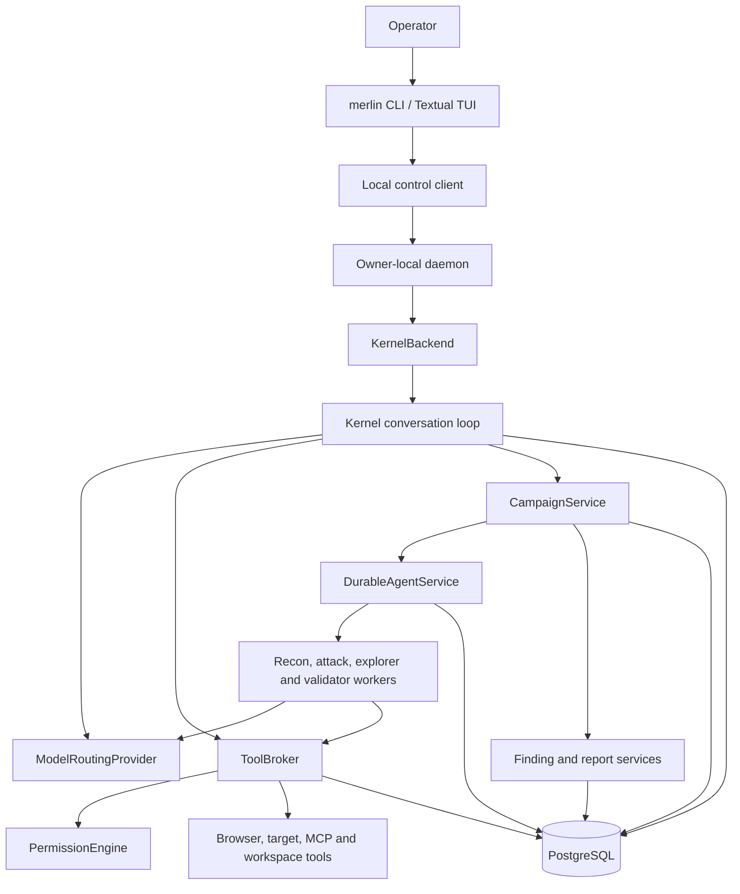

# Merlin source and package architecture

This is the technical map of the Python implementation. Use it to answer three questions:

1. Which package owns a behavior?
2. How does an operator request become a durable campaign and report?
3. Where should a change or investigation begin?

The repository is a Python 3.13 `uv` workspace. There is **no root-level `src/` directory**.
Production code lives in one application and 17 package-local source trees:

```text
apps/merlin-tui/src/merlin_tui/        executable, TUI, daemon, composition root
packages/<distribution>/src/<module>/  reusable product packages
packages/<distribution>/tests/         tests beside each package
```

The installed command is `merlin = merlin_tui.cli:main`.

## Architecture at a glance



The application layer wires the graph. Packages own policy or capability-specific behavior.
PostgreSQL owns durable runtime truth.

## Core design rules

- `merlin-contracts` contains shared data shapes and protocols; it does not perform I/O.
- `merlin-tui.bootstrap.build_backend()` is the production composition root. It creates stores,
  providers, permissions, tools, services, campaign callbacks, and the kernel.
- LLMs propose text, tool calls, hypotheses, and Lead decisions. Application code owns approval,
  capability projection, state transitions, evidence joins, and finding/report status.
- Target, browser, MCP, provider, shell, and filesystem effects must cross a registered tool or
  adapter boundary. A worker does not receive ambient access merely because another worker has it.
- Durable work is represented as schedules, nodes, attempts, generations, leases, checkpoints,
  messages, effects, and completion records. In-memory tasks are execution handles, not truth.
- Package `__init__.py` exports are the intended public surface. Prefer those over imports from
  another package's private helpers.

## Application source: `apps/merlin-tui`

This is the only executable application and the only package that intentionally imports almost
the entire workspace.

| File | Responsibility |
|---|---|
| `cli.py` | `merlin` entry point, daemon/storage commands, non-interactive output, campaign submission, first setup |
| `local_control.py` | owner-local daemon socket, request/stream protocol, journal replay, daemon start/stop |
| `bootstrap.py` | production composition root and integration callbacks for campaigns, evidence, tools, providers, reports, recovery, and cleanup |
| `kernel_backend.py` | adapts kernel/domain events into UI views and daemon methods |
| `app.py` | Textual screens, transcript, command input, review/confirmation dialogs, live campaign views |
| `configuration.py` | operator-facing provider, model-route, MCP, and browser-profile configuration |
| `provider_catalog.py` | provider/model discovery presented during setup |
| `mcp_service.py` | application-facing MCP registration and configuration lifecycle |
| `client_state.py` | client-side streamed state and reconnect projection |

Startup follows this path:

```text
merlin_tui.cli:main
  -> ensure_daemon()
  -> local_control.serve()
  -> bootstrap.build_backend()
  -> KernelBackend + Kernel + campaign/tool/storage services
  -> LocalControlClient
  -> MerlinApp
```

The TUI is a client. The daemon owns the live backend, which lets a UI restart or reconnect without
becoming the owner of durable campaign execution.

Daemon startup records a process incarnation through `DaemonRunRepository.start`, which marks
unfinished predecessors unclean. A dedicated PostgreSQL connection carries heartbeats, attributed
stop requests (including SIGTERM/SIGINT), and cleanup completion. It closes after backend resources;
embedded PostgreSQL stops afterward. Failed cleanup leaves an unfinished run for the next startup
to reconcile.

Local ENOSPC fences new mutating foreground commands until restart, while status/read-only access
and existing durable background campaigns remain available. The socket returns an error with
`code: "local_storage_exhausted"`, `failure_class: "infrastructure"`, and
`infrastructure_failure_category: "storage_exhausted"`. The daemon stops retrying the failed local
replay journal. PostgreSQL SQLSTATE `53100` is classified separately as infrastructure storage
exhaustion; it does not establish negative attack-quality evidence.

## Package catalogue

### Control and orchestration

| Package | What it owns | Start here |
|---|---|---|
| `merlin-contracts` | Shared Pydantic models and protocols for chat, tools, agents, findings, packs, effects, records, GOAT, Hydra-Select, and promotion | `chat.py`, `agents.py`, `findings.py`, `tools.py` |
| `merlin-kernel` | One conversational session: message persistence, provider streaming, tool continuation, commands, context compaction, branching, rewind, restore, and interrupts | `kernel.py`, `protocols.py`, `commands.py` |
| `merlin-agents` | Campaign manifests, specialist routing, graph admission, Lead supervision, durable worker execution, mailbox coordination, learning decisions, and adaptive controllers | `campaign_service.py`, `campaign.py`, `durable_service.py`, `specialists.py` |
| `merlin-assessments` | Target selection/resolution, reviewed API target execution, pack inputs, and the bounded unscored alternating `AssessmentRunner` | `service.py`, `api_target.py`, `runner.py` |

`merlin-assessments` does not own the complete reviewed multi-worker campaign lifecycle.
`merlin-agents.CampaignService` owns campaign preparation, approval binding, execution, waves,
supervision, validation follow-ups, lessons, terminal state, and report triggering.

Within `merlin-agents`:

| File | Responsibility |
|---|---|
| `campaign.py` | immutable manifest/context types, campaign compilation, comparability and cross-campaign learning decisions |
| `campaign_service.py` | reviewed prepare/execute API, Lead supervision, wave lifecycle, saturation, recovery, reports and lessons |
| `durable_service.py` | execution of admitted graphs over durable schedules, leases, retries, cleanup, effects, messages and reducers |
| `scheduler.py` | in-memory/reference scheduler contract and state-machine vocabulary |
| `graph.py` | graph validation, authority narrowing, child graph admission, topology digests |
| `specialists.py` | worker profiles and technique-to-specialist/model routing |
| `runtime.py` | bounded worker/provider/tool loop and handoff/checkpoint behavior |
| `coordination.py`, `mailbox.py` | typed Lead directives and attributable worker communication |
| `exploration.py` | research-policy seeds, critic decisions, experiment plans and held-out evaluation |
| `crescendo.py` | gradual probe/escalate/backtrack state machine |
| `goat.py` | fixed-bound observation/strategy/response trajectory |
| `hydra_select.py` | bounded candidate generation, exact deduplication, selection and sequential execution |

### Capabilities and security boundaries

| Package | What it owns | Start here |
|---|---|---|
| `merlin-providers` | OpenAI-compatible streaming plus Codex App Server, Claude CLI, Kimi/Kiro/OpenCode ACP, Pi RPC, request-scoped MCP admission, and exact-model routing | `routing.py`, `dynamic_mcp.py`, `openai_compatible.py`, transport-specific modules |
| `merlin-tools` | Tool registry/broker, permission checks, effect recording, workspace read/list/shell tools, MCP wrappers | `broker.py`, `workspace.py`, `mcp.py` |
| `merlin-permissions` | Permission rules, scope matching, decisions, audit records and authorization service | `engine.py`, `models.py`, `service.py` |
| `merlin-browser` | Bounded Playwright sessions, exact-origin checks, element references, persistent/isolated contexts, recon handoffs and browser tools | `core.py`, `tools.py`, `service.py`, `models.py` |
| `merlin-mcp` | Local subprocess and authenticated remote MCP server lifecycle, discovery, calls, timeouts and credential handles | `manager.py`, `remote.py` |
| `merlin-config` | Owner-local TOML configuration, runtime tuning and credential storage | `config.py`, `credentials.py` |

The current workspace shell tool runs a bounded subprocess on the owner host. It applies reviewed
workspace confinement, environment minimization, timeout/output bounds, process-group teardown,
and permission confirmation, but it is **not a general OS/container sandbox**.

In `auto` mode, verified read-only argv commands run without an approval prompt and retain
subprocess audit records. The initial allowlist covers installed system versions of `ls`, `pwd`,
`cat`, `head`, `tail`, `wc`, and `grep`, plus trusted system/Homebrew `rg` and a limited grammar for
`git status`, `git diff`, and `git log`. Filesystem operands must resolve inside the workspace.
Executables are pinned to their verified paths. Git optional writes, filesystem monitoring,
external diffs, text conversion, and signature helpers are disabled; repositories with configured
clean/process filters still require approval. Unknown options, wrappers, interpreters, network
commands, and writes keep the regular approval flow. Existing session denials still apply, and
`prompt` mode continues to ask for these commands.
Git worktrees whose repository metadata lives outside the workspace also require approval.

Before approval, the TUI shows the shell command, resolved working directory, and scrollable
arguments with credential redaction. `Allow this command + directory (session)` remembers the
complete original argv and resolved directory within the current session, workspace, and target
scope. Changed arguments (including redacted values) or a different directory require approval
again. `Allow all commands here for this session` remains an explicit broader choice; a broad
session denial overrides remembered command approvals. Command rules use the existing session
expiry and persist across daemon restarts. The command identity covers arguments and directory,
not executable or script contents.

Provider routing is selected from the exact `ChatRequest.model`. Native CLI transports are
no-tool routes unless their production contract explicitly supports Merlin's continuation model;
tool-bearing workers normally use a provider route that can return structured tool calls.

### Knowledge, learning and reporting

| Package | What it owns | Start here |
|---|---|---|
| `merlin-packs` | Attack-pack parsing, bundled catalogues, encrypted RPK knowledge, selection and knowledge-search tool | `catalog.py`, `parser.py`, `knowledge.py` |
| `merlin-skills` | Safe `SKILL.md` discovery, parsing, references and per-session enablement | `catalog.py`, `parser.py`, `service.py` |
| `merlin-memory` | Reviewed portable bundles, target-scoped interaction lessons, sealed lessons and quarantine on import | `bundle.py`, `interaction.py`, `quarantine.py`, `service.py` |
| `merlin-findings` | Finding lifecycle, evidence-aware campaign report projection, revisions, comparison and Markdown/HTML/CSV/JSON exports | `service.py`, `projection.py`, `reporting.py` |
| `merlin-promotion` | Frozen evaluation suites, provider/adapter/browser candidate evaluation, acceptance, activation, and rollback | `service.py`, evaluator modules, `kernel_service.py` |
| `merlin-readiness` | Doctor checks, operational journal, restart/resume seams, sanitization, lifecycle closure and packaging audit | `diagnostics.py`, `journal.py`, `resume.py`, `packaging.py` |

Continuous learning is deliberately split:

- `merlin-agents.campaign` decides whether exact prior evidence can be skipped, must be
  revalidated, or can prioritize an explicit related variant.
- `merlin-storage-postgres` supplies target/scenario/adapter/oracle-bound attempt history.
- `merlin-memory` carries reviewed portable knowledge and verified interaction lessons.
- `merlin-findings` projects lessons and evidence into immutable report revisions.

No package treats general model memory or a worker's prose as a confirmed finding.
Model-judged refusals remain partial, with the judgment, confidence and evaluation uncertainty
retained. They do not become conclusive refutations in completion reports. Cross-campaign
history preserves these attempts and ranks them behind untested cells; it does not retire them.
Legacy model-judged refutations become partial when their completion history is recorded again.
Preparation binds partial-attempt evidence and repeat-planning guidance into the reviewed worker
context, including after resume. Workers explain validation, adaptation or other useful next work
in their strategy plan. Runtime checkpoints retain the model's repeat rationale; missing rationale
is evaluation uncertainty. The harness audits presence, not semantic usefulness, and does not
block an authorized test or retire an unresolved technique based on its interpretation of a reason.

### Durable storage

`merlin-storage-postgres` implements the repositories used by the other packages. It also owns
embedded PostgreSQL startup and ordered SQL migrations. Important stores are:

| State | Implementation |
|---|---|
| sessions, messages, events, pack runs, targets | `repositories.py`, `session_store.py` |
| reviewed campaigns, waves, Lead decisions, lessons | `campaign_store.py` |
| schedules, nodes, attempts, leases, checkpoints, mailbox, reducers | `scheduler_store.py` |
| tool effects and cleanup attribution | `effect_store.py` |
| findings and validation disposition | `finding_store.py` |
| immutable report revisions | `report_store.py` |
| browser metadata and reconnaissance handoffs | `browser_store.py` |
| API session lifecycle | `api_session_store.py` |
| permissions and audits | `permission_store.py` |
| memory and interaction lessons | `memory_store.py`, `interaction_store.py` |
| promotion candidates and operator decisions | `promotion_store.py` |

Migrations under `src/merlin_storage_postgres/sql/` are append-only product history. Add a new
numbered migration; do not silently rewrite a migration already applied by an operator.

## End-to-end campaign flow

### 1. Establish a reviewed target interaction

Browser or API reconnaissance records attributable observations and a durable handoff. The handoff
binds the target, interface, endpoint, session assumptions, observed surfaces, interaction steps,
evidence references, oracle information, and any explicit DOM fallback.

HTTP handoffs distinguish literal request values, response captures (`{{capture:name}}`),
runtime input (`{{input}}`), and client-generated values. Optional step-level `request_bindings`
maps exact RFC 6901 JSON Pointers to `uuid4` or `hex32` generators, including nested arrays.
Recon can declare bindings from frontend/network evidence; the compiler also recognizes UUIDs
that change across distinct successful messages in the same observed lifecycle, excluding
response-sourced values. A UUID-shaped constant alone is not enough to infer a generator.
Unsupported or uncertain value semantics require further recon evidence, rather than guessing
from a target name or field name. Session captures and input cannot be overridden by generators.

Bindings are part of the reviewed adapter identity. Execution creates values once per request,
persists the exact prepared request before dispatch, and reuses it for permitted transport
retries. A new message gets new generated values. Acknowledging a pending request resolves its
local ambiguity, including when its HTTP response rejects delivery; an unacknowledged effect
still requires reconciliation. Adapter error results retain their reviewed target identity.
Existing approved adapters are not silently rewritten; changing bindings requires a new handoff
and campaign review.

Relevant code:

- `merlin-browser`: observation and handoff capture
- `merlin-assessments`: target resolution and reviewed API execution
- `merlin-storage-postgres.browser_store`: durable handoff storage
- `merlin_tui.bootstrap.prepare_campaign()`: handoff verification and manifest input assembly

### 2. Prepare and review

`CampaignService.prepare()` receives the reviewed adapter and objective, compiles the initial team,
validates model-route requirements, persists the exact manifest/context digest, and returns the
operator-facing review. The review includes target identity, evidence references, admitted
techniques and variants, benign controls, specialists, model routes, tools, limits, cleanup,
learning decisions, and known limitations.

Preparation does not authorize execution. `CampaignService.execute()` requires the exact persisted
campaign ID, session, and reviewed digest.

### 3. Execute reconnaissance and attack waves

Execution compiles the reconnaissance graph first and submits it to `DurableAgentService` without
starting it until campaign ownership is committed. Once committed, the service runs graph nodes
under bounded concurrency. The Campaign Lead consumes attributable results and may admit attack,
exploration, validator, or cleanup follow-up waves within the original authority.

```text
reviewed manifest
  -> compile_recon_campaign()
  -> DurableAgentService.submit()
  -> DurableSchedulerStore.create_schedule()
  -> lease-fenced worker attempts
  -> CampaignService._supervise()
  -> attack / exploration / validation follow-up waves
  -> reducer and cleanup nodes
```

### 4. Run a worker

A worker receives a digest-bound `WorkerAssignment` and `WorkerContext`, not the whole application
authority. `WorkerRuntime` sends the assignment through the selected provider. Tool calls are
limited to the projected tool IDs and pass through `ToolBroker`, `PermissionEngine`, and effect
recording before the capability runs.

Adaptive techniques use controller state that is persisted with the attempt:

- Crescendo advances one reviewed step at a time and can backtrack or stop.
- GOAT records the bounded observation/thought/strategy/response trajectory.
- Hydra-Select persists the proposed/selected candidates and runs the selected set sequentially.

The PostgreSQL scheduler reconciles each controller's receipt chain after restart; restoring an
attempt does not ask a model to reconstruct the missing state from memory.

### 5. Reduce, validate and report

Worker output first becomes committed task evidence or a finding draft. Reducer and validator
paths join that claim to attempts, target exchanges, oracle results, independent validation, and
effect/cleanup records. `DurableReportService` then creates a revision-bound projection and exports
the requested audience/format.

The durable chain is:

```text
campaign -> wave -> schedule -> node -> attempt
         -> target exchange / tool effect / adaptive receipt
         -> reducer result -> finding + validation
         -> report revision -> campaign lesson
```

## Regular conversation and tool flow

Not every operator message creates a campaign. A normal conversational turn follows:

```text
MerlinApp or CLI
  -> LocalControlClient
  -> KernelBackend
  -> Kernel.submit()
  -> provider.stream(ChatRequest)
  -> text/reasoning events, or structured ToolCall
  -> ToolBroker.invoke()
  -> permission + durable effect boundary
  -> tool result returned to the model
  -> assistant message and events persisted
```

Chat controls live in `merlin_tui/operator_tools.py`. The foreground model interprets natural
language and calls `campaign_configure` to record the target/objective, effort profile, agent
composition, execution mode and explicit budget in durable tool history. New scans require an
objective and a resolved profile; revisions retain unspecified settings. The preparation wrapper
applies these settings after resume and keeps a compact, parseable campaign ID/digest receipt beside
the full review event. Execution rejects superseded reviews or settings changed since preparation.

`operator_inspect` and `operator_runtime` reuse the backend methods used by interface controls.
`operator_command` queues any documented TUI command through the same dispatcher after the
foreground response finishes. Credentials still use secure setup input, and menus and confirmation
steps retain their existing behavior. These tools are foreground-only and excluded from campaign
worker capabilities. Free-form chat can replace a pending numbered decision; doing so clears the
previous approval binding. Queued receipts must not be described as completed operations.

`Kernel` owns conversation continuity and command routing. `CampaignService` is exposed to the
kernel as reviewed tools such as preparation, execution, status, list, and cancellation.

## Where to start when debugging

Local-control stream frames retain the outer `type`, ordered `cursor`, and `value`
fields. At the send/replay boundary, `value` uses the `wire_events.py`
`merlin.client-event.v1` envelope with the unchanged `{kind, text}` pair under
`presentation`. The client accepts both this envelope and legacy bare pairs, and
still yields the public `StreamEvent`. Journals retain their existing presentation
layout and retention rules. Available identity/correlation fields survive wrapping;
live events also retain the kernel session ID available when they are produced.
Transport cursors are never used as durable event IDs or durable sequences.
Unsupported versions raise `ClientEventDecodeError` with code
`unsupported_client_event_version` and the received `schema_version`; replay-side
failures send these fields alongside the existing string `error` response.

| Symptom | First files to inspect |
|---|---|
| CLI will not start or daemon will not connect | `merlin_tui/cli.py`, `local_control.py`, `bootstrap.py` |
| TUI shows the wrong state | `merlin_tui/app.py`, `kernel_backend.py`, `client_state.py` |
| Conversation loops, loses context, or mishandles a tool continuation | `merlin_kernel/kernel.py`, selected provider transport |
| Provider output or usage is parsed incorrectly | `merlin_providers/<transport>.py`, `routing.py` |
| Tool is missing, denied, or executed with the wrong scope | `merlin_tools/broker.py`, `merlin_permissions/engine.py`, bootstrap registration |
| Campaign review contains the wrong target, team, route, or learning decision | `bootstrap.prepare_campaign`, `merlin_agents/campaign.py`, `campaign_service.py` |
| Campaign is stuck, duplicated, or fails after restart | `campaign_service.py`, `durable_service.py`, `scheduler_store.py`, `campaign_store.py` |
| Browser reference, origin, profile, or recon handoff is wrong | `merlin_browser/core.py`, `tools.py`, `browser_store.py` |
| Finding is not promoted or report evidence is missing | `merlin_findings/service.py`, `projection.py`, `finding_store.py`, `report_store.py` |
| Cross-campaign work is skipped or prioritized incorrectly | `merlin_agents/campaign.py`, `campaign_store.list_attempt_history()` |
| Startup health, packaging, or recovery is wrong | `merlin_readiness/*`, `merlin_tui/bootstrap.py` |

## Where a new feature belongs

- **Shared model or protocol:** add it to `merlin-contracts`; keep I/O elsewhere.
- **Provider transport:** implement `Provider` in `merlin-providers`, add exact config/routing,
  compose it in bootstrap, and add held-out promotion fixtures.
- **Tool:** implement the contract in `merlin-tools` or the owning capability package, classify its
  effect, register it in bootstrap, and add permission/effect persistence when it can change state.
- **Attack technique:** add a reviewed pack/catalogue case with a benign control, oracle, surface
  requirements, strategy identity, and tests for admission and reporting.
- **Adaptive controller:** define its immutable contract/catalogue, controller state machine,
  scheduler persistence/reconciliation, bootstrap admission, report projection, and restart tests.
- **Durable state:** add a numbered SQL migration and a focused repository/store. Keep secrets out
  of PostgreSQL; store opaque credential handles instead.
- **TUI command:** add parsing/domain behavior in the kernel when reusable, UI rendering in
  `merlin_tui`, and a local-control method if the operation must cross the client/daemon boundary.

## Verification

Install all workspace packages:

```bash
uv sync --all-packages
```

Run a focused package:

```bash
uv run pytest packages/merlin-agents/tests
uv run pytest packages/merlin-storage-postgres/tests
uv run pytest apps/merlin-tui/tests
```

Run repository lint and the scoped product gate:

```bash
uv run ruff check apps packages
uv run python scripts/verify.py phase 12
```

PostgreSQL integration tests marked `postgres` require `MERLIN_TEST_DATABASE_URL`. The packaged
release gate and authorized external-target acceptance are separate from ordinary unit tests.

## Current architectural hotspots

Several files are intentionally integration-heavy today:

- `merlin_tui/bootstrap.py` is the large composition root.
- `merlin_agents/campaign_service.py` combines the reviewed campaign API and Lead supervision.
- `merlin_agents/durable_service.py` is the durable execution coordinator.
- `merlin_storage_postgres/scheduler_store.py` is the persistence-heavy scheduler implementation.
- `merlin_kernel/kernel.py` contains the conversation state machine.

Before changing these symbols, use GitNexus impact analysis and trace the affected execution flows.
The repository may contain unrelated in-progress changes; preserve them and use focused tests.
