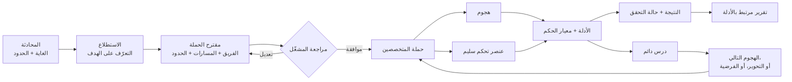

<div align="center" dir="rtl">


[English](../../README.md) · [简体中文](README.zh-CN.md) · [日本語](README.ja.md) · [한국어](README.ko.md) · [Español](README.es.md) · [Français](README.fr.md) · [Deutsch](README.de.md) · [Português (Brasil)](README.pt-BR.md) · [Русский](README.ru.md) · **العربية** · [हिन्दी](README.hi.md)

# Merlin

### اختبار أمان الذكاء الاصطناعي بقيادة المحادثة

**مصمَّم لاختبار: روبوتات الدردشة · وكلاء الذكاء الاصطناعي · تطبيقات RAG · الذكاء الاصطناعي المستخدم للأدوات · الأنظمة متعددة الوكلاء**

أخبر Merlin بما يحق لك اختباره. فهو يتعلّم طريقة عمل التطبيق، ويقترح حملة هجومية لتراجعها،
ويتتبّع الأدلة الواعدة، ثم يعيد إليك نتائج مدعومة بالأدلة مع بيان واضح لحالة الأدلة
وفجوات التغطية.

**72 حالة هجوم · 14 عنصر تحكم سليمًا · متصفح + API · استكشاف تكيّفي · نماذج متباينة**

[البدء السريع](#البدء-السريع) · [كيف يعمل Merlin](#كيف-يعمل-merlin) ·
[ما الذي يميّز Merlin](#ما-الذي-يميّز-merlin) · [التغطية الهجومية الحالية](#التغطية-الهجومية-الحالية)

[](https://github.com/arcanaresearch/merlin-harness/releases/latest)

</div>

> [!NOTE]
> هذه الترجمة مقدَّمة للتيسير وقد تتأخر عن [README الإنجليزي](../../README.md)، وهو المرجع المعتمد.

<div dir="rtl">


## مساحة العمل الاختيارية في المتصفح

تتوفر مساحة عمل ويب بنمط pb2 من المصدر للمحادثة ومراجعة الحملات والوكلاء والتغطية
والتقارير والإعداد والتحكمات المتقدمة. راجع [تشغيل مساحة العمل في المتصفح](../web-interface.md).

## شاهد العرض التوضيحي لواجهة سطر الأوامر

<p align="center">
  <a href="https://www.youtube.com/watch?v=Kyz2PcphWvo">
    
  </a>
</p>

شاهد Merlin وهو يربط النماذج، ويحدّد هدفًا مصرَّحًا باختباره، ويراجع حملة، وينسّق الوكلاء،
ويقبل توجيهات المشغّل، وينتج تقريرًا مرتبطًا بالأدلة.


</div>

> [!NOTE]
> Merlin قيد التطوير النشط. تستهدف الإصدارات المستقلة حاليًا macOS 14 على معالجات
> Apple silicon. الشيفرة الأصلية (first-party) وجميع حزم المعرفة المضمَّنة الثماني مرخّصة بموجب Apache-2.0.

<div dir="rtl">

يتضمن Merlin إرشادات هجومية لضوابط السياسات تغطي سلطة التسعير التجاري، والالتزامات الملزِمة،
وكناري السرية الاصطناعية (synthetic confidentiality canaries)، وعزل العملاء أو المستأجرين (tenants). تتطلب هذه الضوابط
ربطات سياسات مراجَعة خاصة بالهدف، وعناصر تحكم سليمة، وأدلة مستقلة على حالة الهدف أو إيصالات
مستقلة. يتحقق Merlin من عقود الأدلة المطبَّعة (typed) الخاصة بها، ويعرض هويات حزمها الموثَّقة
بصورة منفصلة عن المعرفة الاستشارية. وهي تساعد على اختبار ضوابط محددة؛ لكنها لا
تشهد بالامتثال القانوني أو التنظيمي، ولا يجوز الإبلاغ عن نتيجة سلبية محدودة النطاق على أنها
امتثال على مستوى المؤسسة كلها.

> استخدم Merlin فقط ضد الأهداف المصرَّح لك بتقييمها.

## شاهد Merlin يحقّق

</div>

```text
أنت
  قيّم وكيل الدعم الذي جرت مراجعته من حيث حقن التعليمات (prompt injection)، والوصول إلى
  بيانات مستخدمين آخرين، والاستخدام غير الآمن للأدوات. لا تنفّذ أي إجراءات تدميرية.

Merlin
  1. يتعلّم سلوك المتصفح والجلسة والـ API في الهدف
  2. يقترح الحملة بدقة: الفريق والنماذج والأدوات والحدود وخطوات التنظيف
  3. ينتظر مراجعتك
  4. ينفّذ الهجمات المنطبقة مع عناصر تحكم سليمة مقابلة حيثما يدعمها الهدف
  5. يتتبّع القرائن المفيدة ويسجّل أدلة يمكن نسبتها
  6. يعيد النتائج وحالة الأدلة وفجوات التغطية وما لم يُختبر قط
```

<div dir="rtl">

إذا كنت تستخدم Codex أو Claude Code بالفعل، فسيبدو التفاعل مألوفًا: صِف المهمة بلغة عادية،
وراجع العمل المقترح، ووجّهه عبر المحادثة. يطبّق Merlin أسلوب العمل هذا على
تحقيق أمني مصرَّح به.

## التثبيت والتشغيل

لتشغيل Merlin من المصدر، ثبّت Python 3.13+ و`uv`، وجهّز مساحة العمل مرة واحدة، ثم استخدم
المشغّل (launcher) الموجود في المستودع:

</div>

```bash
git clone https://github.com/arcanaresearch/merlin-harness.git
cd merlin-harness
uv sync --all-packages --locked
./merlin
```

<div dir="rtl">

هذا هو أمر التشغيل المعتاد، فلا توجد خيارات (flags) تحتاج إلى تذكّرها. عند أول تشغيل، يلاحظ Merlin
أنه لم يُضبط أي مزوّد، فيرشدك إلى اختيار المزوّد والنموذج ومفتاح API قبل فتح التطبيق.
وتنتقل عمليات التشغيل اللاحقة مباشرة إلى Merlin. استخدم `/setup` فقط عندما تريد
تغيير هذا الإعداد.

يخزّن Merlin بيانات الاعتماد في مخزن بيانات اعتماد خاص بالمالك فقط، وليس في PostgreSQL
ولا في التعليمات (prompts) ولا في السجلات ولا في التقارير ولا في الذاكرة المصدَّرة.

لإنتاج حزمة macOS المستقلة، شغّل:

</div>

```bash
make release
cd target/releases/merlin-0.2.47-darwin-arm64
./merlin
```

<div dir="rtl">

لرفع رقم إصدار مساحة العمل وبناء الإصدار المقابل بأمر واحد، استخدم
`make release-patch` أو `make release-minor` أو `make release-major`.

تتضمن الحزمة بيئات Python وPostgreSQL والمتصفح الخاصة بها. ويثبّت أول تشغيل لها
Merlin للمستخدم الحالي ويفتح الإعداد الموجَّه نفسه عند الحاجة.

### مزوّدو القيادة ونماذج العمال

استخدم `/model` لتوجيه أي دور من أدوار النماذج عبر **Codex App Server** أو **Claude CLI** أو **Kimi ACP**
أو **Kiro ACP** أو **OpenCode ACP** أو **Pi Agent RPC**، أو اضبط نموذجًا مستضافًا أو محليًا عبر `/setup`. تتطلب
وسائط نقل الوكلاء (agent transports) تثبيتًا محليًا ومصادقة لكل منها. يعرض Merlin فقط الأدوات التي جرت
مراجعتها للطلب الحالي عبر جسر MCP خاص؛ ويقترح الوكيل الخارجي استدعاءً، بينما يحتفظ Merlin
بفحوص الأذونات والتنفيذ والميزانيات وتسجيل الأدلة.

### أحكام JEV الاختيارية

يستطيع Merlin استدعاء خدمة الأحكام **JEV** من TypeSafe للقرارات المطبَّعة (typed) مثل
تقييم الرفض والفرز (triage). يعرض الإعداد الموجَّه هذا الخيار بمعزل عن نموذج الحملة، ويمكنك إبقاءه معطَّلًا.
افتح `/setup` واختر **JEV — judgment API key**، أو استخدم `/setup jev` مباشرة.
يحفظ Merlin المفتاح بأمان ويعرض نتيجة فحص السلامة. ويتيح `/model` بعد ذلك
مفتاح تبديل الأحكام.

توفّر JEV أحكامًا ودرجات ثقة عند نقاط القرار المنفَّذة. ولا تملك صلاحية تفويض الحملة
ولا جدولة جلسات الهدف ولا التنظيف. تظل بعض أحكام التوجيه والقدرات تقييمات ظلّية (shadow evaluations).
وإذا غابت الأحكام أو فشلت، يُرجع إلى المعالجة القائمة، مع الإبقاء على عدم اليقين
بدلًا من حذف الاختبارات المصرَّح بها بصمت.

## لماذا Merlin؟

يرسل سير العمل الشائع لأمان الذكاء الاصطناعي قائمة جاهزة من تعليمات الاختراق (jailbreak) أو الهجوم، ويقيّم
الاستجابات، ويتوقف عند انتهاء القائمة. هذا خط أساس مفيد، لكن منتج الذكاء الاصطناعي الحقيقي
له أيضًا مستخدمون وجلسات وواجهات API وأدوات وذاكرة وعمليات سير عمل، وأحيانًا صلاحية تنفيذ إجراءات.

يبدأ Merlin أيضًا بفهرس (catalogue) جرت مراجعته. ثم يضيف إليه الاستطلاع، وعناصر التحكم السليمة المقابلة،
والتعلّم المستمر، والاستكشاف التكيّفي، وتنسيق المتخصصين، وأدلة التطبيق.

| الفحص القائم على الفهرس | Merlin |
|---|---|
| يبدأ بتعليمات جاهزة | يتعلّم الهدف، ثم ينفّذ جبهة هجوم جرت مراجعتها |
| ينفّذ القائمة المحددة مسبقًا | يمكنه تطوير فرضيات وتحويرات خاصة بالهدف |
| يعامل الاختبارات بصورة مستقلة | ينقل الأدلة والحالة بين خطوات الحملة |
| يقيّم الاستجابات أساسًا | يقارن الهجمات بعناصر التحكم وأدلة حالة الهدف |
| يستخدم مسار تنفيذ عامًا واحدًا | يمكنه توجيه المهام المختلفة إلى نماذج مختلفة |
| يبدأ كل فحص من الصفر | يعيد استخدام الدروس القابلة للمقارنة ويعيد التحقق من الأدلة القديمة |
| يبلّغ عن مخرجات مثيرة للاهتمام | يبلّغ عن النتائج وحالة الأدلة والتغطية والنسب (lineage) |

## كيف يعمل Merlin

</div>



<div dir="rtl">

1. **صِف المهمة.** سمِّ الهدف، وما تريد معرفته، وما يجب أن يبقى خارج النطاق.
2. **تعلَّم الهدف.** يرسم الاستطلاع خريطة التفاعل الذي جرت مراجعته في المتصفح أو الـ API قبل بدء
   تنفيذ الهجمات.
3. **راجع الحملة.** افحص التقنيات، وتركيبة المتخصصين، ومسارات النماذج، والأدوات،
   والميزانيات، ومتطلبات الأدلة، والآثار المحتملة.
4. **شغّل ووجّه.** ينفّذ Merlin الأعمال المقبولة، ويتتبّع الأدلة المفيدة، ويتيح للمشغّل
   الإيقاف المؤقت أو إعادة التوجيه أو الاستئناف أو الإيقاف.
5. **تحقّق من الأدلة.** تظل النتائج مرتبطة بالطلب والاستجابة والحالة المرصودة وعنصر التحكم
   ومعيار الحكم والعامل (worker) ونسخة الحملة.
6. **تعلَّم.** يمكن للنتائج القابلة للمقارنة أن تشكّل الأعمال اللاحقة دون أن تتحول الأدلة القديمة
   إلى حقيقة دائمة.

## ما الذي يميّز Merlin

### الاستطلاع قبل الهجوم

لا يشترط Merlin أن يشرح المشغّل كل محدِّد (selector) أو نقطة نهاية أو انتقال بين حالات الجلسة أو حقل في
الاستجابة. فهو ينفّذ أولًا مرحلة استطلاع محدودة وغير ضارة، ثم ينتج عقد تفاعل جرت
مراجعته للحملة.

### اختبار ما يتجاوز قائمة الميزات المعلَنة

لا ينبغي لماسح أمني أن يفترض أن سطحًا غير موثَّق أو غير مدعوم آمن. فعندما
يتوفر لدى Merlin سبيل مصرَّح به وغير ضار لإيصال مسبار ومراقبته، يمكنه التحقيق في أسطح مجهولة من نوع
الرفع (upload) وRAG والذاكرة والوسائط المتعددة والأدوات ورسائل الوكلاء واللغات. وإذا تعذّر الوصول إلى سطح
ما، يسجّل التقرير هذا القيد بدلًا من حذفه بصمت من التغطية.

### الاستكشاف خارج الفهرس

الفهرس المضمَّن نقطة انطلاق، وليس حدود التحقيق. يمكن للاستكشاف أن:

- ينشئ فرضيات قابلة للدحض من أدلة الهدف؛
- يقترح اختبارات مجاورة مستمدة من المشاهدات؛
- يولّد أذرع اختبار (arms) جديدة عبر العصف الذهني؛
- يلتفّ حول الإخفاقات الموثَّقة بالأدلة؛
- يعمّم الهجمات الناجحة؛
- يطبّق تحويرات النبرة (register) والترميز القابل للتنفيذ التي جرت مراجعتها؛ و
- يرفض الأفكار المكررة أو شبه المكررة قبل أن تستهلك ميزانية الهدف.

ويحتوي Merlin كذلك على لبنات إضافية لتوليد الأذرع لم يُربط بعضها بالمشرف الحي بعد.

### تعلّم مستمر دون ثقة عمياء

يسجّل Merlin ما جرت محاولته، والهدف والسيناريو اللذين حدث فيهما، والنتيجة، والأدلة
التي تقف خلفها. وخلال حملة Autonomous (ذاتية)، يعيد مرارًا ترتيب جبهة الهجمات المتبقية، ويحلّل
النتائج المسجَّلة، ويطوّر التحويرات أو الاختبارات المجاورة، ويمكنه إعادة تشكيل فريق
المتخصصين مع استمرار ظهور الأدلة المفيدة. وفي حملة لاحقة قابلة للمقارنة يمكنه أيضًا أن:

- يتجنب تكرار نتيجة سلبية دقيقة ما زالت سارية؛
- يعيد فحص نتيجة سابقة؛
- يعيد التحقق من العمل بعد انحراف الهدف أو المحوّل (adapter) أو معيار الحكم أو اللغة أو عمر الأدلة؛
- يعطي الأولوية لتنويعة ذات صلة لم تُختبر بعد؛ و
- يعيد استخدام عقد تفاعل موثَّق بالأدلة.

قد تُلهم الأدلة القادمة من هدف أو سيناريو آخر فرضية، لكنها لا تستطيع بصمت إثبات
نتيجة، ولا منع اختبار، ولا أن تُحتسب تغطيةً.

### حملة واحدة، عقول مختلفة

صُمم Merlin للتوجيه غير المتجانس بين النماذج لأن لكل مسؤولية حِملًا مختلفًا. يتلقى الاستطلاع
عادةً أكبر قدر من المدخلات (بنية الصفحة، وحركة المتصفح، وأوصاف الـ API، وبيانات الهدف
الوصفية، والمشاهدات المتراكمة)، ولذلك ينبغي أن يستخدم عادةً نموذجًا ذا نافذة سياق
كبيرة. وقد لا يكون هذا أفضل نموذج أو أكثرها اقتصادًا لقيادة الحملة، أو تنفيذ الهجمات الروتينية،
أو استكشاف القرائن غير المعتادة، أو التحقق من نتيجة. وتظل المسارات المحسومة وترتيب
البدائل (fallback) مرئيَّين أثناء مراجعة الحملة.

</div>

```text
Campaign Lead         → نموذج استدلال عالي الموثوقية
Reconnaissance        → نموذج ذو سياق كبير يدعم الرؤية والأدوات
Routine workers       → نموذج تنفيذ اقتصادي
Adversarial explorer  → نموذج استكشاف إبداعي
Validator             → نموذج تحقق يُختار بصورة منفصلة
Escalation            → بديل أقوى جرت مراجعته
```

<div dir="rtl">

يمكن لنموذج واحد قادر بما يكفي أن يؤدي جميع الأدوار، مما يسهّل الإعداد الأولي.
أما في الحملات الجادة، فالترتيب الموصى به هو توجيه كل مسؤولية إلى نموذج مناسب،
وبخاصة نموذج ذو سياق كبير للاستطلاع ونموذج يُختار بصورة منفصلة للتحقق.

### قارن الهجمات بالسلوك الطبيعي

الاستجابة المشبوهة ليست ثغرة تلقائيًا. وحيثما يدعم الهدف والتقنية ذلك، يقرن Merlin الهجوم
بعنصر تحكم سليم جرت مراجعته ويفحص كليهما بمعيار حكم صريح (oracle).

</div>

```text
Control: User A reads User A's conversation
Attack:  User B requests the same conversation ID
Oracle:  Compare the responses and resulting application state
```

<div dir="rtl">

إذا فشل الإجراء الطبيعي أيضًا، فلا ينبغي لـ Merlin أن يبلّغ بثقة عن خلل في التفويض.

### أبقِ على عدم اليقين بدلًا من إخفاء الاختبار

لا يسمح Merlin لمقيِّم المحتوى الخاص به بأن يمنع بصمت هجومًا مصرَّحًا به. تكون الأولوية للأدلة
التي يملكها الهدف؛ وعندما يختلف معيار الحكم أو البيانات الوصفية أو المقيِّم، يحتفظ Merlin
بالمحاولة ويصنّف النتيجة على أنها غير مؤكدة لأغراض التحقق أو التحوير أو إعادة المحاولة. ولا يُبلَّغ عن عدم يقين المقيِّم
على أنه إخفاق في الهدف، ولا على أنه نتيجة سليمة، ولا على أنه تغطية مكتملة.

### فريق يتغيّر مع التحقيق

اختر كيف تبدأ الحملة:

- **Opinionated** (قالب جاهز): ابدأ من قالب Merlin الجاهز: المصادقة والجلسات، والحقن، وكشف
  البيانات، ومنطق الأعمال، وإساءة استخدام القدرات.
- **Autonomous** (ذاتي؛ الافتراضي): دع Campaign Lead يؤلّف المتخصصين الأوائل انطلاقًا من الاستطلاع، ثم
  يقترح التحويرات والاختبارات المجاورة وتغييرات المتخصصين بعد كل موجة تحمل أدلة.

يستخدم الوضعان محرك الحملة الديناميكي نفسه. تظل مهام الاستطلاع، وCampaign Lead، والتحقق،
والمعالجة (remediation)، وكتابة الأتمتة، ومراجعة الأتمتة، والتنفيذ الحتمي مسؤوليات منفصلة.
يجوز للقائد أن يغيّر مسار التحقيق؛ لكنه لا يستطيع أن يمنح نفسه هدفًا أو أداة أو
حسابًا أو ميزانية جديدة. ويُحسم اكتمال الحملة بالاستناد إلى التقدم الدائم، والعمل المتبقي،
وحالة البنية التحتية، والتنظيف، والحدود التي جرت مراجعتها، وليس لمجرد أن القائد يقول إنها انتهت.

## البدء السريع

1. شغّل `./merlin`. إذا كان هذا أول تشغيل، فسيرشدك Merlin عبر الإعداد تلقائيًا.
2. صِف هدفًا مصرَّحًا به وغاية الاختبار بلغة عادية.
3. دع الاستطلاع يحدّد كيف يعمل الهدف.
4. اختر تغطية Recommended (الافتراضي) أو Quickscan أو Exhaustive أو Exploration/learning، ثم
   تركيبة الوكلاء Autonomous (الافتراضي) أو Opinionated.
5. راجع الحملة المختومة قبل تنفيذ أي شيء.
6. وافق، ثم راقب التحقيق ووجّهه.
7. افتح أدلة النتيجة وصدِّر التقرير.

مثال على غاية الاختبار:

</div>

```text
قيّم https://target.example من حيث الحقن غير المباشر للتعليمات، وكشف البيانات
عبر الجلسات، والاستخدام غير الآمن للأدوات. استخدم حساب الاختبار المعتمد فقط. لا تُحدث
أي آثار جانبية خارجية، وتوقف إذا ظهر على الهدف تدهور في الأداء.
```

<div dir="rtl">

## شاهد الحملة داخل Merlin

هذه اللقطات من واجهة الطرفية (TUI) تستخدم بيانات حملة نموذجية. وهي توضح الواجهة؛ وقد تختلف
التسميات والقيم الافتراضية بين الإصدارات. النتائج والمخرجات المعروضة ليست نتائج اختبارات مرجعية (benchmark).

### اختر التغطية والفريق

التغطية وتركيبة الوكلاء خياران منفصلان. Recommended هو الافتراضي ويوفر
تغطية تمثيلية؛ ويقدّم Quickscan حملة أولية أصغر، ويوسّعها Exhaustive،
ويركّز Exploration/learning على التحقيق. Autonomous هو التركيب الافتراضي للوكلاء؛
أما Opinionated فيستخدم قالب الفريق الذي جرت مراجعته.


### راجع قبل التنفيذ

افحص نطاق الهدف المقترح والعمل ومسارات النماذج والحدود والتنظيف قبل التأكيد.


### تابع العمال في المحادثة الرئيسية

يعرض شريط السرب (swarm) المضمَّن في المحادثة كل عامل على حدة، ومهامه الحالية، وآخر مخرجات محتفَظ بها، والأعمال
المصطفّة في الطابور والإخفاقات. ويتحرك مؤشر العمل البرتقالي فيه أثناء التنفيذ ويصبح ثابتًا
عند الإيقاف المؤقت أو عند الوصول إلى حالة نهائية. وتُستعاد حالة الحملة وسجل العمال عند استئناف الجلسة.


### افحص الوكلاء في مساحة عمل بملء الشاشة

افتح `/agents` أو انقر على شريط السرب. تحدد قائمة إسناد مدمجة المتخصص الذي يعالج كل مهمة بجوار لوحات المخرجات الحية؛
وتعرض كل لوحة المتخصص المسجَّل، ومالك العامل، والمهمة، والنشاط، والمخرجات المحتفَظ بها.
وتظل المهام الموكلة الفاشلة قابلة للفحص بعد انتهاء الحملة.

- **A:** افتح نظرة عامة على الوكلاء، مجمّعة بحسب هوية الوكيل المسجَّلة، مع النشاط الحالي والنموذج وسجل المهام وآخر مخرجات. **T / Esc:** للعودة إلى مساحة عمل المهام.
- **السحب بالفأرة:** لتحديد نص التفاصيل. **Ctrl+Shift+C:** لنسخ التحديد. تتوقف تحديثات النص الحي مؤقتًا أثناء التحديد.
- **مفاتيح الأسهم:** لاختيار عامل.
- **Tab / Shift+Tab:** للتنقل بين لوحات العمال المرئية.
- **Space:** لتثبيت عامل أثناء فحص الآخرين.
- **Enter:** لتوسيع السجل المحتفَظ به للعامل المحدد ومحاولاته ومخرجاته وتفاصيل الإخفاق.
- **Esc:** للخروج من السجل الموسَّع، ثم العودة إلى المحادثة.


يعرض السجل رسائل المساعد والأدوات المحتفَظ بها. أما الرسائل التي أزالها ضغط السياق
فلا تُعاد بناؤها. تستخدم جلسات الهدف المشتركة سعة جرت مراجعتها؛ وينتظر العمل قبوله
بدلًا من التنافس على جلسة يملكها إسناد آخر. وتظل إخفاقات البنية التحتية التاريخية
مرئية ولا تتحول إلى تغطية ناجحة.

### الإنهاء والتصدير والاستئناف

تستبدل الشاشة الرئيسية التقدم الحي بملخص فحص دائم: الاكتمال أو الاكتمال الجزئي،
والنتائج، والتغطية، والتنظيف، ومسار تقرير HTML. وعندما يتوقف التنفيذ مبكرًا، يعرض الملخص الاكتمال الجزئي وسبب التوقف،
مع إظهار العمل المحفوظ والتغطية المتبقية.

يُصدَّر HTML تلقائيًا. استخدم أزرار التصدير في الملخص أو `/report --format …` للحصول على
Markdown وJSON وCSV؛ وتُولَّد هذه الصيغ الإضافية عند الطلب. تتيح إجراءات Open HTML وReports
الوصول إلى النتيجة دون البحث في نظام الملفات.


يفتح `/report` منتقي حملات بملء الشاشة يتضمن **Open HTML** و**Copy HTML path**،
وخيارات التصدير إلى **Markdown** و**JSON** و**حزمة CSV ZIP**. وتظهر الملفات الموجودة
في تفاصيل الحملة المحددة. وتستخدم عمليات التصدير تلك الحملة المحفوظة، بما في ذلك الحملات
التاريخية، وليس أي جلسة تصادف أن تكون مفتوحة.


يجمع تقرير HTML النتائج والتغطية والأدلة المسجَّلة معًا في المتصفح.


*تقرير عيّنة تمثيلي.*


إذا أنهيت التشغيل في منتصف الطريق ثم استأنفت الجلسة المحفوظة، يستعيد Merlin نقاط التحقق الدائمة للحملة
وسجل العمال والتقدم. وعندما تنتهي تلك الحملة المستأنفة، تستخدم الملخص نفسه ومسار التقرير نفسه.
ويؤدي استئناف جلسة منتهية بالفعل إلى استعادة ملخص تقريرها المحفوظ وإجراءاته.
وتحتفظ الحملات المكتملة جزئيًا بتقرير HTML وإجراءات التصدير الخاصة بها. ويستأنف **Recover**
التغطية غير المحسومة من حدود الموجة المحفوظة مع الحفاظ على الموجات المكتملة؛ ويمكنه أيضًا
إعادة بناء تقرير مفقود من الحالة الدائمة. ولا تزال جلسات الهدف بحاجة إلى أن تكون متاحة للطلبات الجديدة،
ولا تتراجع نقاط التحقق المحتفَظ بها عن تغييرات الهدف الخارجية.

الاكتمال لا يعني أن كل اختبار نجح: فالتقرير يسجّل صراحةً الأعمال الفاشلة والمحجوبة
وغير المؤكدة وغير المختبرة.

## من القرينة إلى النتيجة

صُمم Merlin للحفاظ على حدود الاستدلال الكاملة حول أي نتيجة:

</div>

```text
Reconnaissance observation
  هوية المتصفح ومعرّف المحادثة يظهران كقيمتين منفصلتين في الطلب
        ↓
Target-specific hypothesis
  قد يثق الـ API بمعرّف المحادثة دون التحقق من المستخدم المسجَّل دخوله
        ↓
Reviewed experiment
  عنصر تحكم مسموح + معالجة عبر مستخدم آخر + معيار حكم صريح + تنظيف
        ↓
Evidence
  الطلبات والاستجابات الدقيقة، والحالة المختارة، والإيصالات، وهوية الهدف
        ↓
Disposition
  نتيجة، أو نتيجة سلبية، أو غير حاسم، أو محجوب، أو لم تجرِ محاولته
```

<div dir="rtl">

## التغطية الهجومية الحالية

يحتوي الفهرس المضمَّن حاليًا على **72 حالة اختبار هجومية** مقرونة بـ **14 عنصر تحكم
سليمًا قابلًا لإعادة الاستخدام**، أي **86 حالة إجمالًا**. والحالة هي توليفة محددة واحدة
من أبعاد الهجوم، وليست بالضرورة عائلة تقنيات فريدة.

- حقن التعليمات المباشر وغير المباشر (prompt injection)
- استراتيجيات Crescendo وGOAT وHydra-Select متعددة الأدوار
- حدود المصادقة والجلسات والهوية والمستأجرين (tenants)
- كشف البيانات، والوصول بين المستخدمين، والاستخراج
- إساءة استخدام منطق الأعمال والتسلسل وإعادة التشغيل (replay) وآلات الحالة
- إساءة استخدام الأدوات والوكلاء والآثار الخارجية والقدرات
- RAG والمحتوى المخزَّن والذاكرة وإعادة حقن المخرجات السابقة
- تشتيت السياق، وPoison Soup، وتضخيم الرموز (tokens)/المخرجات، وإرشادات إساءة استخدام الموارد
- التنويعات متعددة اللغات والنبرة (register) والمرمَّزة والمموَّهة
- المتصفح وواجهة JSON API وتدفقات هجينة جرت مراجعتها

عضوية الفهرس لا تعني أن كل هجوم ينطبق على كل هدف أو يُنفَّذ ضده.
وتميّز التقارير بين الأعمال المقبولة والمحاوَلة والمحجوبة وغير الحاسمة والسلبية وغير المختبرة.

## القيود الحالية

ما يزال ناقصًا:

- لم يصبح التحوير الآلي العام للـ API عبر المستخدمين والجلسات والمستأجرين ومعرّفات الكائنات
  والأساليب وأنواع المحتوى قدرة شاملة في الحملات بعد.
- لا تشمل بعد جميع الحملات مقارنةٌ كاملة لوقت الفحص من حيث الرموز (tokens) والزمن واستدعاءات الأدوات والتعافي
  واستنزاف التكلفة (denial-of-wallet).
- لا توجد بيئة تشغيل معزولة (sandbox) معتمدة لشيفرة Python أو Playwright المخصصة المولَّدة.
- ليست كل أدوات توليد الأذرع (arm-generation) موصولة بجدولة الحملات الحية.
- إعادة الإنتاج في جلسة معزولة جديدة لا تشمل جميع الأهداف والنتائج.
- ما تزال التغطية المقارنة ضيقة: فأدلة المقارنة المباشرة الحالية مصدرها إعادة إنتاج محلية
  غير رسمية، وليست تقديمات رسمية إلى لوحات المتصدرين.
- يستهدف الدعم المعبَّأ حاليًا macOS 14 على معالجات Apple silicon.

## الاختبارات المرجعية

يُقاس Merlin مرجعيًا بوصفه مهاجمًا تكيّفيًا يعثر على ثغرات حقيقية قابلة للتنفيذ ضمن
ميزانية ثابتة، وليس بوصفه مجموعة بيانات واحدة أو رقم ASR واحدًا. وتشمل إعادة الإنتاج المقارِنة المحلية الآن
RIFT-Bench وMUZZLE + The Zoo. قارن RIFT مسبارًا واحدًا بـ Merlin على التدفق 0 من عائلة مسابير
واحدة عبر 22 نظامًا قابلًا للتشغيل، مع حلول DeepSeek محل نشرات الضحية/المحكّم على Azure ومع
تكييفات للاعتماديات والمزوّدين. وشغّل كلٌّ من MUZZLE وMerlin سيناريو Gitea واحدًا مكيَّفًا ضد
ضحية `deepseek-chat` نفسها ومحكّم الحقيقة المرجعية (ground-truth) نفسه في MUZZLE، لكن بنماذج مهاجمة مختلفة وأعداد جولات مختلفة.
تقيس نتائج Jailbreak Foundry وAgentHarm قابلية ضحية DeepSeek للاختراق، لا أداء Merlin.
ويبقى AIRTBench وREDAgentBench مؤجَّلين؛ وبيانات الاختبار المرجعي لـ REDAgentBench/DianJin-RED
مرخّصة بموجب CC BY-NC 4.0 إضافةً إلى الشروط الأصلية المنطبقة.

**هذه إعادة إنتاج محلية غير رسمية باستخدام DeepSeek وتكييفات مُعلَنة للاختبارات المرجعية،
وليست تقديمات رسمية إلى لوحات المتصدرين.** وتختلف المقامات (denominators) وعقود التقييم بحسب المسار.
راجع [نتائج الاختبارات المرجعية وحدود المنهجية](../benchmarks.md)؛ أما المخرجات الخام للاختبارات المرجعية
وللمزوّدين فلا تُضمَّن في الإصدار.

## الأمان والاستخدام المسؤول

Merlin أداة تقييم هجومية (offensive assessment harness) للاختبار المصرَّح به. تُعامَل النماذج ومحتوى الهدف والأدوات
والإرشادات المستوردة والإجراءات المولَّدة بوصفها مدخلات غير موثوقة. وتحتفظ الشيفرة الحتمية
بالسلطة على الأهداف وبيانات الاعتماد والأدوات والميزانيات والإجراءات ذات العواقب والتنظيف.

لا تستخدم Merlin ضد أنظمة لا تملكها أو ليس لديك إذن صريح باختبارها. أبلغ المشرفين عن
مشكلات الأمان في Merlin بصورة خاصة بدلًا من تضمين تفاصيل حساسة في
بلاغ (issue) عام.

## المجتمع وحالة المشروع

Merlin برنامج ما قبل الإصدار. نرحّب بالبلاغات وأهداف الاختبار وأفكار الهجوم ومساهمات المحوّلات (adapters)
وعمليات التقييم القابلة لإعادة الإنتاج. وينبغي أن تتضمن الادعاءات المتعلقة بمعدل العثور على النتائج الهدف والنموذج
والنطاق والأدوات والميزانية ومعيار الأدلة وشروط المقارنة.

الشيفرة الأصلية (first-party) وجميع حزم المعرفة المضمَّنة الثماني مرخّصة بموجب
[Apache-2.0](../../LICENSE). وتحتفظ المكوّنات الخارجية بتراخيصها الخاصة؛ راجع
[تفاصيل الترخيص](../LICENSING.md) و[جرد الاعتماديات](../THIRD-PARTY.md).
ولإعداد بيئة التطوير والفحوص، راجع [المساهمة](../CONTRIBUTING.md)،
و[مرجع التطوير](../DEVELOPMENT.md)، و[بنية المصدر](../SOURCE-AND-PACKAGES.md).


### عناصر التحكم في الجلسات والحملات

يستعيد `/resume` محادثة محفوظة ويعيد ربط حملاتها. ويواصل `/campaign resume ID`
حملة واحدة متوقفة مؤقتًا داخل الجلسة الحالية؛ ولا يبدّل المحادثات.
يقاطع `/interrupt` دور المحادثة الحالي وأي سرب مرتبط بذلك الدور.
ولا يلغي صراحةً حملة دائمة بمعرّفها؛ استخدم `/campaign cancel ID` لذلك.
يلغي `/cancel task ID` مهمة واحدة بينما يمكن لمهام الحملة الأخرى أن تستمر.
ويلغي `/campaign cancel ID` أعمال تلك الحملة ويحتفظ بأدلتها.
يغلق `/quit` برنامج Merlin بصورة سليمة. وفي `/agents`، اضغط **A** لعرض نظرة الوكلاء المجمّعة
و**T** للعودة إلى مساحة عمل المهام.

</div>
