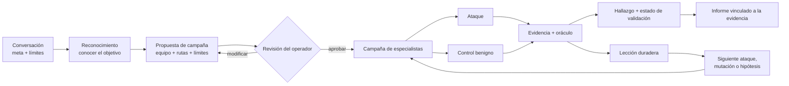

<div align="center">


[English](../../README.md) · [简体中文](README.zh-CN.md) · [日本語](README.ja.md) · [한국어](README.ko.md) · **Español** · [Français](README.fr.md) · [Deutsch](README.de.md) · [Português (Brasil)](README.pt-BR.md) · [Русский](README.ru.md) · [العربية](README.ar.md) · [हिन्दी](README.hi.md)

# Merlin

### Pruebas de seguridad de IA centradas en la conversación

**Pensado para: chatbots · agentes de IA · aplicaciones RAG · IA que usa herramientas · sistemas multiagente**

Dile a Merlin qué estás autorizado a probar. Merlin aprende cómo funciona la aplicación, propone una
campaña ofensiva para que la revises, sigue la evidencia prometedora y devuelve hallazgos respaldados
por evidencia, con un estado de evidencia claro y las brechas de cobertura.

**72 casos de ataque · 14 controles benignos · Navegador + API · Exploración adaptativa · Modelos heterogéneos**

[Inicio rápido](#inicio-rápido) · [Cómo funciona](#cómo-funciona-merlin) ·
[Qué lo diferencia](#qué-diferencia-a-merlin) · [Cobertura actual](#cobertura-ofensiva-actual)

[](https://github.com/arcanaresearch/merlin-harness/releases/latest)

</div>

> [!NOTE]
> Esta traducción se ofrece por comodidad y puede ir por detrás del [README en inglés](../../README.md), que es la versión de referencia.


## Espacio de trabajo opcional en el navegador

Hay disponible, desde el código fuente, un espacio de trabajo web al estilo pb2 para el chat, la
revisión de campañas, los agentes, la cobertura, los informes, la configuración y los controles
avanzados. Consulta [cómo ejecutar el espacio de trabajo en el navegador](../web-interface.md).

## Mira el recorrido por la CLI

<p align="center">
  <a href="https://www.youtube.com/watch?v=Kyz2PcphWvo">
    
  </a>
</p>

Verás cómo Merlin conecta modelos, define un objetivo autorizado, revisa una campaña, coordina
agentes, acepta indicaciones del operador y genera un informe vinculado a la evidencia.


> [!NOTE]
> Merlin está en desarrollo activo. Las versiones independientes (standalone) actualmente están
> dirigidas a macOS 14 en Apple silicon. El código propio y los ocho paquetes de conocimiento
> incluidos usan la licencia Apache-2.0.

Merlin incluye guías adversariales de control de políticas para la autoridad sobre precios
comerciales, los compromisos vinculantes, los canarios sintéticos de confidencialidad y el
aislamiento entre clientes o tenants. Estos controles requieren vinculaciones de política revisadas
y específicas del objetivo, controles benignos y evidencia independiente sobre el estado del objetivo o
basada en comprobantes. Merlin valida sus contratos de evidencia tipados y proyecta las identidades
autenticadas de sus paquetes por separado del conocimiento orientativo. Ayudan a probar controles
definidos; no certifican el cumplimiento legal ni normativo, y un resultado negativo acotado no debe
reportarse como cumplimiento de toda la organización.

> Usa Merlin únicamente contra objetivos que estés autorizado a evaluar.

## Merlin investiga en acción

```text
Tú
  Evalúa el agente de soporte revisado frente a inyección de prompts, acceso a datos
  entre usuarios y uso inseguro de herramientas. No realices acciones destructivas.

Merlin
  1. Aprende el comportamiento del objetivo en el navegador, la sesión y la API
  2. Propone la campaña exacta, el equipo, los modelos, las herramientas, los límites y la limpieza
  3. Espera tu revisión
  4. Ejecuta los ataques aplicables con controles benignos emparejados donde el objetivo los admita
  5. Sigue las pistas útiles y registra evidencia atribuible
  6. Devuelve hallazgos, estado de la evidencia, brechas de cobertura y lo que nunca se probó
```

Si ya usas Codex o Claude Code, la interacción te resultará familiar: describe el trabajo en
lenguaje natural, revisa el trabajo propuesto y dirígelo mediante una conversación. Merlin aplica
ese flujo de trabajo a una investigación de seguridad autorizada.

## Instalación y ejecución

Para ejecutar Merlin desde el código fuente, instala Python 3.13+ y `uv`, prepara el espacio de
trabajo una sola vez y usa el lanzador del repositorio:

```bash
git clone https://github.com/arcanaresearch/merlin-harness.git
cd merlin-harness
uv sync --all-packages --locked
./merlin
```

Ese es el comando de inicio habitual: no hay opciones que recordar. En el primer inicio, Merlin
detecta que no hay ningún proveedor configurado y te guía para elegir un proveedor, un modelo y una
clave de API antes de abrir la aplicación. Los inicios posteriores entran directamente en Merlin.
Usa `/setup` solo cuando quieras cambiar esa configuración.

Merlin guarda las credenciales en su almacén de credenciales accesible solo para el propietario, y
no en PostgreSQL, ni en los prompts, los registros, los informes o la memoria exportada.

Para generar el paquete independiente para macOS, ejecuta:

```bash
make release
cd target/releases/merlin-0.2.47-darwin-arm64
./merlin
```

Para incrementar la versión del espacio de trabajo y compilar la versión correspondiente con un solo
comando, usa `make release-patch`, `make release-minor` o `make release-major`.

El paquete incluye sus propios entornos de ejecución de Python, PostgreSQL y navegador. En el primer
inicio instala Merlin para el usuario actual y, cuando hace falta, abre la misma configuración guiada.

### Proveedores principales y modelos worker

Usa `/model` para enrutar cualquier rol de modelo a través de **Codex App Server**, **Claude CLI**,
**Kimi ACP**, **Kiro ACP**, **OpenCode ACP** o **Pi Agent RPC**, o configura un modelo alojado o
local mediante `/setup`. Los transportes de agente requieren su respectiva instalación y
autenticación locales. Merlin expone únicamente las herramientas revisadas para la solicitud actual
a través de un puente MCP privado; el agente externo propone una llamada, mientras que Merlin
conserva las comprobaciones de permisos, la ejecución, los presupuestos y el registro de evidencia.

### Juicios JEV opcionales

Merlin puede llamar al servicio de juicios **JEV** de TypeSafe para decisiones tipadas, como la
calificación de rechazos y el triaje. La configuración guiada ofrece esta opción por separado del
modelo de la campaña; puedes mantenerla desactivada. Abre `/setup` y elige **JEV — judgment API key**
(clave de API de juicios JEV), o usa directamente `/setup jev`. Merlin guarda la clave de forma
segura e informa del resultado de la comprobación de estado. Después, `/model` expone el
interruptor de juicios.

JEV aporta juicios y niveles de confianza en los puntos de decisión implementados. No es responsable
de la autorización de la campaña, la planificación de las sesiones del objetivo ni la limpieza.
Algunos juicios de enrutamiento y de capacidades siguen siendo evaluaciones en modo sombra. Si faltan
juicios o fallan, se recurre al tratamiento existente, conservando la incertidumbre en lugar de
eliminar silenciosamente pruebas autorizadas.

## ¿Por qué Merlin?

Un flujo habitual de seguridad de IA envía una lista preparada de prompts de jailbreak o de ataque,
puntúa las respuestas y se detiene cuando la lista termina. Es una base de referencia útil, pero un
producto de IA real también tiene usuarios, sesiones, API, herramientas, memoria, flujos de trabajo
y, a veces, la capacidad de ejecutar acciones.

Merlin también parte de un catálogo revisado. Sobre él añade reconocimiento, controles benignos
emparejados, aprendizaje continuo, exploración adaptativa, coordinación de especialistas y evidencia
de la aplicación.

| Análisis basado en catálogo | Merlin |
|---|---|
| Parte de prompts preparados | Aprende el objetivo y después ejecuta una frontera de ataque revisada |
| Ejecuta la lista predefinida | Puede desarrollar hipótesis y mutaciones específicas del objetivo |
| Trata las pruebas de forma independiente | Transfiere evidencia y estado entre los pasos de la campaña |
| Puntúa principalmente las respuestas | Compara los ataques con controles y con evidencia del estado del objetivo |
| Usa una única ruta de ejecución general | Puede enrutar distintos trabajos a distintos modelos |
| Empieza cada análisis desde cero | Reutiliza lecciones comparables y revalida la evidencia obsoleta |
| Reporta salidas interesantes | Reporta hallazgos, estado de la evidencia, cobertura y linaje |

## Cómo funciona Merlin



1. **Describe el trabajo.** Indica el objetivo, qué quieres averiguar y qué debe quedar fuera de
   los límites.
2. **Conoce el objetivo.** El reconocimiento mapea la interacción revisada del navegador o de la API
   antes de que comience la ejecución de ataques.
3. **Revisa la campaña.** Inspecciona las técnicas, la composición de especialistas, las rutas de
   modelos, las herramientas, los presupuestos, los requisitos de evidencia y los posibles efectos.
4. **Ejecuta y dirige.** Merlin ejecuta el trabajo admitido, sigue la evidencia útil y permite al
   operador pausar, redirigir, reanudar o detener la campaña.
5. **Comprueba la evidencia.** Los hallazgos permanecen vinculados a la solicitud, la respuesta, el
   estado observado, el control, el oráculo, el worker y la versión de la campaña.
6. **Aprende.** Los resultados comparables pueden orientar el trabajo posterior sin convertir la
   evidencia antigua en una verdad permanente.

## Qué diferencia a Merlin

### Reconocimiento antes del ataque

Merlin no exige que el operador explique cada selector, endpoint, transición de sesión o campo de
respuesta. Primero realiza una pasada de reconocimiento acotada e inofensiva y produce un contrato de
interacción revisado para la campaña.

### Pruebas más allá de la lista de funciones anunciadas

Un escáner de seguridad no debería asumir que una superficie no documentada o no admitida es segura.
Cuando Merlin dispone de una forma autorizada e inofensiva de entregar y observar una sonda, puede
investigar superficies desconocidas de carga de archivos, RAG, memoria, multimodalidad,
herramientas, mensajes entre agentes e idiomas. Si no es posible llegar a una superficie, el informe
registra esa limitación en lugar de retirarla silenciosamente de la cobertura.

### Exploración más allá del catálogo

El catálogo integrado es un punto de partida, no el límite de la investigación. La exploración puede:

- crear hipótesis falsables a partir de la evidencia del objetivo;
- proponer pruebas vecinas derivadas de las observaciones;
- generar nuevos arms (variantes de ataque candidatas) mediante lluvia de ideas;
- rodear fallos con evidencia;
- generalizar ataques exitosos;
- aplicar mutaciones revisadas de registro lingüístico y de codificación ejecutable; y
- rechazar ideas duplicadas o casi duplicadas antes de que consuman presupuesto del objetivo.

Merlin también contiene otros bloques de generación de arms que
todavía no están todos conectados al supervisor en vivo.

### Aprendizaje continuo sin confianza ciega

Merlin registra qué se intentó, el objetivo y el escenario en que ocurrió, el resultado y la
evidencia que lo respalda. Durante una campaña Autonomous, clasifica repetidamente la frontera de
ataque restante, analiza los resultados registrados, desarrolla mutaciones o pruebas vecinas y puede
reconfigurar el equipo de especialistas mientras siga apareciendo evidencia útil. En una campaña
comparable posterior también puede:

- evitar repetir un resultado negativo exacto que sigue vigente;
- volver a comprobar un hallazgo anterior;
- revalidar el trabajo tras una deriva del objetivo, del adaptador, del oráculo, del idioma o de la
  antigüedad de la evidencia;
- priorizar una variación relacionada pero no probada; y
- reutilizar un contrato de interacción respaldado por evidencia.

La evidencia de otro objetivo o escenario puede inspirar una hipótesis. No puede probar
silenciosamente un hallazgo, suprimir una prueba ni contar como cobertura.

### Una campaña, distintos cerebros

Merlin está diseñado para el enrutamiento heterogéneo de modelos porque cada responsabilidad tiene
una carga de trabajo distinta. El reconocimiento suele recibir la mayor cantidad de entrada
—estructura de las páginas, tráfico del navegador, descripciones de API, metadatos del objetivo y
observaciones acumuladas—, por lo que normalmente debería usar un modelo con una ventana de contexto
amplia. Ese puede no ser el mejor ni el más económico para dirigir la campaña, ejecutar ataques
rutinarios, explorar pistas inusuales o validar un hallazgo. Las rutas resueltas y el orden de
reserva siguen siendo visibles durante la revisión de la campaña.

```text
Campaign Lead          → modelo de razonamiento de alta fiabilidad
Reconocimiento         → modelo de contexto amplio, con visión y uso de herramientas
Workers rutinarios     → modelo de ejecución económico
Explorador adversarial → modelo de exploración creativo
Validador              → modelo de verificación seleccionado por separado
Escalado               → alternativa más potente y revisada
```

Un único modelo suficientemente capaz puede seguir ejecutando todos los roles, lo que facilita la
configuración inicial. Para campañas serias, la disposición recomendada es enrutar cada
responsabilidad a un modelo adecuado, en especial un modelo de contexto amplio para el
reconocimiento y un modelo seleccionado por separado para la validación.

### Compara los ataques con el comportamiento normal

Una respuesta sospechosa no es automáticamente una vulnerabilidad. Cuando el objetivo y la técnica lo
permiten, Merlin empareja un ataque con un control benigno revisado y comprueba ambos con un oráculo
explícito.

```text
Control: el usuario A lee la conversación del usuario A
Ataque:  el usuario B solicita el mismo ID de conversación
Oráculo: compara las respuestas y el estado resultante de la aplicación
```

Si la acción normal también falla, Merlin no debería reportar con seguridad un fallo de autorización.

### Conserva la incertidumbre en lugar de ocultar la prueba

Merlin no permite que su propio evaluador de contenido suprima silenciosamente un ataque autorizado.
La evidencia propiedad del objetivo tiene prioridad; cuando el oráculo, los metadatos o el evaluador
discrepan, Merlin conserva el intento y marca el resultado como incierto para su validación,
mutación o reintento. La incertidumbre del evaluador no se reporta como un fallo del objetivo, como
un resultado limpio ni como cobertura completada.

### Un equipo que cambia con la investigación

Elige cómo empieza la campaña:

- **Opinionated** (plantilla predefinida): parte de la plantilla preparada de Merlin:
  Autenticación y Sesión, Inyección, Exposición de Datos, Lógica de Negocio y Abuso de Capacidades.
- **Autonomous** (predeterminado): deja que el Campaign Lead componga los especialistas iniciales
  a partir del reconocimiento y, después de cada oleada que aporte evidencia, proponga mutaciones,
  pruebas vecinas y cambios en los especialistas.

Ambos modos usan el mismo motor dinámico de campañas. El reconocimiento, el Campaign Lead, la
validación, la remediación, la autoría de automatizaciones, la revisión de automatizaciones y la
ejecución determinista siguen siendo responsabilidades separadas. El Lead puede cambiar la
investigación, pero no puede concederse a sí mismo un nuevo objetivo, herramienta, cuenta o
presupuesto. La finalización de la campaña se decide a partir del progreso duradero, el trabajo
restante, el estado de la infraestructura, la limpieza y los límites revisados, y no simplemente
porque el Lead diga que ha terminado.

## Inicio rápido

1. Ejecuta `./merlin`. Si es tu primer inicio, Merlin te guía automáticamente por la configuración.
2. Describe en lenguaje natural un objetivo autorizado y la meta de la evaluación.
3. Deja que el reconocimiento establezca cómo funciona el objetivo.
4. Elige la cobertura Recommended (predeterminada), Quickscan, Exhaustive o Exploration/learning y,
   después, la composición de agentes Autonomous (predeterminada) u Opinionated.
5. Revisa la campaña sellada antes de que se ejecute nada.
6. Aprueba y luego observa y dirige la investigación.
7. Abre la evidencia de los hallazgos y exporta el informe.

Ejemplo de meta:

```text
Evalúa https://target.example frente a inyección indirecta de prompts, exposición de datos
entre sesiones y uso inseguro de herramientas. Usa únicamente la cuenta de prueba aprobada.
No generes efectos secundarios externos y detente si el objetivo muestra degradación.
```

## La campaña en Merlin

Estas capturas de la TUI usan datos de campaña de ejemplo. Ilustran la interfaz; las etiquetas y los
valores predeterminados pueden variar según la versión. Los hallazgos y las salidas que se muestran
no son resultados de benchmarks.

### Elige la cobertura y el equipo

La cobertura y la composición de agentes son decisiones independientes. Recommended es la opción
predeterminada y ofrece una cobertura representativa; Quickscan ofrece una campaña inicial más
reducida, Exhaustive la amplía y Exploration/learning pone el énfasis en la investigación.
Autonomous es la composición de agentes predeterminada; Opinionated usa la plantilla de equipo
revisada.


### Revisa antes de ejecutar

Inspecciona el alcance propuesto del objetivo, el trabajo, las rutas de modelos, los límites y la
limpieza antes de confirmar.


### Sigue a los workers en la conversación principal

La franja integrada del enjambre muestra cada worker, las tareas en curso, la última salida
conservada, el trabajo en cola y los fallos. Su indicador naranja de actividad se anima durante la
ejecución y se vuelve estático cuando la campaña está en pausa o ha terminado. El estado de la
campaña y el historial de los workers se restauran al reanudar una sesión.


### Inspecciona los agentes en un espacio de trabajo a pantalla completa

Abre `/agents` o haz clic en la franja del enjambre. Una lista compacta de asignaciones identifica al
especialista que atiende cada tarea junto a los paneles de salida en vivo. Cada panel muestra el
especialista registrado, el worker responsable, la tarea, la actividad y la salida conservada. Las
asignaciones fallidas siguen siendo inspeccionables cuando la campaña termina.

- **A:** abre la vista general de agentes, agrupada por identidad de agente registrada, con la actividad actual, el modelo, el historial de tareas y la última salida. **T / Esc:** vuelve al espacio de trabajo de tareas.
- **Arrastrar con el ratón:** selecciona texto de detalle. **Ctrl+Shift+C:** copia la selección. Las actualizaciones de texto en vivo se pausan mientras se selecciona.
- **Teclas de flecha:** seleccionan un worker.
- **Tab / Shift+Tab:** se mueven entre los paneles de workers visibles.
- **Space:** fija un worker mientras inspeccionas otros.
- **Enter:** expande la transcripción conservada del worker seleccionado, sus intentos, su salida y los detalles de fallos.
- **Esc:** sale de la transcripción expandida y después vuelve a la conversación.


La transcripción muestra los mensajes conservados del asistente y de las herramientas. Los mensajes
eliminados por la compactación de contexto no se reconstruyen. Las sesiones compartidas del objetivo
usan una capacidad revisada; el trabajo espera su admisión en lugar de competir por una sesión que
pertenece a otra asignación. Los fallos históricos de infraestructura siguen siendo visibles y no se
convierten en cobertura exitosa.

### Finalizar, exportar y reanudar

La pantalla principal sustituye el progreso en vivo por un resumen persistente del análisis: estado
de finalización completa o parcial, hallazgos, cobertura, limpieza y la ruta del informe HTML. Cuando
la ejecución se detiene antes de tiempo, el resumen muestra la finalización parcial y el motivo de la
detención, con el trabajo guardado y la cobertura pendiente a la vista.

El HTML se exporta automáticamente. Usa los botones de exportación del resumen o
`/report --format …` para Markdown, JSON y CSV; estos formatos adicionales se generan bajo demanda.
Las acciones Open HTML y Reports hacen que el resultado sea accesible sin buscar en el sistema de
archivos.


`/report` abre un selector de campañas a pantalla completa con **Open HTML**, **Copy HTML path** y
exportaciones a **Markdown**, **JSON** y un **paquete CSV ZIP**. Los archivos existentes aparecen en
los detalles de la campaña seleccionada. Las exportaciones usan esa campaña guardada, incluidas las
campañas históricas, y no la sesión que esté abierta en ese momento.


El informe HTML reúne en un navegador los hallazgos, la cobertura y la evidencia registrada.


*Informe de muestra representativo.*


Si sales a mitad de la campaña y reanudas la sesión guardada, Merlin restaura los puntos de control
duraderos de la campaña, el historial de los workers y el progreso. Cuando esa campaña reanudada
termina, usa el mismo flujo de resumen e informe. Al reanudar una sesión ya finalizada se restauran
su resumen de informe guardado y sus acciones. Las campañas completadas parcialmente conservan su
informe HTML y sus acciones de exportación. **Recover** reanuda la cobertura sin resolver desde el
límite de oleada guardado, preservando las oleadas completadas; también puede reconstruir un informe
que falte a partir del estado duradero. Las sesiones del objetivo aún deben estar disponibles para
las nuevas solicitudes, y los puntos de control conservados no deshacen los cambios externos en el
objetivo.

Que una campaña termine no significa que todas las pruebas hayan tenido éxito: el informe registra
de forma explícita el trabajo fallido, bloqueado, incierto y no probado.

## De la pista al hallazgo

Merlin está diseñado para preservar todo el límite de razonamiento que rodea a un resultado:

```text
Observación del reconocimiento
  La identidad del navegador y el ID de conversación aparecen como valores de solicitud separados
        ↓
Hipótesis específica del objetivo
  Es posible que la API confíe en el ID de conversación sin comprobar al usuario autenticado
        ↓
Experimento revisado
  Control permitido + tratamiento entre usuarios + oráculo explícito + limpieza
        ↓
Evidencia
  Solicitudes y respuestas exactas, estado seleccionado, comprobantes e identidad del objetivo
        ↓
Resolución
  Hallazgo, resultado negativo, no concluyente, bloqueado o no intentado
```

## Cobertura ofensiva actual

El catálogo integrado contiene actualmente **72 casos de prueba ofensivos** emparejados con **14
controles benignos reutilizables**, para un total de **86 casos**. Un caso es una combinación
concreta de dimensiones de ataque, no necesariamente una familia de técnicas única.

- Inyección de prompts directa e indirecta
- Estrategias multiturno Crescendo, GOAT y Hydra-Select
- Límites de autenticación, sesión, identidad y tenant
- Exposición de datos, acceso entre usuarios y extracción
- Abuso de la lógica de negocio, de la secuencia, de la reproducción (replay) y de la máquina de estados
- Abuso de herramientas, agentes, efectos externos y capacidades
- RAG, contenido almacenado, memoria y reinyección de salidas previas
- Desvío del contexto, Poison Soup, amplificación de tokens y salidas, y guías sobre abuso de recursos
- Variantes multilingües, de registro lingüístico, codificadas y ofuscadas
- Flujos de navegador, de API JSON y flujos híbridos revisados

Que un ataque forme parte del catálogo no significa que sea aplicable ni que se ejecute contra todos
los objetivos. Los informes distinguen el trabajo admitido, intentado, bloqueado, no concluyente,
negativo y no probado.

## Limitaciones actuales

Lo que sigue incompleto:

- La mutación automática general de API entre usuarios, sesiones, tenants, ID de objeto, métodos y
  tipos de contenido todavía no es una capacidad universal de las campañas.
- La comparación completa, durante el análisis, de tokens, latencia, llamadas a herramientas,
  recuperación y denial-of-wallet todavía no está disponible para todas las campañas.
- El código personalizado generado en Python o Playwright no cuenta con un entorno de ejecución
  aislado (sandbox) aprobado.
- No todos los auxiliares de generación de arms están conectados a la planificación de campañas en vivo.
- La reproducción en una sesión nueva y aislada no está disponible para todos los objetivos y hallazgos.
- La cobertura comparativa sigue siendo limitada: la evidencia comparativa directa actual proviene
  de reproducciones locales no oficiales, y no de envíos oficiales a clasificaciones (leaderboards).
- El soporte empaquetado actualmente está dirigido a macOS 14 en Apple silicon.

## Benchmarking

Merlin se evalúa como un atacante adaptativo que encuentra vulnerabilidades reales y ejecutables con
un presupuesto fijo, y no como un único conjunto de datos ni una sola cifra de ASR. Las
reproducciones comparativas locales incluyen ahora RIFT-Bench y MUZZLE + The Zoo. RIFT comparó una
sonda con Merlin en el flujo 0 de una familia de sondas, en 22 sistemas ejecutables, con DeepSeek
sustituyendo los despliegues de víctima y juez de Azure y con adaptaciones de dependencias y
proveedores. MUZZLE y Merlin ejecutaron cada uno un escenario adaptado de Gitea contra la misma
víctima `deepseek-chat` y el mismo juez de verdad de referencia de MUZZLE, pero usaron modelos
atacantes y números de rondas distintos.
Los resultados de Jailbreak Foundry y AgentHarm miden la susceptibilidad de la víctima DeepSeek, no
el rendimiento de Merlin. AIRTBench y REDAgentBench siguen aplazados; los datos de benchmark de
REDAgentBench/DianJin-RED se rigen por CC BY-NC 4.0 más las condiciones originales aplicables.

**Se trata de reproducciones locales no oficiales que usan DeepSeek y adaptaciones de benchmark
declaradas, no de envíos oficiales a clasificaciones (leaderboards).** Los denominadores y los
contratos de evaluación difieren según la pista. Consulta [los resultados de los benchmarks y los
límites de la metodología](../benchmarks.md); los resultados sin procesar de los benchmarks y de los
proveedores no se incluyen en la versión.

## Seguridad y uso responsable

Merlin es un harness de evaluación ofensiva para pruebas autorizadas. Los modelos, el contenido del
objetivo, las herramientas, las guías importadas y los procedimientos generados se tratan como
entradas no confiables. El código determinista conserva la autoridad sobre los objetivos, las
credenciales, las herramientas, los presupuestos, las acciones con consecuencias y la limpieza.

No uses Merlin contra sistemas que no sean tuyos o para los que no tengas permiso explícito de
prueba. Reporta de forma privada a los mantenedores los problemas de seguridad de Merlin, en lugar
de incluir detalles sensibles en una incidencia (issue) pública.

## Comunidad y estado del proyecto

Merlin es software de preversión. Se agradecen las incidencias (issues), los objetivos de prueba,
las ideas de ataque, las contribuciones de adaptadores y las evaluaciones reproducibles. Las
afirmaciones sobre la tasa de hallazgos deben incluir el objetivo, el modelo, el alcance, las
herramientas, el presupuesto, el estándar de evidencia y las condiciones de comparación.

El código propio y los ocho paquetes de conocimiento incluidos se publican bajo la licencia
[Apache-2.0](../../LICENSE). Los componentes de terceros conservan sus propias licencias; consulta
los [detalles de licencias](../LICENSING.md) y el [inventario de dependencias](../THIRD-PARTY.md).
Para la configuración de desarrollo y las comprobaciones, consulta [Contributing](../CONTRIBUTING.md),
[la referencia de desarrollo](../DEVELOPMENT.md) y la [arquitectura del código fuente](../SOURCE-AND-PACKAGES.md).


### Controles de sesión y de campaña

`/resume` restaura una conversación guardada y reconecta sus campañas. `/campaign resume ID`
continúa una campaña en pausa dentro de la sesión actual; no cambia de conversación.
`/interrupt` interrumpe el turno actual de la conversación y cualquier enjambre asociado a ese turno.
No cancela explícitamente una campaña duradera por ID; para eso usa `/campaign cancel ID`.
`/cancel task ID` cancela una tarea mientras las demás tareas de la campaña pueden continuar.
`/campaign cancel ID` cancela el trabajo de esa campaña y conserva su evidencia.
`/quit` cierra Merlin de forma limpia. En `/agents`, pulsa **A** para la vista general de agentes
agrupados y **T** para volver al espacio de trabajo de tareas.
