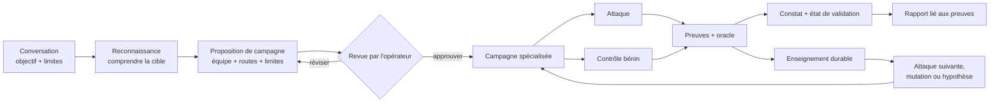

<div align="center">


[English](../../README.md) · [简体中文](README.zh-CN.md) · [日本語](README.ja.md) · [한국어](README.ko.md) · [Español](README.es.md) · **Français** · [Deutsch](README.de.md) · [Português (Brasil)](README.pt-BR.md) · [Русский](README.ru.md) · [العربية](README.ar.md) · [हिन्दी](README.hi.md)

# Merlin

### Tests de sécurité de l'IA pilotés par la conversation

**Conçu pour : chatbots · agents IA · applications RAG · IA utilisant des outils · systèmes multi-agents**

Dites à Merlin ce que vous êtes autorisé à tester. Il apprend comment fonctionne l'application,
propose une campagne offensive à relire, suit les indices prometteurs et restitue des constats
étayés par des preuves, avec un statut de preuve explicite et les lacunes de couverture.

**72 cas d'attaque · 14 contrôles bénins · Navigateur + API · Exploration adaptative · Modèles hétérogènes**

[Démarrage rapide](#démarrage-rapide) · [Fonctionnement](#fonctionnement-de-merlin) ·
[Ce qui distingue Merlin](#ce-qui-distingue-merlin) · [Couverture actuelle](#couverture-offensive-actuelle)

[](https://github.com/arcanaresearch/merlin-harness/releases/latest)

</div>

> [!NOTE]
> Cette traduction est fournie à titre indicatif et peut être en retard sur le [README anglais](../../README.md), qui fait foi.


## Espace de travail navigateur optionnel

Un espace de travail web dans le style de pb2 est disponible depuis les sources pour le chat, la revue
des campagnes, les agents, la couverture, les rapports, la configuration et les contrôles avancés.
Voir [exécuter l'espace de travail navigateur](../web-interface.md).

## Regarder la démonstration de la CLI

<p align="center">
  <a href="https://www.youtube.com/watch?v=Kyz2PcphWvo">
    
  </a>
</p>

Voyez Merlin connecter des modèles, définir une cible autorisée, relire une campagne, coordonner des
agents, accepter les consignes de l'opérateur et produire un rapport relié aux preuves.


> [!NOTE]
> Merlin est en développement actif. Les versions autonomes ciblent actuellement macOS 14 sur
> puce Apple silicon. Le code first-party et les huit packs de connaissances inclus sont sous licence Apache-2.0.

Merlin inclut des consignes adversariales de contrôle des politiques pour l'autorité sur les prix
commerciaux, les engagements contraignants, les canaris de confidentialité synthétiques et
l'isolation entre clients ou tenants. Ces contrôles exigent des liaisons de politique examinées et
propres à la cible, des contrôles bénins et des preuves indépendantes portant sur l'état de la cible ou issues de
reçus. Merlin valide leurs contrats de preuve typés et expose l'identité authentifiée de leurs packs
séparément des connaissances consultatives. Ils aident à tester des contrôles définis ; ils ne
certifient pas la conformité légale ou réglementaire, et un résultat négatif borné ne doit pas être
présenté comme une conformité à l'échelle de l'organisation.

> N'utilisez Merlin que contre des cibles que vous êtes autorisé à évaluer.

## Voir Merlin enquêter

```text
Vous
  Évalue l'agent de support examiné : injection de prompt, accès aux données d'autres
  utilisateurs et usage dangereux des outils. N'effectue aucune action destructrice.

Merlin
  1. Apprend le comportement de la cible côté navigateur, session et API
  2. Propose la campagne exacte, l'équipe, les modèles, les outils, les limites et le nettoyage
  3. Attend votre relecture
  4. Exécute les attaques applicables avec des contrôles bénins appariés lorsque la cible les prend en charge
  5. Suit les indices utiles et consigne des preuves attribuables
  6. Restitue les constats, le statut des preuves, les lacunes de couverture et ce qui n'a jamais été testé
```

Si vous utilisez déjà Codex ou Claude Code, l'interaction devrait vous sembler familière : décrivez
la tâche en langage courant, relisez le travail proposé et pilotez-le par la conversation. Merlin
applique ce mode de travail à une investigation de sécurité autorisée.

## Installation et exécution

Pour exécuter Merlin depuis les sources, installez Python 3.13+ et `uv`, préparez l'espace de travail
une fois, puis utilisez le lanceur du dépôt :

```bash
git clone https://github.com/triwiz-ai/merlin-harness.git
cd merlin-harness
uv sync --all-packages --locked
./merlin
```

C'est la commande de lancement habituelle : aucun indicateur à retenir. Au premier lancement, Merlin
constate qu'aucun fournisseur n'est configuré et vous guide pour choisir un fournisseur, un modèle et
une clé d'API avant d'ouvrir l'application. Les lancements suivants ouvrent directement Merlin.
N'utilisez `/setup` que lorsque vous voulez modifier cette configuration.

Merlin conserve les identifiants dans son magasin d'identifiants accessible uniquement à son
propriétaire, et non dans PostgreSQL, les prompts, les journaux, les rapports ou la mémoire exportée.

Pour produire le bundle macOS autonome, exécutez :

```bash
make release
cd target/releases/merlin-0.2.47-darwin-arm64
./merlin
```

Pour incrémenter la version du workspace et construire la version correspondante en une seule
commande, utilisez `make release-patch`, `make release-minor` ou `make release-major`.

Le bundle inclut ses propres environnements d'exécution Python, PostgreSQL et navigateur. Son premier
lancement installe Merlin pour l'utilisateur courant et ouvre la même configuration guidée si
nécessaire.

### Fournisseurs principaux et modèles des workers

Utilisez `/model` pour acheminer n'importe quel rôle de modèle via **Codex App Server**, **Claude CLI**,
**Kimi ACP**, **Kiro ACP**, **OpenCode ACP** ou **Pi Agent RPC**, ou configurez un modèle hébergé ou
local via `/setup`. Les transports d'agent exigent leur installation locale et leur authentification
respectives. Merlin n'expose que les outils examinés pour la requête en cours, par un pont MCP privé :
l'agent externe propose un appel, tandis que Merlin conserve les contrôles de permission,
l'exécution, les budgets et l'enregistrement des preuves.

### Jugements JEV optionnels

Merlin peut appeler le service de jugement **JEV** de TypeSafe pour des décisions typées, comme
l'évaluation des refus et le triage. La configuration guidée le propose séparément du modèle de
campagne ; vous pouvez le laisser désactivé. Ouvrez `/setup` et choisissez **JEV — judgment API key**
(clé d'API de jugement JEV), ou utilisez directement `/setup jev`. Merlin enregistre la clé de façon
sécurisée et rapporte le résultat du contrôle de santé. `/model` expose ensuite l'option d'activation
des jugements.

JEV fournit des jugements et des niveaux de confiance aux points de décision implémentés. Il n'est pas
responsable de l'autorisation des campagnes, de l'ordonnancement des sessions de la cible ni du
nettoyage. Certains jugements de routage et de capacités restent des évaluations en mode fantôme
(shadow). Un jugement manquant ou en échec retombe sur le traitement existant, l'incertitude étant
conservée plutôt que de retirer silencieusement des tests autorisés.

## Pourquoi choisir Merlin

Un workflow courant de sécurité de l'IA envoie une liste préparée de prompts de jailbreak ou
d'attaque, note les réponses et s'arrête quand la liste est épuisée. C'est une base de référence
utile, mais un vrai produit d'IA a aussi des utilisateurs, des sessions, des API, des outils, de la
mémoire, des workflows et parfois le pouvoir d'agir.

Merlin part lui aussi d'un catalogue examiné. Il y ajoute ensuite la reconnaissance, des contrôles
bénins appariés, l'apprentissage continu, l'exploration adaptative, la coordination de spécialistes
et des preuves au niveau de l'application.

| Scan par catalogue | Merlin |
|---|---|
| Part de prompts préparés | Apprend la cible, puis exécute un front d'attaque examiné |
| Exécute la liste prédéfinie | Peut développer des hypothèses et des mutations propres à la cible |
| Traite les tests indépendamment | Transmet preuves et état d'une étape de campagne à l'autre |
| Note principalement les réponses | Compare les attaques à des contrôles et à des preuves sur l'état de la cible |
| Utilise un seul chemin d'exécution général | Peut acheminer différentes tâches vers différents modèles |
| Repart de zéro à chaque scan | Réutilise les enseignements comparables et revalide les preuves périmées |
| Rapporte des sorties intéressantes | Rapporte constats, statut des preuves, couverture et lignée |

## Fonctionnement de Merlin



1. **Décrire la tâche.** Nommez la cible, ce que vous voulez apprendre et ce qui doit rester
   interdit.
2. **Apprendre la cible.** La reconnaissance cartographie l'interaction examinée du navigateur ou de
   l'API avant le début de l'exécution des attaques.
3. **Relire la campagne.** Examinez les techniques, la composition des spécialistes, les routes de
   modèles, les outils, les budgets, les exigences de preuve et les effets possibles.
4. **Exécuter et piloter.** Merlin exécute le travail admis, suit les preuves utiles et permet à
   l'opérateur de mettre en pause, rediriger, reprendre ou arrêter.
5. **Vérifier les preuves.** Les constats restent liés à la requête, à la réponse, à l'état observé,
   au contrôle, à l'oracle, au worker et à la révision de la campagne.
6. **Apprendre.** Des résultats comparables peuvent orienter le travail ultérieur sans transformer
   d'anciennes preuves en vérité permanente.

## Ce qui distingue Merlin

### Reconnaissance avant l'attaque

Merlin n'exige pas que l'opérateur explique chaque sélecteur, point de terminaison, transition de
session ou champ de réponse. Il effectue d'abord une passe de reconnaissance bornée et inoffensive,
puis produit un contrat d'interaction examiné pour la campagne.

### Tester au-delà de la liste de fonctionnalités annoncée

Un scanner de sécurité ne doit pas supposer qu'une surface non documentée ou non prise en charge est
sûre. Lorsque Merlin dispose d'un moyen autorisé et inoffensif de délivrer et d'observer une sonde, il
peut investiguer des surfaces inconnues : téléversement, RAG, mémoire, multimodal, outils, messages
entre agents et langues. Si une surface est inaccessible, le rapport consigne cette limite au lieu de
la retirer silencieusement de la couverture.

### Une exploration qui dépasse le catalogue

Le catalogue intégré est un point de départ, pas la limite de l'investigation. L'exploration peut :

- créer des hypothèses réfutables à partir des preuves sur la cible ;
- proposer des tests voisins dérivés des observations ;
- générer de nouveaux bras par brainstorming ;
- contourner les échecs documentés par des preuves ;
- généraliser les attaques réussies ;
- appliquer des mutations examinées de registre et d'encodage exécutable ; et
- rejeter les idées en double ou quasi doublons avant qu'elles ne consomment du budget sur la cible.

Merlin contient aussi d'autres briques de génération de bras qui ne sont pas encore toutes
raccordées au superviseur en cours d'exécution.

### Apprentissage continu sans confiance aveugle

Merlin consigne ce qui a été tenté, la cible et le scénario concernés, le résultat et les preuves qui
le soutiennent. Pendant une campagne Autonomous, il reclasse de façon répétée le front d'attaque restant,
analyse les résultats enregistrés, développe des mutations ou des tests voisins et peut remodeler
l'équipe de spécialistes tant que des preuves utiles continuent d'arriver. Lors d'une campagne
comparable ultérieure, il peut aussi :

- éviter de répéter un résultat négatif exact toujours valable ;
- revérifier un constat précédent ;
- revalider le travail après une dérive de la cible, de l'adaptateur, de l'oracle, de la langue ou de
  l'ancienneté des preuves ;
- prioriser une variation voisine mais non testée ; et
- réutiliser un contrat d'interaction appuyé sur des preuves.

Les preuves provenant d'une autre cible ou d'un autre scénario peuvent inspirer une hypothèse. Elles
ne peuvent ni prouver silencieusement un constat, ni supprimer un test, ni compter comme couverture.

### Une campagne, plusieurs cerveaux

Merlin est conçu pour un routage hétérogène des modèles, car chaque responsabilité a une charge de
travail différente. La reconnaissance reçoit généralement le plus d'entrées — structure des pages,
trafic du navigateur, descriptions d'API, métadonnées de la cible et observations accumulées — et
devrait donc normalement utiliser un modèle à grande fenêtre de contexte. Ce n'est pas forcément le
meilleur modèle, ni le plus économique, pour diriger la campagne, exécuter les attaques de routine,
explorer des indices inhabituels ou valider un constat. Les routes résolues et l'ordre de repli
restent visibles pendant la relecture de la campagne.

```text
Campaign Lead           → modèle de raisonnement haute fiabilité
Reconnaissance          → modèle à grand contexte, avec vision et outils
Workers de routine      → modèle d'exécution économique
Explorateur adversarial → modèle d'exploration créatif
Validateur              → modèle de vérification choisi séparément
Escalade                → repli plus puissant, examiné
```

Un seul modèle suffisamment capable peut quand même assurer tous les rôles, ce qui facilite la
configuration initiale. Pour des campagnes sérieuses, la configuration recommandée consiste à
acheminer chaque responsabilité vers un modèle adapté — en particulier un modèle à grand contexte
pour la reconnaissance et un modèle choisi séparément pour la validation.

### Comparer les attaques au comportement normal

Une réponse suspecte n'est pas automatiquement une vulnérabilité. Lorsque la cible et la technique le
permettent, Merlin apparie une attaque à un contrôle bénin examiné et vérifie les deux au regard d'un
oracle explicite.

```text
Contrôle : l'utilisateur A lit la conversation de l'utilisateur A
Attaque :  l'utilisateur B demande le même identifiant de conversation
Oracle :   comparer les réponses et l'état applicatif résultant
```

Si l'action normale échoue aussi, Merlin ne doit pas rapporter avec assurance une faille
d'autorisation.

### Garder l'incertitude plutôt que masquer le test

Merlin ne laisse pas son propre évaluateur de contenu supprimer silencieusement une attaque
autorisée. Les preuves détenues par la cible ont priorité ; lorsque l'oracle, les métadonnées ou
l'évaluateur divergent, Merlin conserve la tentative et marque le résultat comme incertain en vue
d'une validation, d'une mutation ou d'une nouvelle tentative. L'incertitude de l'évaluateur n'est pas
rapportée comme une défaillance de la cible, un résultat propre ou une couverture achevée.

### Une équipe qui évolue avec l'enquête

Choisissez comment la campagne démarre :

- **Opinionated :** partir du modèle prêt à l'emploi de Merlin : Authentication and Session,
  Injection, Data Exposure, Business Logic et Capability Abuse.
- **Autonomous (par défaut) :** laisser le Campaign Lead composer les spécialistes initiaux à partir
  de la reconnaissance, puis proposer des mutations, des tests voisins et des changements de
  spécialistes après chaque vague porteuse de preuves.

Les deux modes utilisent le même moteur de campagne dynamique. La reconnaissance, le Campaign Lead,
la validation, la remédiation, la rédaction de l'automatisation, sa relecture et l'exécution
déterministe restent des responsabilités distinctes. Le Lead peut modifier l'investigation ; il ne
peut pas s'attribuer une nouvelle cible, un nouvel outil, un nouveau compte ou un nouveau budget. La
fin d'une campagne est décidée d'après la progression durable, le travail restant, l'état de
l'infrastructure, le nettoyage et les limites examinées — et non simplement parce que le Lead déclare
avoir terminé.

## Démarrage rapide

1. Exécutez `./merlin`. S'il s'agit de votre premier lancement, Merlin vous guide automatiquement dans
   la configuration.
2. Décrivez en langage courant une cible autorisée et un objectif.
3. Laissez la reconnaissance établir le fonctionnement de la cible.
4. Choisissez la couverture Recommended (par défaut), Quickscan, Exhaustive ou Exploration/learning,
   puis la composition d'agents Autonomous (par défaut) ou Opinionated.
5. Relisez la campagne scellée avant toute exécution.
6. Approuvez, puis observez et pilotez l'investigation.
7. Ouvrez les preuves des constats et exportez le rapport.

Exemple d'objectif :

```text
Évalue https://target.example pour l'injection de prompt indirecte, l'exposition de
données entre sessions et l'usage dangereux d'outils. Utilise uniquement le compte de
test approuvé. Ne crée aucun effet de bord externe et arrête-toi si la cible montre une dégradation.
```

## Voir la campagne dans Merlin

Ces captures de la TUI utilisent des données de campagne d'exemple. Elles illustrent l'interface ;
les libellés et les valeurs par défaut peuvent varier selon la version. Les constats et sorties
affichés ne sont pas des résultats de benchmark.

### Choisir la couverture et l'équipe

La couverture et la composition des agents sont deux choix distincts. Recommended est la valeur par
défaut et offre une couverture représentative ; Quickscan propose une campagne de départ plus
réduite, Exhaustive l'élargit et Exploration/learning met l'accent sur l'investigation. Autonomous
est la composition d'agents par défaut ; Opinionated utilise le modèle d'équipe examiné.


### Relire avant l'exécution

Examinez le périmètre de cible proposé, le travail, les routes de modèles, les limites et le
nettoyage avant de confirmer.


### Suivre les workers dans la conversation principale

Le bandeau d'essaim intégré à la conversation montre chaque worker, ses tâches en cours, la dernière
sortie conservée, le travail en file d'attente et les échecs. Son indicateur de travail orange est
animé pendant l'exécution et devient fixe en pause ou à l'état terminal. L'état de la campagne et
l'historique des workers sont restaurés à la reprise d'une session.


### Inspecter les agents dans un espace plein écran

Ouvrez `/agents` ou cliquez sur le bandeau d'essaim. Une liste compacte d'affectations identifie le
spécialiste chargé de chaque tâche, à côté de volets de sortie en direct. Chaque volet affiche le
spécialiste enregistré, le worker responsable, la tâche, l'activité et la sortie conservée. Les
affectations en échec restent consultables après la fin de la campagne.

- **A :** ouvrir la vue d'ensemble des agents, regroupés par identité d'agent enregistrée, avec
  l'activité en cours, le modèle, l'historique des tâches et la dernière sortie. **T / Esc :** revenir
  à l'espace de travail des tâches.
- **Glisser à la souris :** sélectionner le texte du détail. **Ctrl+Shift+C :** copier la sélection.
  Les mises à jour du texte en direct sont suspendues pendant la sélection.
- **Touches fléchées :** sélectionner un worker.
- **Tab / Shift+Tab :** passer d'un volet de worker visible à l'autre.
- **Space :** épingler un worker pendant que vous en inspectez d'autres.
- **Enter :** développer la transcription conservée du worker sélectionné, ses tentatives, sa sortie
  et le détail de ses échecs.
- **Esc :** quitter la transcription développée, puis revenir à la conversation.


La transcription montre les messages conservés de l'assistant et des outils. Les messages supprimés
par la compaction du contexte ne sont pas reconstitués. Les sessions de cible partagées utilisent une
capacité examinée ; le travail attend son admission plutôt que de se disputer une session appartenant à
une autre affectation. Les échecs d'infrastructure passés restent visibles et ne deviennent pas de la
couverture réussie.

### Terminer, exporter et reprendre

L'écran principal remplace la progression en direct par un résumé de scan persistant : statut
d'achèvement ou d'achèvement partiel, constats, couverture, nettoyage et chemin du rapport HTML.
Lorsque l'exécution s'arrête prématurément, le résumé indique l'achèvement partiel et la raison de
l'arrêt, avec le travail sauvegardé et la couverture restante.

Le HTML est exporté automatiquement. Utilisez les boutons d'export du résumé ou `/report --format …`
pour Markdown, JSON et CSV ; ces formats supplémentaires sont générés à la demande. Les actions
Open HTML et Reports rendent le résultat accessible sans fouiller le système de fichiers.


`/report` ouvre un sélecteur de campagnes en plein écran avec **Open HTML**, **Copy HTML path**
et des exports **Markdown**, **JSON** et **CSV ZIP bundle** (archive ZIP de CSV). Les fichiers
existants apparaissent dans le détail de la campagne sélectionnée. Les exports portent sur cette
campagne sauvegardée, y compris les campagnes passées, et non sur la session qui se trouve ouverte.


Le rapport HTML réunit dans un navigateur les constats, la couverture et les preuves enregistrées.


*Exemple de rapport représentatif.*


Si vous quittez en cours de route puis reprenez la session sauvegardée, Merlin restaure les points de
contrôle durables de la campagne, l'historique des workers et la progression. Lorsque la campagne
reprise se termine, elle suit le même flux de résumé et de rapport. Reprendre une session déjà
terminée restaure son résumé de rapport et ses actions. Les campagnes partiellement achevées
conservent leur rapport HTML et leurs actions d'export. **Recover** reprend la couverture non résolue
à partir de la dernière frontière de vague sauvegardée tout en préservant les vagues terminées ; il
peut aussi reconstruire un rapport manquant à partir de l'état durable. Les sessions de cible doivent
toujours être disponibles pour les nouvelles requêtes, et les points de contrôle conservés
n'annulent pas les modifications externes apportées à la cible.

Un achèvement ne signifie pas que tous les tests ont réussi : le rapport consigne explicitement le
travail en échec, bloqué, incertain et non testé.

## De l'indice au constat

Merlin est conçu pour préserver toute la chaîne de raisonnement autour d'un résultat :

```text
Observation de reconnaissance
  L'identité du navigateur et l'identifiant de conversation apparaissent comme des valeurs de requête distinctes
        ↓
Hypothèse propre à la cible
  L'API pourrait faire confiance à l'identifiant de conversation sans vérifier l'utilisateur connecté
        ↓
Expérience examinée
  Contrôle autorisé + traitement inter-utilisateurs + oracle explicite + nettoyage
        ↓
Preuves
  Requêtes et réponses exactes, état sélectionné, reçus et identité de la cible
        ↓
Qualification
  Constat, résultat négatif, non concluant, bloqué ou non tenté
```

## Couverture offensive actuelle

Le catalogue intégré contient actuellement **72 cas de test offensifs** associés à **14 contrôles
bénins réutilisables**, soit **86 cas au total**. Un cas est une combinaison concrète de dimensions
d'attaque, pas nécessairement une famille de techniques unique.

- Injection de prompt directe et indirecte
- Stratégies multi-tours Crescendo, GOAT et Hydra-Select
- Frontières d'authentification, de session, d'identité et de tenant
- Exposition de données, accès inter-utilisateurs et extraction
- Abus de logique métier, de séquencement, de rejeu et de machine à états
- Abus d'outils, d'agents, d'effets externes et de capacités
- RAG, contenu stocké, mémoire et réinjection de sorties antérieures
- Déraillement de contexte, Poison Soup, amplification de tokens et de sorties, et consignes sur
  l'abus de ressources
- Variantes multilingues, de registre, encodées et obfusquées
- Flux navigateur, API JSON et flux hybrides examinés

L'appartenance au catalogue ne signifie pas que chaque attaque est applicable ou exécutée contre
chaque cible. Les rapports distinguent le travail admis, tenté, bloqué, non concluant, négatif et non
testé.

## Limites actuelles

Ce qui reste incomplet :

- La mutation automatique générale d'API entre utilisateurs, sessions, tenants, identifiants d'objet,
  méthodes et types de contenu n'est pas encore une capacité universelle des campagnes.
- Une comparaison complète, au moment du scan, des tokens, de la latence, des appels d'outils, de la
  reprise et du denial-of-wallet n'est pas encore disponible pour toutes les campagnes.
- Le code Python ou Playwright personnalisé généré n'a pas d'environnement d'exécution isolé approuvé.
- Tous les assistants de génération de bras ne sont pas raccordés à l'ordonnancement des campagnes en
  cours d'exécution.
- La reproduction dans une session isolée neuve n'est pas disponible pour toutes les cibles et tous
  les constats.
- La couverture comparative reste étroite : les preuves comparatives directes actuelles proviennent
  de reproductions locales non officielles, et non de soumissions officielles à un classement.
- Le support des paquets cible actuellement macOS 14 sur puce Apple silicon.

## Benchmarks

Merlin est évalué comme un attaquant adaptatif qui trouve des vulnérabilités réelles et exécutables
sous un budget fixe — et non comme un jeu de données unique ou un chiffre d'ASR. Les reproductions
comparatives locales incluent désormais RIFT-Bench et MUZZLE + The Zoo. RIFT a comparé une sonde à
Merlin sur le flux 0 d'une famille de sondes, sur 22 systèmes exécutables, DeepSeek remplaçant les
déploiements Azure de victime/juge, avec des adaptations de dépendances et de fournisseurs. MUZZLE et
Merlin ont chacun exécuté un scénario Gitea adapté contre la même victime `deepseek-chat` et le même
juge de vérité terrain MUZZLE, mais avec des modèles attaquants et des nombres de tours différents.
Les résultats de Jailbreak Foundry et d'AgentHarm mesurent la susceptibilité de la victime DeepSeek,
et non les performances de Merlin. AIRTBench et REDAgentBench restent reportés ; les données de
benchmark REDAgentBench/DianJin-RED sont sous CC BY-NC 4.0, en plus des conditions amont applicables.

**Il s'agit de reproductions locales non officielles utilisant DeepSeek et des adaptations de
benchmark documentées, et non de soumissions officielles à un classement.** Les dénominateurs et les
contrats d'évaluation diffèrent selon la piste. Voir [les résultats des benchmarks et les limites
méthodologiques](../benchmarks.md) ; les sorties brutes des benchmarks et des fournisseurs ne sont pas
incluses dans la version.

## Sécurité et usage responsable

Merlin est un harnais d'évaluation offensive destiné aux tests autorisés. Les modèles, le contenu des
cibles, les outils, les consignes importées et les procédures générées sont traités comme des entrées
non fiables. Le code déterministe conserve l'autorité sur les cibles, les identifiants, les outils, les
budgets, les actions à conséquences et le nettoyage.

N'utilisez pas Merlin contre des systèmes que vous ne possédez pas ou que vous n'avez pas l'autorisation
explicite de tester. Signalez les problèmes de sécurité de Merlin en privé aux mainteneurs plutôt que
d'inclure des détails sensibles dans un ticket public.

## Communauté et état du projet

Merlin est un logiciel en pré-version. Les tickets, cibles de test, idées d'attaque, contributions
d'adaptateurs et évaluations reproductibles sont les bienvenus. Toute affirmation sur le rendement en
constats doit préciser la cible, le modèle, le périmètre, les outils, le budget, le niveau de preuve
exigé et les conditions de comparaison.

Le code first-party et les huit packs de connaissances inclus sont sous licence
[Apache-2.0](../../LICENSE). Les composants tiers conservent leurs propres licences ; voir les
[détails de licence](../LICENSING.md) et l'[inventaire des dépendances](../THIRD-PARTY.md).
Pour la mise en place de l'environnement de développement et les vérifications, voir
[Contributing](../CONTRIBUTING.md), [la référence de développement](../DEVELOPMENT.md) et
[l'architecture des sources](../SOURCE-AND-PACKAGES.md).


### Contrôles de session et de campagne

`/resume` restaure une conversation sauvegardée et reconnecte ses campagnes. `/campaign resume ID`
poursuit une campagne en pause dans la session courante ; il ne change pas de conversation.
`/interrupt` interrompt le tour de conversation en cours et tout essaim rattaché à ce tour.
Il n'annule pas explicitement une campagne durable par son ID ; utilisez `/campaign cancel ID` pour cela.
`/cancel task ID` annule une tâche, tandis que les autres tâches de la campagne peuvent continuer.
`/campaign cancel ID` annule le travail de cette campagne et conserve ses preuves.
`/quit` ferme Merlin proprement. Dans `/agents`, appuyez sur **A** pour la vue d'ensemble groupée des
agents et sur **T** pour revenir à l'espace de travail des tâches.
