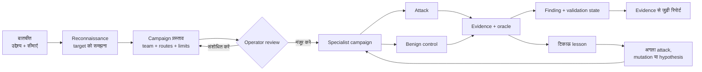

<div align="center">


[English](../../README.md) · [简体中文](README.zh-CN.md) · [日本語](README.ja.md) · [한국어](README.ko.md) · [Español](README.es.md) · [Français](README.fr.md) · [Deutsch](README.de.md) · [Português (Brasil)](README.pt-BR.md) · [Русский](README.ru.md) · [العربية](README.ar.md) · **हिन्दी**

# Merlin

### Conversation-first AI security testing

**इनके लिए बना है: Chatbots · AI agents · RAG applications · Tool-using AI · Multi-agent systems**

आप जिस चीज़ को टेस्ट करने के लिए authorized हैं, वह Merlin को बताइए। Merlin समझता है कि application कैसे काम करती है,
review के लिए एक offensive campaign प्रस्तावित करता है, आशाजनक evidence का पीछा करता है, और evidence पर आधारित
findings लौटाता है, जिनके साथ evidence status और coverage gaps साफ़ तौर पर दिए जाते हैं।

**72 attack cases · 14 benign controls · Browser + API · Adaptive exploration · Heterogeneous models**

[त्वरित शुरुआत](#त्वरित-शुरुआत) · [यह कैसे काम करता है](#merlin-कैसे-काम-करता-है) ·
[क्या अलग बनाता है](#merlin-को-क्या-अलग-बनाता-है) · [वर्तमान कवरेज](#वर्तमान-ऑफेंसिव-कवरेज)

[](https://github.com/arcanaresearch/merlin-harness/releases/latest)

</div>

> [!NOTE]
> यह अनुवाद सुविधा के लिए उपलब्ध कराया गया है और हो सकता है कि यह अंग्रेज़ी README से पीछे रह जाए; प्रामाणिक संस्करण [English README](../../README.md) ही है।


## वैकल्पिक browser workspace

source से एक pb2-style web workspace उपलब्ध है, जिसमें chat, campaign review, agents, coverage,
reports, setup और advanced controls शामिल हैं। देखें [browser workspace चलाना](../web-interface.md)।

## CLI walkthrough देखें

<p align="center">
  <a href="https://www.youtube.com/watch?v=Kyz2PcphWvo">
    
  </a>
</p>

देखिए कि Merlin कैसे models को connect करता है, authorized target परिभाषित करता है, campaign को review के लिए पेश करता है,
agents को coordinate करता है, operator का guidance स्वीकार करता है, और evidence से जुड़ी रिपोर्ट तैयार करता है।


> [!NOTE]
> Merlin पर अभी सक्रिय रूप से development चल रहा है। Standalone releases फ़िलहाल Apple silicon पर macOS 14 को
> target करते हैं। First-party code और सभी आठ bundled knowledge packs Apache-2.0 के अंतर्गत हैं।

Merlin में commercial price authority, binding commitments, synthetic confidentiality canaries, और
customer या tenant isolation के लिए adversarial policy-control guidance शामिल है। इन controls के लिए
target-specific और reviewed policy bindings, benign controls, और स्वतंत्र target-state या receipt evidence
की आवश्यकता होती है। Merlin इनके typed evidence contracts को validate करता है और इनकी authenticated pack
identities को advisory knowledge से अलग प्रदर्शित करता है। ये परिभाषित controls को टेस्ट करने में मदद करते हैं;
ये legal या regulatory compliance को certify नहीं करते, और किसी सीमित (bounded) negative result को
संगठन-व्यापी compliance के रूप में रिपोर्ट नहीं किया जाना चाहिए।

> Merlin का उपयोग केवल उन्हीं targets पर करें जिनका आकलन करने के लिए आप authorized हैं।

## Merlin को investigate करते देखें

```text
आप
  Assess the reviewed support agent for prompt injection, cross-user data access,
  and unsafe tool use. Do not perform destructive actions.

Merlin
  1. Target के browser, session और API behaviour को समझता है
  2. सटीक campaign, team, models, tools, limits और cleanup प्रस्तावित करता है
  3. आपके review की प्रतीक्षा करता है
  4. जहाँ target इन्हें support करता है, वहाँ matched benign controls के साथ लागू attacks चलाता है
  5. उपयोगी संकेतों का पीछा करता है और attributable evidence दर्ज करता है
  6. Findings, evidence status, coverage gaps, और जो कभी टेस्ट नहीं हुआ, वह लौटाता है
```

अगर आप पहले से Codex या Claude Code इस्तेमाल करते हैं, तो यह interaction जाना-पहचाना लगना चाहिए: काम को
सामान्य भाषा में बताइए, प्रस्तावित काम को review कीजिए, और बातचीत के ज़रिए उसे steer कीजिए। Merlin यही workflow
एक authorized security investigation पर लागू करता है।

## इंस्टॉल करें और चलाएँ

Merlin को source से चलाने के लिए Python 3.13+ और `uv` इंस्टॉल करें, workspace को एक बार तैयार करें, फिर
repository में दिए गए launcher का उपयोग करें:

```bash
git clone https://github.com/arcanaresearch/merlin-harness.git
cd merlin-harness
uv sync --all-packages --locked
./merlin
```

यही सामान्य launch command है—याद रखने के लिए कोई flags नहीं हैं। पहली बार launch करने पर Merlin देखता है कि
कोई provider configure नहीं है, और app खोलने से पहले provider, model और API key चुनने में आपका मार्गदर्शन
करता है। इसके बाद के launches सीधे Merlin में खुलते हैं। `/setup` का उपयोग केवल तभी करें जब आप उस configuration को बदलना चाहें।

Merlin credentials को अपने owner-only credential store में रखता है; वे PostgreSQL, prompts, logs, reports
या exported memory में नहीं रखे जाते।

Standalone macOS bundle बनाने के लिए यह चलाएँ:

```bash
make release
cd target/releases/merlin-0.2.47-darwin-arm64
./merlin
```

Workspace version बढ़ाने और संबंधित release को एक ही command में बनाने के लिए `make release-patch`,
`make release-minor` या `make release-major` का उपयोग करें।

Bundle में अपने Python, PostgreSQL और browser runtimes शामिल हैं। इसके पहले launch पर Merlin वर्तमान user के
लिए इंस्टॉल होता है, और ज़रूरत पड़ने पर वही guided setup खुलता है।

### Lead providers और worker models

किसी भी model role को **Codex App Server**, **Claude CLI**, **Kimi ACP**, **Kiro ACP**, **OpenCode ACP**
या **Pi Agent RPC** के ज़रिए route करने के लिए `/model` का उपयोग करें, या `/setup` से hosted या local model
configure करें। Agent transports के लिए उनकी अपनी local installation और authentication ज़रूरी है। Merlin
एक private MCP bridge के ज़रिए केवल मौजूदा request के लिए reviewed tools ही expose करता है; बाहरी agent सिर्फ़
call प्रस्तावित करता है, जबकि permission checks, execution, budgets और evidence recording Merlin के पास रहते हैं।

### वैकल्पिक JEV judgments

Merlin refusal grading और triage जैसे typed decisions के लिए TypeSafe की **JEV** judgment service को call
कर सकता है। Guided setup इसे campaign model से अलग विकल्प के रूप में पेश करता है; आप इसे बंद रख सकते हैं।
`/setup` खोलकर **JEV — judgment API key** चुनें, या सीधे `/setup jev` का उपयोग करें।
Merlin key को सुरक्षित रूप से सहेजता है और health-check का नतीजा बताता है। इसके बाद `/model` में judgment toggle
उपलब्ध हो जाता है।

JEV लागू किए गए decision points पर judgments और confidence प्रदान करता है। Campaign authorization,
target-session scheduling या cleanup JEV के अधिकार में नहीं हैं। कुछ routing और capability judgments अभी
shadow evaluations ही हैं। जब judgments उपलब्ध नहीं होते या fail हो जाते हैं, तो मौजूदा handling पर लौटा जाता है,
और uncertainty को बनाए रखा जाता है; authorized tests को चुपचाप हटाया नहीं जाता।

## Merlin क्यों?

AI security का एक आम workflow jailbreak या attack prompts की पहले से तैयार सूची भेजता है, responses को score
करता है, और सूची ख़त्म होते ही रुक जाता है। यह एक उपयोगी baseline है, लेकिन असली AI product में users,
sessions, APIs, tools, memory और workflows भी होते हैं, और कभी-कभी actions लेने की शक्ति भी।

Merlin भी एक reviewed catalogue से शुरू करता है। इसके बाद वह reconnaissance, matched benign controls,
continuous learning, adaptive exploration, specialist coordination और application evidence जोड़ता है।

| Catalogue-based scan | Merlin |
|---|---|
| तैयार prompts से शुरू होता है | पहले target को समझता है, फिर reviewed attack frontier चलाता है |
| पहले से तय सूची चलाता है | Target-specific hypotheses और mutations विकसित कर सकता है |
| हर test को स्वतंत्र मानता है | Campaign के चरणों के बीच evidence और state आगे ले जाता है |
| मुख्यतः responses को score करता है | Attacks की तुलना controls और target-state evidence से करता है |
| एक ही सामान्य execution path इस्तेमाल करता है | अलग-अलग jobs को अलग-अलग models पर route कर सकता है |
| हर scan शून्य से शुरू करता है | तुलनीय lessons को दोबारा इस्तेमाल करता है और पुराने evidence को revalidate करता है |
| दिलचस्प output रिपोर्ट करता है | Findings, evidence status, coverage और lineage रिपोर्ट करता है |

## Merlin कैसे काम करता है



1. **काम बताइए।** Target का नाम बताइए, आप क्या जानना चाहते हैं, और क्या off-limits रहना चाहिए।
2. **Target को समझिए।** Attack execution शुरू होने से पहले reconnaissance reviewed browser या API interaction का
   नक्शा बनाती है।
3. **Campaign को review कीजिए।** Techniques, specialist composition, model routes, tools, budgets, evidence
   requirements और संभावित प्रभावों की जाँच कीजिए।
4. **चलाइए और steer कीजिए।** Merlin admitted काम चलाता है, उपयोगी evidence का पीछा करता है, और operator को
   उसे pause, redirect, resume या stop करने देता है।
5. **Evidence जाँचिए।** Findings request, response, observed state, control, oracle, worker और campaign revision
   से जुड़े रहते हैं।
6. **सीखिए।** तुलनीय नतीजे आगे के काम को दिशा दे सकते हैं, पर पुराने evidence को स्थायी सत्य नहीं बना देते।

## Merlin को क्या अलग बनाता है

### Attack से पहले Reconnaissance

Merlin operator से यह अपेक्षा नहीं करता कि वह हर selector, endpoint, session transition या response field
समझाए। वह पहले एक सीमित (bounded), हानिरहित reconnaissance pass करता है और campaign के लिए एक reviewed
interaction contract तैयार करता है।

### Advertised feature list से आगे का testing

एक security scanner को यह नहीं मान लेना चाहिए कि कोई undocumented या unsupported surface सुरक्षित है। जब
Merlin के पास probe को पहुँचाने और उसका नतीजा देखने का कोई authorized, हानिरहित तरीक़ा होता है, तो वह अज्ञात
upload, RAG, memory, multimodal, tool, agent-message और language surfaces की जाँच कर सकता है। अगर कोई surface
तक पहुँचा नहीं जा सकता, तो रिपोर्ट उस सीमा को दर्ज करती है; उसे coverage से चुपचाप हटाया नहीं जाता।

### Catalogue से आगे Exploration

Built-in catalogue शुरुआती बिंदु है, investigation की सीमा नहीं। Exploration ये कर सकता है:

- target के evidence से falsifiable hypotheses बनाना;
- observations से निकले पड़ोसी (neighbouring) tests प्रस्तावित करना;
- brainstorming के ज़रिए नए arms generate करना;
- evidence-backed failures के इर्द-गिर्द रास्ता निकालना;
- सफल attacks को generalize करना;
- reviewed register और executable encoding mutations लागू करना; और
- target budget ख़र्च होने से पहले duplicate या near-duplicate ideas को reject करना।

Merlin में arm-generation के कुछ अतिरिक्त building blocks भी हैं, जिनमें से कुछ अभी live supervisor से जुड़े नहीं हैं।

### बिना अंधविश्वास के Continuous learning

Merlin दर्ज करता है कि क्या आज़माया गया, वह किस target और scenario में हुआ, नतीजा क्या रहा, और उसके पीछे
कौन-सा evidence है। Autonomous campaign के दौरान वह बचे हुए attack frontier को बार-बार rank करता है, committed
results का विश्लेषण करता है, mutations या neighbouring tests विकसित करता है, और उपयोगी evidence मिलते रहने पर
specialist team को नया आकार भी दे सकता है। बाद के किसी तुलनीय campaign में वह यह भी कर सकता है:

- किसी ऐसे exact negative को दोहराने से बचना जो अब भी current है;
- पिछले finding को दोबारा जाँचना;
- target, adapter, oracle, language या evidence-age में drift के बाद काम को revalidate करना;
- किसी संबंधित लेकिन अब तक untested variation को प्राथमिकता देना; और
- evidence से पुष्ट interaction contract को दोबारा इस्तेमाल करना।

किसी दूसरे target या scenario का evidence किसी hypothesis की प्रेरणा बन सकता है। वह चुपचाप किसी finding को साबित नहीं
कर सकता, किसी test को दबा नहीं सकता, और coverage में नहीं गिना जा सकता।

### एक campaign, अलग-अलग दिमाग़

Merlin को heterogeneous model routing के लिए डिज़ाइन किया गया है, क्योंकि हर ज़िम्मेदारी का workload अलग
होता है। Reconnaissance को आम तौर पर सबसे ज़्यादा input मिलता है—page structure, browser traffic, API
descriptions, target metadata और जमा हुए observations—इसलिए उसमें सामान्यतः बड़ी context window वाला model होना चाहिए।
ज़रूरी नहीं कि वही model campaign को lead करने, routine attacks चलाने, असामान्य संकेतों को explore करने या
किसी finding को validate करने के लिए सबसे अच्छा या सबसे किफ़ायती हो। Resolved routes और fallback order campaign
review के दौरान दिखाई देते रहते हैं।

```text
Campaign Lead         → उच्च-विश्वसनीयता वाला reasoning model
Reconnaissance        → बड़े context वाला, vision/tool-capable model
Routine workers       → किफ़ायती execution model
Adversarial explorer  → रचनात्मक exploration model
Validator             → अलग से चुना गया checking model
Escalation            → अधिक सक्षम, reviewed fallback
```

पर्याप्त रूप से सक्षम कोई एक model भी हर role चला सकता है, जिससे शुरुआती setup आसान हो जाता है।
गंभीर campaigns के लिए सुझाई गई व्यवस्था यह है कि हर ज़िम्मेदारी को उपयुक्त model पर route किया जाए—ख़ासकर
reconnaissance के लिए बड़ी context window वाला model और validation के लिए अलग से चुना गया model।

### Attacks की तुलना सामान्य behaviour से कीजिए

कोई संदिग्ध response अपने-आप vulnerability नहीं होता। जहाँ target और technique इसे support करते हैं, वहाँ Merlin
attack को एक reviewed benign control के साथ जोड़ता है और दोनों को एक स्पष्ट oracle से जाँचता है।

```text
Control: User A, User A की conversation पढ़ता है
Attack:  User B वही conversation ID माँगता है
Oracle:  Responses और परिणामी application state की तुलना करें
```

अगर सामान्य action भी fail हो जाता है, तो Merlin को किसी authorization flaw की आत्मविश्वास के साथ रिपोर्ट नहीं करनी चाहिए।

### Uncertainty को बनाए रखिए, test को छिपाइए नहीं

Merlin अपने content evaluator को किसी authorized attack को चुपचाप दबाने नहीं देता। Target के अपने evidence को
प्राथमिकता मिलती है; जब oracle, metadata या evaluator असहमत होते हैं, तो Merlin उस प्रयास को सुरक्षित रखता है और
नतीजे को validation, mutation या retry के लिए uncertain चिह्नित करता है। Evaluator की uncertainty को न तो target की
विफलता के रूप में, न clean result के रूप में, और न पूरे हुए coverage के रूप में रिपोर्ट किया जाता है।

### जाँच के साथ बदलने वाली team

तय कीजिए कि campaign कैसे शुरू हो:

- **Opinionated:** Merlin के तैयार Authentication and Session, Injection, Data Exposure, Business Logic और
  Capability Abuse template से शुरू करें।
- **Autonomous (default):** Campaign Lead को reconnaissance के आधार पर शुरुआती specialists तैयार करने दें, फिर
  हर evidence-bearing wave के बाद वह mutations, neighbouring tests और specialist बदलाव प्रस्तावित करे।

दोनों modes एक ही dynamic campaign engine इस्तेमाल करते हैं। Reconnaissance, Campaign Lead, validation,
remediation, automation authorship, automation review और deterministic execution अलग-अलग ज़िम्मेदारियाँ बनी रहती हैं।
Lead investigation को बदल सकता है, लेकिन वह ख़ुद को कोई नया target, tool, account या budget नहीं दे सकता। Campaign
पूरा हुआ या नहीं, यह durable progress, बचे हुए काम, infrastructure state, cleanup और reviewed limits के आधार पर तय होता है—
सिर्फ़ इसलिए नहीं कि Lead कहता है कि काम पूरा हो गया।

## त्वरित शुरुआत

1. `./merlin` चलाएँ। अगर यह आपका पहला launch है, तो Merlin अपने-आप setup में आपका मार्गदर्शन करता है।
2. सामान्य भाषा में एक authorized target और objective बताइए।
3. Reconnaissance को यह पता लगाने दीजिए कि target कैसे काम करता है।
4. Recommended (default), Quickscan, Exhaustive या Exploration/learning coverage चुनिए, फिर Autonomous (default)
   या Opinionated agent composition।
5. कुछ भी execute होने से पहले sealed campaign को review कीजिए।
6. Approve कीजिए, फिर investigation को देखिए और steer कीजिए।
7. Finding का evidence खोलिए और रिपोर्ट export कीजिए।

उदाहरण objective:

```text
Assess https://target.example for indirect prompt injection, cross-session data
exposure, and unsafe tool use. Use only the approved test account. Do not create
external side effects, and stop if the target shows degradation.
```

## Merlin में campaign देखिए

ये TUI captures sample campaign data का उपयोग करते हैं। ये interface को दर्शाते हैं; labels और defaults version
के अनुसार अलग हो सकते हैं। यहाँ दिखाए गए findings और outputs benchmark results नहीं हैं।

### Coverage और team चुनिए

Coverage और agent composition दो अलग विकल्प हैं। Recommended डिफ़ॉल्ट है और प्रतिनिधि (representative) coverage देता है;
Quickscan एक छोटा शुरुआती campaign देता है, Exhaustive उसे व्यापक बनाता है, और Exploration/learning investigation
पर ज़ोर देता है। Autonomous डिफ़ॉल्ट agent composition है; Opinionated reviewed team template का उपयोग करता है।


### Execution से पहले review

पुष्टि करने से पहले प्रस्तावित target scope, काम, model routes, limits और cleanup की जाँच कीजिए।


### मुख्य बातचीत में workers को follow कीजिए

Inline swarm strip अलग-अलग workers, उनके मौजूदा tasks, retained आख़िरी output, queued काम और failures दिखाती है।
इसका orange working indicator execution के दौरान animate होता है और paused या terminal होने पर static हो जाता है।
Session resume करने पर campaign state और worker history बहाल हो जाती है।


### Full-screen workspace में agents को inspect कीजिए

`/agents` खोलिए या swarm strip पर click कीजिए। एक compact assignment list, live output panes के बग़ल में, बताती है कि हर task को कौन-सा specialist संभाल रहा है;
हर pane दर्ज किया गया specialist, worker owner, task, activity और retained output दिखाता है।
Campaign ख़त्म होने के बाद भी failed assignments को inspect किया जा सकता है।

- **A:** agent overview खोलें, जो दर्ज की गई agent identity के अनुसार grouped है और जिसमें मौजूदा activity, model, task history और आख़िरी output है। **T / Esc:** task workspace पर लौटें।
- **Mouse drag:** detail text चुनें। **Ctrl+Shift+C:** चुने हुए हिस्से को copy करें। चयन करते समय live text updates रुक जाते हैं।
- **Arrow keys:** किसी worker को चुनें।
- **Tab / Shift+Tab:** दिखाई दे रहे worker panes के बीच जाएँ।
- **Space:** दूसरों को inspect करते समय किसी worker को pin करें।
- **Enter:** चुने हुए worker का retained transcript, attempts, output और failure details expand करें।
- **Esc:** expanded transcript से बाहर निकलें, फिर बातचीत पर लौटें।


Transcript retained assistant और tool messages दिखाता है। Context compaction से हटाए गए messages को दोबारा नहीं बनाया
जाता। Shared target sessions reviewed capacity का उपयोग करते हैं; किसी दूसरे assignment के स्वामित्व वाले session के लिए
होड़ करने के बजाय काम admission का इंतज़ार करता है। पुरानी infrastructure failures दिखाई देती रहती हैं और सफल coverage नहीं बन जातीं।

### पूरा करें, export करें और resume करें

मुख्य screen live progress की जगह एक persistent scan summary दिखाती है: पूर्ण या आंशिक रूप से पूर्ण status, findings, coverage, cleanup और
HTML रिपोर्ट का path। जब execution जल्दी रुक जाता है, तो summary आंशिक पूर्णता और रुकने का कारण दिखाती है,
साथ ही सहेजा गया काम और बचा हुआ coverage भी।

HTML अपने-आप export होता है। Markdown, JSON और CSV के लिए summary के export buttons या `/report --format …` का उपयोग
करें; ये अतिरिक्त formats अनुरोध करने पर ही generate होते हैं। Open HTML और Reports actions नतीजे को
filesystem में खोजे बिना पहुँच में लाते हैं।


`/report` एक full-screen campaign picker खोलता है, जिसमें **Open HTML**, **Copy HTML path**, और
**Markdown**, **JSON** तथा **CSV ZIP bundle** के exports हैं। चुने हुए campaign के details में मौजूदा फ़ाइलें दिखती हैं।
Exports उसी saved campaign का उपयोग करते हैं, पुराने campaigns समेत, उस session का नहीं जो संयोग से खुला हो।


HTML रिपोर्ट findings, coverage और दर्ज किए गए evidence को browser में एक साथ लाती है।


*प्रतिनिधि sample रिपोर्ट।*


अगर आप बीच में ही बाहर निकल जाते हैं और saved session को resume करते हैं, तो Merlin durable campaign checkpoints,
worker history और progress बहाल करता है। जब वह resumed campaign ख़त्म होता है, तो वही summary और रिपोर्ट flow
इस्तेमाल होता है। पहले से पूर्ण हो चुके session को resume करने पर उसकी saved report summary और actions बहाल हो जाते हैं।
आंशिक रूप से पूर्ण campaigns अपनी HTML रिपोर्ट और export actions बनाए रखते हैं। **Recover** पूरे हो चुके waves को सुरक्षित रखते हुए
saved wave boundary से अनसुलझे coverage को फिर शुरू करता है; यह durable state से किसी ग़ायब रिपोर्ट को दोबारा भी बना सकता है। नए
requests के लिए target sessions का उपलब्ध होना अब भी ज़रूरी है, और retained checkpoints बाहरी target में हुए बदलावों को पलटते नहीं।

Completion का मतलब यह नहीं कि हर test सफल रहा: रिपोर्ट failed, blocked, uncertain और untested काम को स्पष्ट रूप से दर्ज करती है।

## Clue से finding तक

Merlin को किसी नतीजे के आसपास की पूरी reasoning boundary को सुरक्षित रखने के लिए डिज़ाइन किया गया है:

```text
Reconnaissance observation
  Browser identity और conversation ID अलग-अलग request values के रूप में दिखते हैं
        ↓
Target-specific hypothesis
  API संभवतः signed-in user की जाँच किए बिना conversation ID पर भरोसा करती है
        ↓
Reviewed experiment
  अनुमत control + cross-user treatment + स्पष्ट oracle + cleanup
        ↓
Evidence
  सटीक requests, responses, चुनी हुई state, receipts और target identity
        ↓
Disposition
  Finding, negative result, inconclusive, blocked या not attempted
```

## वर्तमान ऑफेंसिव कवरेज

Built-in catalogue में फ़िलहाल **72 offensive test cases** और **14 reusable benign controls** हैं, यानी कुल
**86 cases**। एक case attack dimensions का एक ठोस संयोजन है, ज़रूरी नहीं कि वह किसी अनूठे technique family का
प्रतिनिधित्व करे।

- Direct और indirect prompt injection
- Multi-turn Crescendo, GOAT और Hydra-Select strategies
- Authentication, session, identity और tenant boundaries
- Data exposure, cross-user access और extraction
- Business-logic, sequencing, replay और state-machine abuse
- Tool, agent, external-effect और capability abuse
- RAG, stored content, memory और prior-output reinjection
- Context derailment, Poison Soup, token/output amplification और resource-abuse guidance
- Multilingual, register, encoded और obfuscated variants
- Browser, JSON API और reviewed hybrid flows

Catalogue में शामिल होने का मतलब यह नहीं कि हर attack हर target पर लागू होता है या चलाया जाता है।
रिपोर्ट admitted, attempted, blocked, inconclusive, negative और untested काम में फ़र्क़ करती हैं।

## वर्तमान सीमाएँ

जो अभी अधूरा है:

- सामान्य स्वचालित cross-user, cross-session, cross-tenant, object-ID, method और content-type API mutation
  अभी एक सार्वभौमिक campaign capability नहीं है।
- Scan-time token, latency, tool-call, recovery और denial-of-wallet की पूरी तुलना अभी हर campaign के लिए
  उपलब्ध नहीं है।
- Generate किए गए custom Python या Playwright code के लिए कोई approved sandboxed runtime नहीं है।
- हर arm-generation helper live campaign scheduling से जुड़ा नहीं है।
- Fresh isolated-session reproduction हर target और finding के लिए उपलब्ध नहीं है।
- Comparative coverage अब भी सीमित है: मौजूदा head-to-head evidence local, non-official reproductions से
  आता है, official leaderboard submissions से नहीं।
- Packaged support फ़िलहाल Apple silicon पर macOS 14 को target करता है।

## Benchmarking

Merlin को एक adaptive attacker के रूप में benchmark किया जाता है जो एक तय budget के भीतर असली, executable
vulnerabilities खोजता है — किसी एक dataset या एक ASR number के रूप में नहीं। Local comparative reproductions में अब
RIFT-Bench और MUZZLE + The Zoo शामिल हैं। RIFT ने एक probe की तुलना Merlin से की, जिसमें एक probe family के flow 0 पर 22
runnable systems थे, Azure victim/judge deployments की जगह DeepSeek का उपयोग हुआ, और dependency/provider adaptations किए गए।
MUZZLE और Merlin ने प्रत्येक ने एक adapted Gitea scenario चलाया, एक ही `deepseek-chat` victim और एक ही MUZZLE ground-truth judge के विरुद्ध,
लेकिन attacker models और rounds की संख्या अलग थी।
Jailbreak Foundry और AgentHarm के नतीजे DeepSeek victim की susceptibility मापते हैं, Merlin का performance नहीं। AIRTBench और
REDAgentBench फ़िलहाल स्थगित हैं; REDAgentBench/DianJin-RED benchmark data CC BY-NC 4.0 के साथ लागू upstream terms के अधीन है।

**ये DeepSeek और घोषित benchmark adaptations का उपयोग करने वाले local, non-official reproductions हैं,
official leaderboard submissions नहीं।** हर track के अनुसार denominators और evaluation contracts अलग हैं।
देखें [benchmark नतीजे और methodology की सीमाएँ](../benchmarks.md); raw benchmark और vendor outputs release में शामिल नहीं हैं।

## सुरक्षा और ज़िम्मेदार उपयोग

Merlin authorized testing के लिए एक offensive assessment harness है। Models, target content, tools, imported guidance और
generated procedures को untrusted inputs माना जाता है। Targets, credentials, tools, budgets, consequential actions और cleanup पर
अधिकार deterministic code के पास रहता है।

Merlin का उपयोग उन systems पर न करें जिनके आप मालिक नहीं हैं या जिन्हें टेस्ट करने की आपके पास स्पष्ट अनुमति नहीं है। Merlin की
security issues maintainers को निजी तौर पर रिपोर्ट करें; संवेदनशील विवरण किसी public issue में न डालें।

## समुदाय और प्रोजेक्ट की स्थिति

Merlin pre-release software है। Issues, test targets, attack ideas, adapter contributions और reproducible evaluations का स्वागत है।
Finding yield के बारे में किए गए दावों में target, model, scope, tools, budget, evidence standard और comparison conditions शामिल होनी चाहिए।

First-party code और सभी आठ bundled knowledge packs [Apache-2.0](../../LICENSE) के अंतर्गत licensed हैं।
Third-party components अपने-अपने licenses बनाए रखते हैं; देखें [licensing details](../LICENSING.md) और
[dependency inventory](../THIRD-PARTY.md)। Development setup और checks के लिए देखें [Contributing](../CONTRIBUTING.md),
[the development reference](../DEVELOPMENT.md) और [source architecture](../SOURCE-AND-PACKAGES.md)।


### Session और campaign controls

`/resume` किसी saved conversation को बहाल करता है और उसके campaigns को दोबारा जोड़ता है। `/campaign resume ID`
मौजूदा session के भीतर एक paused campaign को जारी रखता है; यह conversations नहीं बदलता।
`/interrupt` मौजूदा conversation turn और उस turn से जुड़े किसी भी swarm को interrupt करता है।
यह किसी durable campaign को ID से स्पष्ट रूप से cancel नहीं करता; उसके लिए `/campaign cancel ID` का उपयोग करें।
`/cancel task ID` एक task को cancel करता है, जबकि campaign के अन्य tasks चलते रह सकते हैं।
`/campaign cancel ID` उस campaign के काम को cancel करता है और उसका evidence सुरक्षित रखता है।
`/quit` Merlin को सुचारु रूप से बंद करता है। `/agents` में grouped agent overview के लिए **A** दबाएँ
और task workspace पर लौटने के लिए **T**।
