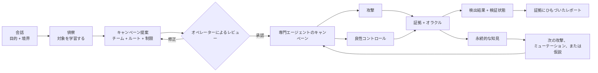

<div align="center">


[English](../../README.md) · [简体中文](README.zh-CN.md) · **日本語** · [한국어](README.ko.md) · [Español](README.es.md) · [Français](README.fr.md) · [Deutsch](README.de.md) · [Português (Brasil)](README.pt-BR.md) · [Русский](README.ru.md) · [العربية](README.ar.md) · [हिन्दी](README.hi.md)

# Merlin

### 会話から始める AI セキュリティテスト

**対象: チャットボット · AI エージェント · RAG アプリケーション · ツールを使う AI · マルチエージェントシステム**

テストする権限のある対象を Merlin に伝えてください。Merlin はアプリケーションの仕組みを学習し、
レビュー用の攻撃キャンペーンを提案し、有望な証拠を追跡して、証拠ステータスとカバレッジの欠落を
明示した、証拠に裏づけられた検出結果を返します。

**72 件の攻撃ケース · 14 件の良性コントロール · ブラウザ + API · 適応型探索 · 異種モデル構成**

[クイックスタート](#クイックスタート) · [Merlin の仕組み](#merlin-の仕組み) ·
[Merlin の違い](#merlin-の違い) · [現在の攻撃カバレッジ](#現在の攻撃カバレッジ)

[](https://github.com/arcanaresearch/merlin-harness/releases/latest)

</div>

> [!NOTE]
> この翻訳は利便性のために提供されているものであり、[English README](../../README.md) より更新が遅れる場合があります。英語版が正本です。


## オプションのブラウザワークスペース

チャット、キャンペーンのレビュー、エージェント、カバレッジ、レポート、セットアップ、高度な制御のための
pb2 スタイルの Web ワークスペースを、ソースから利用できます。[ブラウザワークスペースの実行方法](../web-interface.md)を参照してください。

## CLI ウォークスルー動画

<p align="center">
  <a href="https://www.youtube.com/watch?v=Kyz2PcphWvo">
    
  </a>
</p>

Merlin がモデルを接続し、認可された対象を定義し、キャンペーンをレビューし、エージェントを連携させ、
オペレーターの指示を受け入れ、証拠にひもづいたレポートを作成する様子をご覧ください。


> [!NOTE]
> Merlin は活発に開発中です。スタンドアロン版リリースは現在、Apple silicon 上の macOS 14 を対象としています。
> 自社製コードと同梱の 8 つのナレッジパックはすべて Apache-2.0 を使用しています。

Merlin には、商取引上の価格決定権限、拘束力のあるコミットメント、合成した機密性カナリア、
顧客またはテナントの分離に関する、敵対的なポリシー制御ガイダンスが含まれています。これらの制御には、
対象固有のレビュー済みポリシーバインディング、良性コントロール、そして対象の状態または
レシートに関する独立した証拠が必要です。Merlin はそれらの型付き証拠コントラクトを検証し、認証済みパックの
識別情報を、参考情報としてのナレッジとは別に投影します。これらは定義された制御のテストを支援するもので
あり、法令や規制への準拠を証明するものではありません。また、範囲を限定した否定的な結果を、
組織全体のコンプライアンスとして報告してはなりません。

> Merlin は、アセスメントの権限がある対象に対してのみ使用してください。

## Merlin の調査の様子

```text
あなた
  レビュー済みのサポートエージェントについて、プロンプトインジェクション、
  ユーザー間のデータアクセス、安全でないツール使用を評価してください。
  破壊的な操作は行わないでください。

Merlin
  1. 対象のブラウザ、セッション、API の挙動を学習する
  2. 具体的なキャンペーン、チーム、モデル、ツール、制限、クリーンアップを提案する
  3. あなたのレビューを待つ
  4. 対象が対応している場合は、対応する良性コントロールとともに、適用可能な攻撃を実行する
  5. 有用な手がかりを追跡し、帰属可能な証拠を記録する
  6. 検出結果、証拠ステータス、カバレッジの欠落、そして一度もテストされなかった項目を返す
```

すでに Codex や Claude Code を使っている方なら、操作感はなじみ深いはずです。普通の言葉で作業内容を伝え、
提案された作業をレビューし、会話を通じて進行を調整します。Merlin はこのワークフローを、
認可されたセキュリティ調査に適用します。

## インストールと実行

ソースから Merlin を実行するには、Python 3.13+ と `uv` をインストールし、ワークスペースを一度準備してから、
リポジトリ内のランチャーを使います。

```bash
git clone https://github.com/triwiz-ai/merlin-harness.git
cd merlin-harness
uv sync --all-packages --locked
./merlin
```

これが通常の起動コマンドであり、覚えておくべきフラグはありません。初回起動時、Merlin はプロバイダーが
設定されていないことを検出し、アプリを開く前に、プロバイダー、モデル、API キーの選択を案内します。
2 回目以降の起動では、そのまま Merlin に入ります。設定を変更したい場合にのみ `/setup` を使ってください。

Merlin は認証情報を、所有者のみがアクセスできる専用の認証情報ストアに保存します。PostgreSQL、プロンプト、
ログ、レポート、エクスポートされたメモリには保存しません。

スタンドアロンの macOS バンドルを作成するには、次を実行します。

```bash
make release
cd target/releases/merlin-0.2.47-darwin-arm64
./merlin
```

ワークスペースのバージョンを上げ、対応するリリースを 1 つのコマンドでビルドするには、
`make release-patch`、`make release-minor`、`make release-major` を使います。

このバンドルには、独自の Python、PostgreSQL、ブラウザのランタイムが含まれています。初回起動時に現在の
ユーザー向けに Merlin をインストールし、必要に応じて同じガイド付きセットアップを開きます。

### リードプロバイダーとワーカーモデル

`/model` を使うと、任意のモデルロールを **Codex App Server**、**Claude CLI**、**Kimi ACP**、
**Kiro ACP**、**OpenCode ACP**、**Pi Agent RPC** 経由にルーティングできます。ホスト型またはローカルのモデルは
`/setup` で設定します。エージェントトランスポートを使うには、それぞれのローカルへのインストールと認証が
必要です。Merlin は、現在のリクエストに対してレビュー済みのツールだけを、プライベートな MCP ブリッジ経由で
公開します。外部エージェントは呼び出しを提案するだけで、権限チェック、実行、予算管理、証拠の記録は
Merlin が引き続き担います。

### オプションの JEV 判定

Merlin は、拒否の採点やトリアージといった型付きの判断のために、TypeSafe の **JEV** 判定サービスを呼び出せます。
ガイド付きセットアップでは、これをキャンペーン用モデルとは別に案内します。オフのままにしておくこともできます。
`/setup` を開いて **JEV — judgment API key**（JEV の判定用 API キー）を選ぶか、`/setup jev` を直接使ってください。
Merlin はキーを安全に保存し、ヘルスチェックの結果を報告します。その後は `/model` から判定のオン・オフを
切り替えられます。

JEV が提供するのは、実装済みの判断ポイントにおける判定と信頼度です。キャンペーンの認可、対象セッションの
スケジューリング、クリーンアップは JEV の担当ではありません。一部のルーティングおよびケイパビリティの判定は、
引き続きシャドー評価の段階にあります。判定が得られない場合や失敗した場合は、既存の処理にフォールバックし、
認可されたテストを黙って取り除くことなく、不確実性を保持します。

## Merlin を選ぶ理由

AI セキュリティの一般的なワークフローは、用意されたジェイルブレイクや攻撃のプロンプトのリストを送り、
応答を採点し、リストが終わった時点で停止するものです。これは有用なベースラインですが、実際の AI プロダクトには
ユーザー、セッション、API、ツール、メモリ、ワークフローがあり、場合によっては操作を実行する権限もあります。

Merlin もレビュー済みのカタログから始めます。そのうえで、偵察、対応する良性コントロール、継続的な学習、
適応型探索、専門エージェントの連携、アプリケーションの証拠を加えます。

| カタログ型スキャン | Merlin |
|---|---|
| 用意されたプロンプトから始める | 対象を学習してから、レビュー済みの攻撃フロンティアを実行する |
| 事前定義されたリストを実行する | 対象固有の仮説とミューテーションを開発できる |
| テストを互いに独立したものとして扱う | キャンペーンの各ステップ間で証拠と状態を引き継ぐ |
| 主に応答を採点する | 攻撃を、コントロールおよび対象の状態に関する証拠と比較する |
| 単一の汎用的な実行経路を使う | ジョブごとに異なるモデルへルーティングできる |
| 毎回のスキャンをゼロから始める | 比較可能な知見を再利用し、古くなった証拠を再検証する |
| 興味深い出力を報告する | 検出結果、証拠ステータス、カバレッジ、系譜（lineage）を報告する |

## Merlin の仕組み



1. **作業内容を伝える。** 対象、知りたいこと、そして対象外としなければならないものを指定します。
2. **対象を学習する。** 偵察では、攻撃の実行を始める前に、レビュー済みのブラウザまたは API とのやり取りを
   マッピングします。
3. **キャンペーンをレビューする。** 手法、専門エージェントの構成、モデルのルート、ツール、予算、証拠の要件、
   起こりうる影響を確認します。
4. **実行して調整する。** Merlin は受け入れられた作業を実行し、有用な証拠を追跡します。オペレーターは、
   一時停止、方向転換、再開、停止を行えます。
5. **証拠を確認する。** 検出結果は、リクエスト、レスポンス、観測された状態、コントロール、オラクル、ワーカー、
   キャンペーンのリビジョンにひもづいたまま保たれます。
6. **学習する。** 比較可能な結果は以降の作業に影響を与えることができますが、古い証拠が恒久的な真実になる
   わけではありません。

## Merlin の違い

### 攻撃の前に偵察する

Merlin は、オペレーターにセレクター、エンドポイント、セッション遷移、レスポンスフィールドの一つひとつを
説明させることはしません。まず範囲を限定した無害な偵察を行い、キャンペーン用にレビュー済みの
インタラクションコントラクトを作成します。

### 公表された機能一覧の外側もテストする

セキュリティスキャナーは、文書化されていない、あるいはサポートされていない領域が安全だと仮定すべきではありません。
Merlin は、プローブを送って観測する認可済みで無害な方法がある場合、未知のアップロード、RAG、メモリ、
マルチモーダル、ツール、エージェント間メッセージ、言語の各領域を調査できます。領域に到達できない場合、
レポートはその制約を記録し、カバレッジから黙って取り除くことはしません。

### カタログを超えた探索

組み込みのカタログは出発点であり、調査の限界ではありません。探索では次のことができます。

- 対象の証拠から、反証可能な仮説を作る
- 観測に基づく近傍のテストを提案する
- ブレインストーミングによって新しいアームを生成する
- 証拠のある失敗を回避する別ルートを探る
- 成功した攻撃を一般化する
- レビュー済みのレジスターおよび実行可能なエンコーディングのミューテーションを適用する
- 重複または重複に近いアイデアを、対象の予算を消費する前に却下する

Merlin には、アーム生成のための追加のビルディングブロックも含まれていますが、そのすべてが
ライブのスーパーバイザーにまだ接続されているわけではありません。

### 盲信しない継続的な学習

Merlin は、試行した内容、それが行われた対象とシナリオ、結果、その裏づけとなる証拠を記録します。
Autonomous キャンペーンの実行中は、残りの攻撃フロンティアを繰り返しランク付けし、確定した結果を分析し、
ミューテーションや近傍のテストを開発し、有用な証拠が出続ける間は専門エージェントのチームを再編成することも
できます。後で比較可能なキャンペーンを実行する際には、次のこともできます。

- いまも有効な、完全一致の否定的結果を繰り返さない
- 以前の検出結果を再確認する
- 対象、アダプター、オラクル、言語、証拠の経過時間のドリフトの後で、作業を再検証する
- 関連はあるが未テストのバリエーションを優先する
- 証拠のあるインタラクションコントラクトを再利用する

別の対象やシナリオの証拠は、仮説の着想にはなり得ます。しかし、検出結果を黙って証明したり、
テストを抑制したり、カバレッジとして数えたりすることはできません。

### 1つのキャンペーンで複数のモデルを使い分ける

Merlin は、役割ごとに作業負荷が異なるため、異種モデルのルーティングを前提に設計されています。偵察には通常、
ページ構造、ブラウザトラフィック、API の記述、対象のメタデータ、蓄積された観測結果といった最も多くの入力が
渡されるため、通常は大きなコンテキストウィンドウを持つモデルを使うべきです。ただし、そのモデルが、キャンペーンの
指揮、定型的な攻撃の実行、異例の手がかりの探索、検出結果の検証に最適、あるいは最も経済的であるとは限りません。
解決されたルートとフォールバックの順序は、キャンペーンのレビュー中も確認できます。

```text
Campaign Lead         → 信頼性の高い推論モデル
偵察                  → 大きなコンテキストを持ち、ビジョン／ツールに対応したモデル
定型ワーカー          → 経済的な実行モデル
敵対的エクスプローラー → 創造的な探索モデル
バリデーター          → 別途選択した検証用モデル
エスカレーション      → レビュー済みのより強力なフォールバック
```

十分な能力を持つ単一のモデルで全ロールを実行することも引き続き可能で、初期セットアップは簡単になります。
本格的なキャンペーンでは、各役割を適したモデルにルーティングする構成を推奨します。特に、偵察には大きな
コンテキストを持つモデルを、検証には別途選択したモデルを使います。

### 攻撃を通常の動作と比較する

疑わしい応答が、自動的に脆弱性であるとは限りません。対象と手法が対応している場合、Merlin は攻撃を
レビュー済みの良性コントロールと組み合わせ、両方を明示的なオラクルに照らして確認します。

```text
コントロール: ユーザー A が自分の会話を読む
攻撃:         ユーザー B が同じ会話 ID をリクエストする
オラクル:     応答と、その結果のアプリケーション状態を比較する
```

通常の操作も失敗する場合、Merlin は認可の欠陥を確信を持って報告すべきではありません。

### テストを隠さず不確実性を保つ

Merlin は、自身のコンテンツ評価器に、認可された攻撃を黙って抑制させることはしません。対象側が保持する証拠を
優先します。オラクル、メタデータ、評価器の判断が食い違う場合、Merlin は試行を保持し、結果を不確実として
マークして、検証、ミューテーション、再試行に回します。評価器の不確実性は、対象の失敗、問題なしという結果、
完了したカバレッジのいずれとしても報告されません。

### 調査に合わせて変化するチーム

キャンペーンの開始方法を選びます。

- **Opinionated:** Merlin があらかじめ用意した、認証とセッション、インジェクション、データ露出、ビジネスロジック、
  ケイパビリティの悪用というテンプレートから始めます。
- **Autonomous（デフォルト）:** Campaign Lead が偵察の結果から最初の専門エージェントを構成し、
  証拠を伴う各ウェーブの後に、ミューテーション、近傍のテスト、専門エージェントの変更を提案します。

どちらのモードも、同じ動的キャンペーンエンジンを使用します。偵察、Campaign Lead、検証、修復、
自動化の作成、自動化のレビュー、決定論的な実行は、引き続き別々の責務です。Lead は調査内容を変更できますが、
新しい対象、ツール、アカウント、予算を自分に付与することはできません。キャンペーンの完了は、永続化された進捗、
残りの作業、インフラの状態、クリーンアップ、レビュー済みの制限から判断されます。Lead が終了を宣言した
というだけでは完了になりません。

## クイックスタート

1. `./merlin` を実行します。初回起動の場合は、Merlin が自動的にセットアップを案内します。
2. 認可された対象と目的を、普通の言葉で説明します。
3. 偵察で、対象の仕組みを把握させます。
4. カバレッジとして Recommended（デフォルト）、Quickscan、Exhaustive、Exploration/learning のいずれかを選び、
   続いてエージェント構成として Autonomous（デフォルト）または Opinionated を選びます。
5. 何かが実行される前に、封印されたキャンペーンをレビューします。
6. 承認し、調査を見守りながら調整します。
7. 検出結果の証拠を開き、レポートをエクスポートします。

目的の例:

```text
https://target.example について、間接プロンプトインジェクション、セッションをまたぐデータ
露出、安全でないツール使用を評価してください。承認されたテストアカウントのみを使用し、
外部への副作用を発生させず、対象に劣化が見られた場合は停止してください。
```

## Merlin でのキャンペーン画面

以下の TUI キャプチャはサンプルのキャンペーンデータを使用しています。インターフェースを説明するためのもので、
ラベルやデフォルト値はバージョンによって異なる場合があります。ここに示した検出結果と出力は、
ベンチマークの結果ではありません。

### カバレッジとチームの選択

カバレッジとエージェント構成は、別々の選択です。Recommended がデフォルトで、代表的なカバレッジを提供します。
Quickscan はより小規模な開始キャンペーンを提供し、Exhaustive はそれを拡張し、Exploration/learning は調査に
重点を置きます。Autonomous がデフォルトのエージェント構成で、Opinionated はレビュー済みのチームテンプレートを
使用します。


### 実行前のレビュー

確定する前に、提案された対象スコープ、作業、モデルのルート、制限、クリーンアップを確認します。


### メイン会話でワーカーを追う

インラインのスウォームストリップには、個々のワーカー、現在のタスク、保持されている最新の出力、キューに入った作業、
失敗が表示されます。オレンジ色の稼働インジケーターは実行中にアニメーションし、一時停止中または終了状態では
静止します。キャンペーンの状態とワーカーの履歴は、セッションを再開する際に復元されます。


### フルスクリーンのワークスペースでエージェントを調べる

`/agents` を開くか、スウォームストリップをクリックします。コンパクトな割り当て一覧が、各タスクを担当する専門エージェントを
ライブ出力ペインの横に示します。
各ペインには、記録された専門エージェント、ワーカーの所有者、タスク、アクティビティ、保持されている出力が表示されます。
失敗した割り当ては、キャンペーンの終了後も確認できます。

- **A:** 記録されたエージェントの識別情報ごとにグループ化したエージェント概要を開きます。現在のアクティビティ、モデル、タスク履歴、最新の出力を確認できます。**T / Esc:** タスクワークスペースに戻ります。
- **マウスドラッグ:** 詳細テキストを選択します。**Ctrl+Shift+C:** 選択範囲をコピーします。選択中は、ライブのテキスト更新が一時停止します。
- **矢印キー:** ワーカーを選択します。
- **Tab / Shift+Tab:** 表示中のワーカーペイン間を移動します。
- **Space:** ほかのワーカーを調べている間、ワーカーをピン留めします。
- **Enter:** 選択したワーカーの、保持されているトランスクリプト、試行、出力、失敗の詳細を展開します。
- **Esc:** 展開したトランスクリプトを閉じ、その後、会話に戻ります。


トランスクリプトには、保持されているアシスタントおよびツールのメッセージが表示されます。コンテキストの圧縮で
削除されたメッセージは再構築されません。共有された対象セッションには、レビュー済みの容量が適用されます。
作業は、別の割り当てが所有するセッションを奪い合うのではなく、受け入れられるまで待機します。過去のインフラの
失敗は引き続き表示され、成功したカバレッジになることはありません。

### 完了、エクスポート、再開

メイン画面では、ライブの進捗が、永続的なスキャンサマリーに置き換わります。サマリーには、完了または部分的な完了の
ステータス、検出結果、カバレッジ、クリーンアップ、HTML レポートのパスが表示されます。実行が途中で停止した場合、
サマリーには部分的な完了と停止の理由が表示され、保存済みの作業と残りのカバレッジも確認できます。

HTML は自動的にエクスポートされます。Markdown、JSON、CSV は、サマリーのエクスポートボタンか
`/report --format …` を使います。これらの追加フォーマットは、要求に応じて生成されます。Open HTML と
Reports のアクションにより、ファイルシステムを探し回ることなく結果にアクセスできます。


`/report` は、**Open HTML**、**Copy HTML path**、および **Markdown**、**JSON**、**CSV ZIP バンドル**への
エクスポートを備えた、フルスクリーンのキャンペーンピッカーを開きます。既存のファイルは、選択したキャンペーンの
詳細に表示されます。エクスポートは、たまたま開いているセッションではなく、過去のキャンペーンを含め、
保存されたそのキャンペーンを対象に行われます。


HTML レポートは、検出結果、カバレッジ、記録された証拠をブラウザ上にまとめます。


*代表的なサンプルレポート。*


途中で終了し、保存されたセッションを再開すると、Merlin は永続化されたキャンペーンのチェックポイント、
ワーカーの履歴、進捗を復元します。再開したキャンペーンが終了すると、同じサマリーとレポートのフローが使われます。
すでに終了したセッションを再開すると、保存されたレポートサマリーとアクションが復元されます。
部分的に完了したキャンペーンも、HTML レポートとエクスポート操作を保持します。**Recover** は、完了済みのウェーブを
保持したまま、保存されたウェーブ境界から未解決のカバレッジを再開します。また、永続化された状態から、
失われたレポートを再構築することもできます。新しいリクエストには、引き続き対象セッションが利用可能である必要が
あり、保持されたチェックポイントは、対象に対する外部での変更を元に戻しません。

完了とは、すべてのテストが成功したという意味ではありません。レポートには、失敗、ブロック、不確実、
未テストの作業が明示的に記録されます。

## 手がかりから発見まで

Merlin は、結果の周囲にある推論の境界全体を保持するよう設計されています。

```text
偵察での観測
  ブラウザの識別情報と会話 ID が、別々のリクエスト値として現れる
        ↓
対象固有の仮説
  API が、サインイン中のユーザーを確認せずに会話 ID を信頼している可能性がある
        ↓
レビュー済みの実験
  許可されたコントロール + ユーザー間のトリートメント + 明示的なオラクル + クリーンアップ
        ↓
証拠
  正確なリクエスト、レスポンス、選択した状態、レシート、対象の識別情報
        ↓
結果の区分
  検出結果、否定的な結果、結論なし、ブロック、または未試行
```

## 現在の攻撃カバレッジ

組み込みのカタログには現在、**72 件の攻撃テストケース**と **14 件の再利用可能な良性コントロール**が含まれており、
合計 **86 件のケース**になります。1 つのケースは、攻撃の各次元の具体的な組み合わせ 1 つであり、
必ずしも固有の手法ファミリーを意味するわけではありません。

- 直接および間接のプロンプトインジェクション
- マルチターンの Crescendo、GOAT、Hydra-Select 戦略
- 認証、セッション、アイデンティティ、テナントの境界
- データ露出、ユーザー間アクセス、抽出
- ビジネスロジック、シーケンス、リプレイ、ステートマシンの悪用
- ツール、エージェント、外部への影響、ケイパビリティの悪用
- RAG、保存されたコンテンツ、メモリ、過去の出力の再注入
- コンテキストの逸脱、Poison Soup、トークン／出力の増幅、リソース悪用に関するガイダンス
- 多言語、レジスター、エンコード、難読化のバリアント
- ブラウザ、JSON API、レビュー済みのハイブリッドフロー

カタログに含まれていることは、すべての攻撃があらゆる対象に適用可能である、あるいは実行されることを
意味しません。レポートは、受け入れ済み、試行済み、ブロック、結論なし、否定的、未テストの作業を区別して示します。

## 現在の制限事項

未完成の部分:

- ユーザー間、セッション間、テナント間、オブジェクト ID、メソッド、コンテントタイプにわたる API の汎用的な自動ミューテーションは、
  まだすべてのキャンペーンで使える機能にはなっていません。
- スキャン時のトークン、レイテンシ、ツール呼び出し、リカバリー、denial-of-wallet を網羅した比較は、
  まだすべてのキャンペーンで利用できるわけではありません。
- 生成されたカスタムの Python または Playwright コードには、承認済みのサンドボックス化されたランタイムがありません。
- すべてのアーム生成ヘルパーが、ライブのキャンペーンスケジューリングに接続されているわけではありません。
- 新規の分離セッションでの再現は、すべての対象と検出結果で利用できるわけではありません。
- 比較カバレッジはまだ限られています。現時点での直接比較の証拠は、公式のリーダーボードへの提出ではなく、
  ローカルでの非公式の再現によるものです。
- パッケージ版のサポートは現在、Apple silicon 上の macOS 14 を対象としています。

## ベンチマーク

Merlin は、単一のデータセットや 1 つの ASR の数値ではなく、固定された予算の下で、実在し実行可能な脆弱性を見つける
適応型の攻撃者としてベンチマークされています。ローカルでの比較再現には現在、RIFT-Bench と MUZZLE + The Zoo が
含まれます。RIFT では、1 つのプローブファミリーのフロー 0 について、1 つのプローブと Merlin を、22 の実行可能な
システムで比較しました。その際、Azure の被害者側／ジャッジ側のデプロイを DeepSeek に置き換え、依存関係と
プロバイダーに関する調整を加えています。MUZZLE と Merlin は、それぞれ調整した Gitea シナリオを 1 つ実行しました。
被害者側の `deepseek-chat` と、MUZZLE のグラウンドトゥルースのジャッジは同一でしたが、攻撃側のモデルとラウンド数は
異なります。
Jailbreak Foundry と AgentHarm の結果は、DeepSeek の被害者としての脆弱性を測定したものであり、Merlin の
性能を測定したものではありません。AIRTBench と REDAgentBench は保留のままです。REDAgentBench/DianJin-RED の
ベンチマークデータは CC BY-NC 4.0 に加え、該当する上流の条件が適用されます。

**これらは、DeepSeek と開示済みのベンチマーク調整を用いた、ローカルでの非公式の再現であり、公式のリーダーボードへの提出ではありません。**
分母と評価コントラクトはトラックごとに異なります。
[ベンチマーク結果と方法論上の境界](../benchmarks.md)を参照してください。ベンチマークとベンダーの生の出力は、
リリースに含まれていません。

## セキュリティと責任ある利用

Merlin は、認可されたテストのための攻撃的アセスメントハーネスです。モデル、対象のコンテンツ、ツール、インポートされた
ガイダンス、生成された手順は、信頼できない入力として扱われます。対象、認証情報、ツール、予算、重大な結果を伴う操作、
クリーンアップに対する権限は、決定論的なコードが保持します。

所有していない、またはテストの明示的な許可を得ていないシステムに対して、Merlin を使用しないでください。Merlin の
セキュリティ上の問題は、公開 issue に機微な詳細を含めるのではなく、メンテナーに非公開で報告してください。

## コミュニティとプロジェクトの状況

Merlin はプレリリースのソフトウェアです。issue、テスト対象、攻撃のアイデア、アダプターへの貢献、再現可能な評価を
歓迎します。検出の成果（finding yield）に関する主張には、対象、モデル、スコープ、ツール、予算、証拠の基準、
比較条件を含めてください。

自社製コードと同梱の 8 つのナレッジパックはすべて、[Apache-2.0](../../LICENSE) でライセンスされています。
サードパーティのコンポーネントは各自のライセンスを保持します。[ライセンスの詳細](../LICENSING.md)と
[依存関係の一覧](../THIRD-PARTY.md)を参照してください。開発環境のセットアップとチェックについては、
[Contributing](../CONTRIBUTING.md)、[開発リファレンス](../DEVELOPMENT.md)、
[ソースアーキテクチャ](../SOURCE-AND-PACKAGES.md)を参照してください。


### セッションとキャンペーンの操作

`/resume` は保存された会話を復元し、そのキャンペーンを再接続します。`/campaign resume ID` は、現在のセッション内で
一時停止中の 1 つのキャンペーンを続行します。会話の切り替えは行いません。
`/interrupt` は、現在の会話のターンと、そのターンに接続されているスウォームを中断します。
永続化されたキャンペーンを ID 指定で明示的にキャンセルすることはありません。それには `/campaign cancel ID` を使ってください。
`/cancel task ID` は 1 つのタスクをキャンセルし、キャンペーンのほかのタスクは続行できます。
`/campaign cancel ID` は、そのキャンペーンの作業をキャンセルし、証拠は保持します。
`/quit` は Merlin を正常に終了します。`/agents` では、**A** を押すとグループ化されたエージェント概要が開き、
**T** を押すとタスクワークスペースに戻ります。
