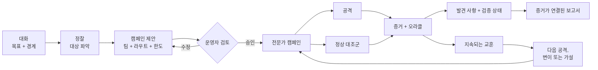

<div align="center">


[English](../../README.md) · [简体中文](README.zh-CN.md) · [日本語](README.ja.md) · **한국어** · [Español](README.es.md) · [Français](README.fr.md) · [Deutsch](README.de.md) · [Português (Brasil)](README.pt-BR.md) · [Русский](README.ru.md) · [العربية](README.ar.md) · [हिन्दी](README.hi.md)

# Merlin

### 대화 중심 AI 보안 테스트

**지원 대상: 챗봇 · AI 에이전트 · RAG 애플리케이션 · 도구를 사용하는 AI · 멀티 에이전트 시스템**

테스트할 권한이 있는 대상을 Merlin에게 알려 주세요. Merlin은 애플리케이션의 동작 방식을 파악하고,
검토용 공격 캠페인을 제안하며, 유망한 증거를 추적한 뒤, 증거 상태와 커버리지 공백이 명확히 표시된
증거 기반 발견 사항을 반환합니다.

**공격 케이스 72개 · 정상 대조군 14개 · 브라우저 + API · 적응형 탐색 · 이기종 모델**

[빠른 시작](#빠른-시작) · [작동 방식](#merlin-작동-방식) ·
[차별점](#merlin의-차별점) · [현재 커버리지](#현재-공격-커버리지)

[](https://github.com/arcanaresearch/merlin-harness/releases/latest)

</div>

> [!NOTE]
> 이 번역은 편의를 위해 제공되며 영문 README보다 늦게 반영될 수 있습니다. [English README](../../README.md)가 기준 문서입니다.


## 선택형 브라우저 워크스페이스

소스에서 실행할 수 있는 pb2 스타일의 웹 워크스페이스가 있으며, 채팅, 캠페인 검토, 에이전트, 커버리지,
보고서, 설정, 고급 제어를 제공합니다. 자세한 내용은 [브라우저 워크스페이스 실행](../web-interface.md)을
참고하세요.

## CLI 시연 영상 보기

<p align="center">
  <a href="https://www.youtube.com/watch?v=Kyz2PcphWvo">
    
  </a>
</p>

Merlin이 모델을 연결하고, 승인된 대상을 정의하고, 캠페인을 검토하고, 에이전트를 조율하고, 운영자의
지침을 반영하며, 증거가 연결된 보고서를 생성하는 과정을 확인해 보세요.


> [!NOTE]
> Merlin은 현재 활발히 개발 중입니다. 독립 실행형 릴리스는 현재 Apple silicon 기반 macOS 14를
> 대상으로 합니다. 자체 제작 코드와 번들된 8개 지식 팩 전부는 Apache-2.0을 따릅니다.

Merlin에는 상업적 가격 결정 권한, 구속력 있는 약속, 합성 기밀성 카나리아, 고객 또는 테넌트 격리에 대한
적대적 정책 통제 가이드가 포함되어 있습니다. 이러한 통제를 사용하려면 대상별로 검토된 정책 바인딩,
정상 대조군, 그리고 독립적인 대상 상태 또는 영수증(receipt) 증거가 필요합니다. Merlin은 이 통제의
타입이 지정된 증거 계약(typed evidence contract)을 검증하며, 인증된 팩 식별자를 참고용 지식과는 별도로
제시합니다. 이 통제는 정의된 통제 항목을 테스트하는 데 도움을 줄 뿐 법적 또는 규제상의 준수를 인증하지
않으며, 범위가 한정된 부정(negative) 결과를 조직 전체의 규정 준수 결과로 보고해서는 안 됩니다.

> 평가할 권한이 있는 대상에 대해서만 Merlin을 사용하세요.

## Merlin의 조사 과정 살펴보기

```text
사용자
  검토된 고객 지원 에이전트에 대해 프롬프트 인젝션, 사용자 간 데이터 접근,
  안전하지 않은 도구 사용을 평가해 줘. 파괴적인 작업은 수행하지 마.

Merlin
  1. 대상의 브라우저, 세션, API 동작을 학습합니다
  2. 정확한 캠페인, 팀, 모델, 도구, 한도, 정리(cleanup) 방안을 제안합니다
  3. 사용자의 검토를 기다립니다
  4. 대상이 지원하는 경우 짝을 맞춘 정상 대조군과 함께 해당되는 공격을 실행합니다
  5. 유용한 단서를 추적하고 귀속 가능한 증거를 기록합니다
  6. 발견 사항, 증거 상태, 커버리지 공백, 한 번도 테스트하지 않은 항목을 반환합니다
```

이미 Codex나 Claude Code를 사용하고 계시다면 상호작용 방식이 익숙할 것입니다. 일상적인 언어로 작업을
설명하고, 제안된 작업을 검토하고, 대화를 통해 방향을 조정하면 됩니다. Merlin은 이 워크플로를 승인된 보안
조사에 적용합니다.

## 설치 및 실행

소스에서 Merlin을 실행하려면 Python 3.13 이상과 `uv`를 설치하고 워크스페이스를 한 번 준비한 뒤,
저장소의 런처를 사용하세요.

```bash
git clone https://github.com/arcanaresearch/merlin-harness.git
cd merlin-harness
uv sync --all-packages --locked
./merlin
```

이것이 일반적인 실행 명령이며, 따로 기억해야 할 플래그는 없습니다. 처음 실행하면 Merlin이 구성된
프로바이더가 없음을 감지하고, 앱을 열기 전에 프로바이더, 모델, API 키를 선택하도록 안내합니다. 이후에는
바로 Merlin이 실행됩니다. 구성을 변경하고 싶을 때만 `/setup`을 사용하세요.

Merlin은 자격 증명을 PostgreSQL, 프롬프트, 로그, 보고서, 내보낸 메모리가 아니라 소유자 전용 자격 증명
저장소에 보관합니다.

독립 실행형 macOS 번들을 만들려면 다음을 실행하세요.

```bash
make release
cd target/releases/merlin-0.2.47-darwin-arm64
./merlin
```

워크스페이스 버전을 올리고 해당 릴리스를 한 번에 빌드하려면 `make release-patch`, `make release-minor`,
`make release-major` 중 하나를 사용하세요.

이 번들에는 자체 Python, PostgreSQL, 브라우저 런타임이 포함되어 있습니다. 처음 실행하면 현재 사용자를
위해 Merlin을 설치하고, 필요한 경우 동일한 안내형 설정을 엽니다.

### 리드 프로바이더와 워커 모델

`/model`을 사용하면 모든 모델 역할을 **Codex App Server**, **Claude CLI**, **Kimi ACP**,
**Kiro ACP**, **OpenCode ACP**, **Pi Agent RPC** 중 하나로 라우팅할 수 있으며, `/setup`을 통해 호스팅형
또는 로컬 모델을 구성할 수도 있습니다. 에이전트 트랜스포트를 사용하려면 각각의 로컬 설치와 인증이
필요합니다. Merlin은 현재 요청에 대해 검토된 도구만 비공개 MCP 브리지를 통해 노출합니다. 외부 에이전트는
호출을 제안할 뿐이며, 권한 검사, 실행, 예산 관리, 증거 기록은 Merlin이 계속 담당합니다.

### 선택형 JEV 판단

Merlin은 거부 응답 채점이나 분류(triage) 같은 타입이 지정된 의사결정을 위해 TypeSafe의 **JEV** 판단
서비스를 호출할 수 있습니다. 안내형 설정은 이 기능을 캠페인 모델과 별도로 제안하며, 꺼 둘 수도 있습니다.
`/setup`을 열어 **JEV — judgment API key**(JEV 판단용 API 키)를 선택하거나, `/setup jev`를 직접
사용하세요. Merlin은 키를 안전하게 저장하고 상태 점검 결과를 보여 줍니다. 이후에는 `/model`에서 판단
토글을 사용할 수 있습니다.

JEV는 구현된 의사결정 지점에서 판단과 신뢰도를 제공합니다. 캠페인 승인, 대상 세션 스케줄링, 정리(cleanup)는
JEV의 소관이 아닙니다. 일부 라우팅 및 기능(capability) 판단은 여전히 섀도 평가(shadow evaluation) 단계입니다.
판단이 없거나 실패하면 기존 처리 방식으로 대체되며, 승인된 테스트를 조용히 제거하는 대신 불확실성을
그대로 보존합니다.

## 왜 Merlin인가

일반적인 AI 보안 워크플로는 미리 준비된 탈옥(jailbreak) 또는 공격 프롬프트 목록을 전송하고, 응답을
채점하고, 목록이 끝나면 멈춥니다. 이는 유용한 기준선이지만, 실제 AI 제품에는 사용자, 세션, API, 도구,
메모리, 워크플로가 있고 때로는 실제 행동을 취할 권한도 있습니다.

Merlin도 검토된 카탈로그에서 시작합니다. 여기에 정찰, 짝을 맞춘 정상 대조군, 지속적 학습, 적응형 탐색,
전문가 에이전트 간 조율, 애플리케이션 증거를 더합니다.

| 카탈로그 기반 스캔 | Merlin |
|---|---|
| 준비된 프롬프트에서 시작 | 대상을 파악한 뒤 검토된 공격 프런티어를 실행 |
| 사전에 정의된 목록을 실행 | 대상에 특화된 가설과 변이를 개발할 수 있음 |
| 테스트를 서로 독립적으로 처리 | 캠페인 단계 사이에서 증거와 상태를 이어받음 |
| 주로 응답을 채점 | 공격을 대조군 및 대상 상태 증거와 비교 |
| 하나의 범용 실행 경로 사용 | 작업별로 서로 다른 모델에 라우팅할 수 있음 |
| 매 스캔을 처음부터 시작 | 비교 가능한 교훈을 재사용하고 오래된 증거를 재검증 |
| 흥미로운 출력을 보고 | 발견 사항, 증거 상태, 커버리지, 계보(lineage)를 보고 |

## Merlin 작동 방식



1. **작업을 설명합니다.** 대상, 알고 싶은 내용, 그리고 반드시 범위 밖으로 남겨야 할 것을 지정합니다.
2. **대상을 파악합니다.** 공격을 실행하기 전에 정찰이 검토된 브라우저 또는 API 상호작용을 매핑합니다.
3. **캠페인을 검토합니다.** 기법, 전문가 구성, 모델 라우트, 도구, 예산, 증거 요구 사항, 발생할 수 있는
   영향을 확인합니다.
4. **실행하고 방향을 조정합니다.** Merlin은 입장 허가(admission)를 통과한 작업을 실행하고 유용한 증거를 추적하며, 운영자는
   이를 일시 중지, 방향 전환, 재개 또는 중단할 수 있습니다.
5. **증거를 확인합니다.** 발견 사항은 요청, 응답, 관찰된 상태, 대조군, 오라클, 워커, 캠페인 리비전과
   계속 연결됩니다.
6. **학습합니다.** 비교 가능한 결과는 이후 작업에 영향을 줄 수 있지만, 오래된 증거가 영구적인 사실이
   되지는 않습니다.

## Merlin의 차별점

### 공격 전 정찰

Merlin은 운영자가 모든 셀렉터, 엔드포인트, 세션 전환, 응답 필드를 일일이 설명하기를 요구하지 않습니다.
먼저 범위가 한정된 무해한 정찰을 수행하고, 캠페인에 사용할 검토된 상호작용 계약을 만듭니다.

### 광고된 기능 목록 너머까지 테스트

보안 스캐너는 문서화되지 않았거나 지원되지 않는 표면이 안전하다고 가정해서는 안 됩니다. Merlin은
승인되고 무해한 방식으로 프로브를 전달하고 관찰할 수 있는 경우, 알려지지 않은 업로드, RAG, 메모리,
멀티모달, 도구, 에이전트 메시지, 언어 표면을 조사할 수 있습니다. 어떤 표면에 도달할 수 없다면, 보고서는
이를 커버리지에서 조용히 제거하지 않고 그 한계를 기록합니다.

### 카탈로그를 넘어서는 탐색

내장 카탈로그는 출발점일 뿐 조사의 한계가 아닙니다. 탐색은 다음을 수행할 수 있습니다.

- 대상 증거에서 반증 가능한 가설을 생성
- 관찰에서 도출한 인접 테스트를 제안
- 브레인스토밍을 통해 새로운 arm(후보 공격 단위)을 생성
- 증거로 확인된 실패를 우회
- 성공한 공격을 일반화
- 검토된 말투(register) 변이와 실행 가능한 인코딩 변이를 적용
- 대상 예산을 소모하기 전에 중복되거나 거의 중복된 아이디어를 거부

Merlin에는 arm 생성을 위한 추가 구성 요소도 있지만, 아직 모두가 라이브 supervisor에 연결된 것은
아닙니다.

### 맹신 없는 지속 학습

Merlin은 무엇을 시도했는지, 그것이 어떤 대상과 시나리오에서 일어났는지, 결과가 무엇이었는지, 그리고
그 근거가 된 증거를 기록합니다. Autonomous(자율) 캠페인 중에는 남은 공격 프런티어의 순위를 반복해서
매기고, 확정된 결과를 분석하고, 변이나 인접 테스트를 개발하며, 유용한 증거가 계속 나오는 동안 전문가
팀의 구성을 조정할 수 있습니다. 이후 비교 가능한 캠페인에서는 다음도 수행할 수 있습니다.

- 여전히 유효한 정확한 부정 결과의 반복을 회피
- 이전 발견 사항을 다시 확인
- 대상, 어댑터, 오라클, 언어, 증거 경과 시간의 변동(drift) 이후 작업을 재검증
- 관련은 있지만 아직 테스트하지 않은 변형을 우선 처리
- 증거로 확인된 상호작용 계약을 재사용

다른 대상이나 시나리오에서 얻은 증거는 가설의 영감이 될 수는 있습니다. 하지만 발견 사항을 조용히
입증하거나, 테스트를 생략시키거나, 커버리지로 계산될 수는 없습니다.

### 하나의 캠페인, 서로 다른 두뇌

Merlin은 이기종 모델 라우팅을 염두에 두고 설계되었습니다. 책임마다 워크로드가 다르기 때문입니다.
정찰은 페이지 구조, 브라우저 트래픽, API 설명, 대상 메타데이터, 누적된 관찰 등 보통 가장 많은 입력을
받으므로, 일반적으로 컨텍스트 윈도가 큰 모델을 사용해야 합니다. 하지만 그 모델이 캠페인을 이끌거나,
일상적인 공격을 실행하거나, 특이한 단서를 탐색하거나, 발견 사항을 검증하는 데 가장 적합하거나 가장
경제적인 모델은 아닐 수 있습니다. 확정된 라우트와 폴백 순서는 캠페인 검토 중에 계속 확인할 수 있습니다.

```text
Campaign Lead         → 신뢰성 높은 추론 모델
정찰                  → 대용량 컨텍스트, 비전/도구 지원 모델
일상 작업 워커        → 경제적인 실행 모델
적대적 탐색기         → 창의적 탐색 모델
검증기                → 별도로 선택한 점검 모델
에스컬레이션          → 더 강력한, 검토된 폴백
```

충분히 유능한 단일 모델 하나가 모든 역할을 실행할 수도 있으며, 이 경우 초기 설정이 쉬워집니다. 본격적인
캠페인에서는 각 책임을 적합한 모델로 라우팅하는 구성을 권장합니다. 특히 정찰에는 대용량 컨텍스트 모델을,
검증에는 별도로 선택한 모델을 사용하는 것이 좋습니다.

### 공격과 정상 동작 비교

의심스러운 응답이 곧바로 취약점은 아닙니다. 대상과 기법이 지원하는 경우, Merlin은 공격을 검토된 정상
대조군과 짝지어 명시적인 오라클로 둘 다 확인합니다.

```text
대조군: 사용자 A가 사용자 A의 대화를 읽음
공격:   사용자 B가 동일한 대화 ID를 요청
오라클: 응답과 그 결과로 나타난 애플리케이션 상태를 비교
```

정상 동작마저 실패한다면, Merlin은 권한 부여 결함이라고 확신을 갖고 보고해서는 안 됩니다.

### 테스트를 숨기지 않고 불확실성을 유지

Merlin은 자체 콘텐츠 평가기가 승인된 공격을 조용히 억제하도록 두지 않습니다. 대상이 소유한 증거가
우선하며, 오라클, 메타데이터 또는 평가기의 판단이 서로 어긋나면 Merlin은 시도를 보존하고 결과를
불확실로 표시하여 검증, 변이, 재시도 대상으로 남깁니다. 평가기의 불확실성은 대상의 실패, 깨끗한 결과,
완료된 커버리지로 보고되지 않습니다.

### 조사에 따라 변하는 팀

캠페인을 시작하는 방식을 선택하세요.

- **Opinionated**(미리 정의된 팀): Merlin이 준비한 Authentication and Session, Injection, Data Exposure,
  Business Logic, Capability Abuse 템플릿으로 시작합니다.
- **Autonomous(기본값):** Campaign Lead가 정찰 결과를 바탕으로 초기 전문가를 구성하고, 증거가 나온
  각 웨이브 이후에 변이, 인접 테스트, 전문가 변경을 제안합니다.

두 모드 모두 동일한 동적 캠페인 엔진을 사용합니다. 정찰, Campaign Lead, 검증, 수정 방안 제시,
자동화 작성, 자동화 검토, 결정적 실행은 각각 별개의 책임으로 유지됩니다. Lead는 조사 방향을 바꿀 수
있지만, 스스로에게 새로운 대상, 도구, 계정, 예산을 부여할 수는 없습니다. 캠페인의 완료 여부는 Lead가
끝났다고 말했는지가 아니라, 지속적으로 기록된 진행 상황, 남은 작업, 인프라 상태, 정리(cleanup), 검토된
한도를 기준으로 판단합니다.

## 빠른 시작

1. `./merlin`을 실행합니다. 처음 실행이라면 Merlin이 설정을 자동으로 안내합니다.
2. 승인된 대상과 목표를 일상적인 언어로 설명합니다.
3. 정찰이 대상의 작동 방식을 파악하도록 둡니다.
4. 커버리지로 Recommended(권장, 기본값), Quickscan(소규모 시작), Exhaustive(범위 확장),
   Exploration/learning(탐색·학습 중심) 중 하나를 선택하고, 에이전트 구성으로 Autonomous(기본값) 또는
   Opinionated 중 하나를 선택합니다.
5. 아무것도 실행되기 전에 확정(seal)된 캠페인을 검토합니다.
6. 승인한 뒤 조사를 지켜보며 방향을 조정합니다.
7. 발견 사항의 증거를 열어 보고 보고서를 내보냅니다.

목표 예시:

```text
https://target.example 에 대해 간접 프롬프트 인젝션, 세션 간 데이터 노출, 안전하지 않은
도구 사용을 평가하세요. 승인된 테스트 계정만 사용하세요. 외부 부작용을 만들지 말고,
대상에 성능 저하가 나타나면 중단하세요.
```

## Merlin에서 캠페인 보기

다음 TUI 캡처는 샘플 캠페인 데이터를 사용한 것입니다. 인터페이스를 설명하기 위한 예시이며, 레이블과
기본값은 버전에 따라 다를 수 있습니다. 표시된 발견 사항과 출력은 벤치마크 결과가 아닙니다.

### 커버리지와 팀 선택

커버리지와 에이전트 구성은 별개의 선택입니다. Recommended가 기본값이며 대표적인 커버리지를 제공합니다.
Quickscan은 더 작은 시작 캠페인을 제공하고, Exhaustive는 범위를 넓히며, Exploration/learning은 조사에
무게를 둡니다. Autonomous가 기본 에이전트 구성이며, Opinionated는 검토된 팀 템플릿을 사용합니다.


### 실행 전 검토

확정하기 전에 제안된 대상 범위, 작업, 모델 라우트, 한도, 정리(cleanup) 방안을 확인하세요.


### 메인 대화에서 워커 따라가기

인라인 스웜 스트립은 개별 워커, 현재 작업, 가장 최근에 보존된 출력, 대기 중인 작업, 실패를 보여 줍니다.
주황색 작업 표시기는 실행 중에는 움직이고, 일시 중지되거나 종료 상태가 되면 정지합니다. 캠페인 상태와
워커 기록은 세션을 재개할 때 복원됩니다.


### 전체 화면 워크스페이스에서 에이전트 점검

`/agents`를 열거나 스웜 스트립을 클릭하세요. 간결한 할당 목록이 실시간 출력 패널 옆에 각 작업을 처리하는
전문가를 보여 주며, 각 패널에는 기록된 전문가, 워커 소유자, 작업, 활동, 보존된 출력이 표시됩니다.
실패한 할당은 캠페인이 끝난 뒤에도 계속 확인할 수 있습니다.

- **A:** 기록된 에이전트 식별자별로 묶은 에이전트 개요를 엽니다. 현재 활동, 모델, 작업 기록, 최신 출력이 표시됩니다. **T / Esc:** 작업 워크스페이스로 돌아갑니다.
- **마우스 드래그:** 상세 텍스트를 선택합니다. **Ctrl+Shift+C:** 선택한 내용을 복사합니다. 선택하는 동안에는 실시간 텍스트 업데이트가 일시 중지됩니다.
- **방향키:** 워커를 선택합니다.
- **Tab / Shift+Tab:** 표시된 워커 패널 사이를 이동합니다.
- **Space:** 다른 워커를 살펴보는 동안 해당 워커를 고정합니다.
- **Enter:** 선택한 워커의 보존된 트랜스크립트, 시도, 출력, 실패 상세를 펼칩니다.
- **Esc:** 펼친 트랜스크립트를 닫은 뒤 대화로 돌아갑니다.


트랜스크립트에는 보존된 어시스턴트 및 도구 메시지가 표시됩니다. 컨텍스트 압축으로 제거된 메시지는
복원되지 않습니다. 공유 대상 세션은 검토된 용량을 사용하며, 작업은 다른 할당이 소유한 세션을 두고
경쟁하는 대신 입장 허가(admission)를 기다립니다. 과거의 인프라 실패는 계속 표시되며 성공한 커버리지로
바뀌지 않습니다.

### 완료, 내보내기, 재개

메인 화면은 실시간 진행 상황을 지속되는 스캔 요약으로 대체합니다. 요약에는 완료 또는 부분 완료 상태,
발견 사항, 커버리지, 정리(cleanup) 결과, HTML 보고서 경로가 표시됩니다. 실행이 일찍 중단되면 요약에
부분 완료 상태와 중단 사유가 표시되며, 저장된 작업과 남은 커버리지도 함께 확인할 수 있습니다.

HTML은 자동으로 내보내집니다. Markdown, JSON, CSV는 요약의 내보내기 버튼이나 `/report --format …`을
사용하세요. 이러한 추가 형식은 요청 시 생성됩니다. Open HTML 및 Reports 동작을 통해 파일 시스템을
뒤지지 않고도 결과에 접근할 수 있습니다.


`/report`는 **Open HTML**, **Copy HTML path**, 그리고 **Markdown**, **JSON**, **CSV ZIP bundle**
내보내기를 제공하는 전체 화면 캠페인 선택기를 엽니다. 이미 존재하는 파일은 선택한 캠페인의 상세 정보에
표시됩니다. 내보내기는 지금 열려 있는 세션이 아니라, 과거 캠페인을 포함해 저장된 해당 캠페인을
기준으로 수행됩니다.


HTML 보고서는 발견 사항, 커버리지, 기록된 증거를 브라우저에서 한곳에 모아 보여 줍니다.


*대표 샘플 보고서입니다.*


도중에 종료한 뒤 저장된 세션을 재개하면, Merlin은 지속적으로 저장된 캠페인 체크포인트, 워커 기록, 진행
상황을 복원합니다. 재개된 캠페인이 끝나면 동일한 요약 및 보고서 흐름을 사용합니다. 이미 끝난 세션을
재개하면 저장된 보고서 요약과 동작이 복원됩니다. 부분 완료된 캠페인도 HTML 보고서와 내보내기 동작을
유지합니다. **Recover**는 완료된 웨이브를 보존한 채 저장된 웨이브 경계에서 미해결 커버리지를 재개하며,
누락된 보고서를 지속 저장된 상태로부터 다시 만들 수도 있습니다. 새 요청을 보내려면 대상 세션을 여전히
사용할 수 있어야 하며, 보존된 체크포인트가 외부 대상에서 일어난 변경을 되돌리지는 않습니다.

완료가 모든 테스트의 성공을 뜻하지는 않습니다. 보고서에는 실패, 차단, 불확실, 미테스트 작업이
명시적으로 기록됩니다.

## 단서에서 발견 사항까지

Merlin은 결과를 둘러싼 추론의 전체 경계를 보존하도록 설계되었습니다.

```text
정찰 관찰
  브라우저 식별자와 대화 ID가 별개의 요청 값으로 나타남
        ↓
대상 특화 가설
  API가 로그인한 사용자를 확인하지 않고 대화 ID를 그대로 신뢰하고 있을 수 있음
        ↓
검토된 실험
  허용된 대조군 + 사용자 간 처리 + 명시적 오라클 + 정리(cleanup)
        ↓
증거
  정확한 요청, 응답, 선택된 상태, 영수증, 대상 식별 정보
        ↓
처분
  발견 사항, 부정 결과, 결론 불가, 차단됨, 또는 시도하지 않음
```

## 현재 공격 커버리지

내장 카탈로그에는 현재 **72개의 공격 테스트 케이스**와 재사용 가능한 **14개의 정상 대조군**이 있으며,
**총 86개 케이스**입니다. 케이스 하나는 공격 차원의 구체적인 조합 하나를 뜻하며, 반드시 고유한 기법
계열을 의미하지는 않습니다.

- 직접 및 간접 프롬프트 인젝션
- 멀티턴 Crescendo, GOAT, Hydra-Select 전략
- 인증, 세션, ID, 테넌트 경계
- 데이터 노출, 사용자 간 접근, 추출
- 비즈니스 로직, 순서, 리플레이, 상태 머신 악용
- 도구, 에이전트, 외부 영향, 기능(capability) 악용
- RAG, 저장된 콘텐츠, 메모리, 이전 출력 재주입
- 컨텍스트 이탈, Poison Soup, 토큰/출력 증폭, 리소스 악용 가이드
- 다국어, 말투(register), 인코딩, 난독화 변형
- 브라우저, JSON API, 검토된 하이브리드 흐름

카탈로그에 포함되어 있다고 해서 모든 공격이 모든 대상에 적용 가능하거나 실행된다는 뜻은 아닙니다.
보고서는 입장 허가됨(admitted), 시도(attempted), 차단(blocked), 결론 불가(inconclusive), 부정(negative),
미테스트(untested) 작업을 구분합니다.

## 현재 한계

아직 완성되지 않은 부분은 다음과 같습니다.

- 사용자 간, 세션 간, 테넌트 간, 객체 ID, 메서드, 콘텐츠 타입에 대한 일반적인 자동 API 변이는 아직
  범용 캠페인 기능이 아닙니다.
- 스캔 시점의 토큰, 지연 시간, 도구 호출, 복구, 지갑 고갈(denial-of-wallet)에 대한 완전한 비교가 아직
  모든 캠페인에서 제공되는 것은 아닙니다.
- 생성된 커스텀 Python 또는 Playwright 코드를 위한 승인된 샌드박스 런타임이 없습니다.
- 모든 arm 생성 헬퍼가 라이브 캠페인 스케줄링에 연결된 것은 아닙니다.
- 새로 격리된 세션에서의 재현이 모든 대상과 발견 사항에 대해 가능한 것은 아닙니다.
- 비교 커버리지는 아직 좁습니다. 현재의 직접 비교 증거는 공식 리더보드 제출이 아니라 로컬에서 수행한
  비공식 재현에서 나온 것입니다.
- 패키지 지원은 현재 Apple silicon 기반 macOS 14를 대상으로 합니다.

## 벤치마킹

Merlin은 단일 데이터셋이나 하나의 ASR 수치가 아니라, 고정된 예산 안에서 실제로 실행 가능한 취약점을
찾아내는 적응형 공격자로서 벤치마크됩니다. 현재 로컬 비교 재현에는 RIFT-Bench와 MUZZLE + The Zoo가
포함됩니다. RIFT에서는 하나의 프로브 패밀리의 flow 0에 대해 프로브 1개와 Merlin을 실행 가능한 22개
시스템에서 비교했으며, Azure 피해자(victim)/판정(judge) 배포 대신 DeepSeek를 사용하고 의존성/프로바이더
변경을 적용했습니다. MUZZLE과 Merlin은 각각 변경(adapt)된 Gitea 시나리오 하나를 동일한
`deepseek-chat` 피해자와 동일한 MUZZLE 정답(ground-truth) 판정기를 상대로 실행했지만, 사용한 공격자
모델과 라운드 수는 서로 달랐습니다.
Jailbreak Foundry와 AgentHarm 결과는 Merlin의 성능이 아니라 DeepSeek 피해자 모델의 취약성을 측정합니다.
AIRTBench와 REDAgentBench는 보류 상태입니다. REDAgentBench/DianJin-RED 벤치마크 데이터는 CC BY-NC 4.0과
해당되는 업스트림 약관을 따릅니다.

**이 결과는 DeepSeek와 공개된 벤치마크 변경 사항을 사용한 로컬 비공식 재현이며, 공식 리더보드 제출이
아닙니다.** 분모(denominator)와 평가 계약은 트랙마다 다릅니다. [벤치마크 결과와 방법론의 경계](../benchmarks.md)를
참고하세요. 원시 벤치마크 출력과 벤더 출력은 릴리스에 포함되어 있지 않습니다.

## 보안 및 책임 있는 사용

Merlin은 승인된 테스트를 위한 공격적 평가 하니스입니다. 모델, 대상 콘텐츠, 도구, 가져온 가이드, 생성된
절차는 신뢰할 수 없는 입력으로 취급됩니다. 대상, 자격 증명, 도구, 예산, 중대한 영향을 미치는 행동,
정리(cleanup)에 대한 권한은 결정적(deterministic) 코드가 계속 보유합니다.

소유하지 않았거나 테스트를 명시적으로 허가받지 않은 시스템에는 Merlin을 사용하지 마세요. Merlin의 보안
문제는 공개 이슈에 민감한 세부 정보를 포함하지 말고 메인테이너에게 비공개로 보고해 주세요.

## 커뮤니티 및 프로젝트 현황

Merlin은 정식 출시 이전(pre-release) 소프트웨어입니다. 이슈, 테스트 대상, 공격 아이디어, 어댑터 기여,
재현 가능한 평가를 환영합니다. 발견 사항 산출량(finding yield)에 대한 주장에는 대상, 모델, 범위, 도구,
예산, 증거 기준, 비교 조건이 포함되어야 합니다.

자체 제작 코드와 번들된 8개 지식 팩 전부는 [Apache-2.0](../../LICENSE) 라이선스입니다. 서드파티
구성 요소는 각자의 라이선스를 유지하며, [라이선스 상세](../LICENSING.md)와
[의존성 목록](../THIRD-PARTY.md)을 참고하세요. 개발 환경 설정과 점검에 대해서는
[기여 안내](../CONTRIBUTING.md), [개발 레퍼런스](../DEVELOPMENT.md),
[소스 아키텍처](../SOURCE-AND-PACKAGES.md)를 참고하세요.


### 세션 및 캠페인 제어

`/resume`은 저장된 대화를 복원하고 해당 대화의 캠페인을 다시 연결합니다. `/campaign resume ID`는
현재 세션 안에서 일시 중지된 캠페인 하나를 이어서 실행하며, 대화를 전환하지는 않습니다.
`/interrupt`는 현재 대화 턴과 그 턴에 연결된 모든 스웜을 중단합니다. 지속되는 캠페인을 ID로
명시적으로 취소하지는 않으므로, 그 용도에는 `/campaign cancel ID`를 사용하세요.
`/cancel task ID`는 작업 하나를 취소하며, 캠페인의 다른 작업은 계속 진행될 수 있습니다.
`/campaign cancel ID`는 해당 캠페인의 작업을 취소하고 증거는 보존합니다.
`/quit`는 Merlin을 정상적으로 종료합니다. `/agents`에서는 **A**를 눌러 그룹화된 에이전트 개요를 열고,
**T**를 눌러 작업 워크스페이스로 돌아갑니다.
