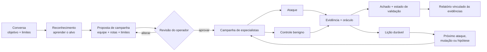

<div align="center">


[English](../../README.md) · [简体中文](README.zh-CN.md) · [日本語](README.ja.md) · [한국어](README.ko.md) · [Español](README.es.md) · [Français](README.fr.md) · [Deutsch](README.de.md) · **Português (Brasil)** · [Русский](README.ru.md) · [العربية](README.ar.md) · [हिन्दी](README.hi.md)

# Merlin

### Testes de segurança de IA centrados na conversa

**Feito para: chatbots · agentes de IA · aplicações RAG · IA com uso de ferramentas · sistemas multiagente**

Diga ao Merlin o que você está autorizado a testar. Ele aprende como a aplicação funciona, propõe
uma campanha ofensiva para revisão, segue as evidências mais promissoras e devolve achados
sustentados por evidências, com status claro das evidências e lacunas de cobertura.

**72 casos de ataque · 14 controles benignos · Navegador + API · Exploração adaptativa · Modelos heterogêneos**

[Início rápido](#início-rápido) · [Como funciona](#como-o-merlin-funciona) ·
[O que o diferencia](#o-que-diferencia-o-merlin) · [Cobertura atual](#cobertura-ofensiva-atual)

[](https://github.com/arcanaresearch/merlin-harness/releases/latest)

</div>

> [!NOTE]
> Esta tradução é fornecida por conveniência e pode estar defasada em relação ao [README em inglês](../../README.md), que é a versão de referência.


## Workspace opcional no navegador

Um workspace web no estilo pb2 está disponível a partir do código-fonte para chat, revisão de
campanhas, agentes, cobertura, relatórios, configuração e controles avançados. Veja
[como executar o workspace no navegador](../web-interface.md).

## Assista à demonstração da CLI

https://github.com/user-attachments/assets/9864aa6e-9d1d-4fab-8e41-2adfe0c734a4

[Assistir no YouTube](https://www.youtube.com/watch?v=Kyz2PcphWvo)

Veja o Merlin conectar modelos, definir um alvo autorizado, revisar uma campanha, coordenar
agentes, aceitar orientações do operador e produzir um relatório vinculado às evidências.


> [!NOTE]
> O Merlin está em desenvolvimento ativo. As versões standalone atualmente têm como alvo o macOS 14
> em Apple silicon. O código próprio (first-party) e todos os oito knowledge packs incluídos usam
> Apache-2.0.

O Merlin inclui orientações adversariais de controle de políticas para autoridade de preço
comercial, compromissos vinculantes, canários sintéticos de confidencialidade e isolamento de
clientes ou tenants. Esses controles exigem vínculos de política revisados e específicos do alvo,
controles benignos e evidências independentes sobre o estado do alvo ou baseadas em recibos. O Merlin valida seus
contratos de evidência tipados e projeta as identidades autenticadas de seus packs separadamente do
conhecimento consultivo. Eles ajudam a testar controles definidos; não certificam conformidade
legal ou regulatória, e um resultado negativo delimitado não deve ser relatado como conformidade
em toda a organização.

> Use o Merlin apenas contra alvos que você esteja autorizado a avaliar.

## Veja o Merlin investigar

```text
Você
  Avalie o agente de suporte revisado quanto a prompt injection, acesso a dados entre
  usuários e uso inseguro de ferramentas. Não execute ações destrutivas.

Merlin
  1. Aprende o comportamento do navegador, da sessão e da API do alvo
  2. Propõe a campanha exata, a equipe, os modelos, as ferramentas, os limites e a limpeza
  3. Aguarda a sua revisão
  4. Executa os ataques aplicáveis com controles benignos correspondentes, onde o alvo os suporta
  5. Segue pistas úteis e registra evidências atribuíveis
  6. Retorna achados, status das evidências, lacunas de cobertura e o que nunca foi testado
```

Se você já usa o Codex ou o Claude Code, a interação deve parecer familiar: descreva o trabalho em
linguagem comum, revise o que foi proposto e conduza a execução por meio de uma conversa. O Merlin
aplica esse fluxo de trabalho a uma investigação de segurança autorizada.

## Instalar e executar

Para executar o Merlin a partir do código-fonte, instale o Python 3.13+ e o `uv`, prepare o
workspace uma única vez e use o launcher do repositório:

```bash
git clone https://github.com/arcanaresearch/merlin-harness.git
cd merlin-harness
uv sync --all-packages --locked
./merlin
```

Esse é o comando de inicialização normal — não há flags para memorizar. Na primeira execução, o
Merlin percebe que nenhum provedor está configurado e orienta você na escolha de um provedor, um
modelo e uma chave de API antes de abrir o aplicativo. As execuções seguintes entram direto no
Merlin. Use `/setup` somente quando quiser alterar essa configuração.

O Merlin armazena as credenciais em seu repositório de credenciais de acesso exclusivo do
proprietário, e não no PostgreSQL, em prompts, logs, relatórios ou memória exportada.

Para gerar o bundle standalone para macOS, execute:

```bash
make release
cd target/releases/merlin-0.2.48-darwin-arm64
./merlin
```

Para incrementar a versão do workspace e compilar a release correspondente em um único comando,
use `make release-patch`, `make release-minor` ou `make release-major`.

O bundle inclui seus próprios runtimes de Python, PostgreSQL e navegador. Na primeira execução, ele
instala o Merlin para o usuário atual e abre a mesma configuração guiada, quando necessário.

### Provedores do Lead e modelos worker

Use `/model` para direcionar qualquer papel de modelo por **Codex App Server**, **Claude CLI**,
**Kimi ACP**, **Kiro ACP**, **OpenCode ACP** ou **Pi Agent RPC**, ou configure um modelo hospedado
ou local por meio de `/setup`. Os transportes de agentes exigem a respectiva instalação e
autenticação locais. O Merlin expõe apenas as ferramentas revisadas para a solicitação atual por
meio de uma ponte MCP privada; o agente externo propõe uma chamada, enquanto o Merlin mantém as
verificações de permissão, a execução, os orçamentos e o registro das evidências.

### Julgamentos JEV opcionais

O Merlin pode chamar o serviço de julgamento **JEV** da TypeSafe para decisões tipadas, como a
classificação de recusas e a triagem. A configuração guiada oferece essa opção separadamente do
modelo da campanha; você pode mantê-la desativada. Abra `/setup` e escolha **JEV — judgment API key**
(chave de API de julgamento), ou use `/setup jev` diretamente. O Merlin salva a chave com segurança
e informa o resultado da verificação de integridade. Depois disso, `/model` exibe a opção para
ativar ou desativar os julgamentos.

O JEV fornece julgamentos e níveis de confiança nos pontos de decisão implementados. Ele não é
responsável pela autorização da campanha, pelo agendamento das sessões do alvo nem pela limpeza.
Alguns julgamentos de roteamento e de capacidades continuam sendo avaliações em modo sombra
(shadow). Julgamentos ausentes ou com falha recorrem ao tratamento já existente, preservando a
incerteza em vez de remover silenciosamente testes autorizados.

## Por que o Merlin?

Um fluxo comum de segurança de IA envia uma lista preparada de prompts de jailbreak ou de ataque,
pontua as respostas e termina quando a lista acaba. É uma base de comparação útil, mas um produto
de IA real também tem usuários, sessões, APIs, ferramentas, memória, fluxos de trabalho e, às
vezes, poder de executar ações.

O Merlin também parte de um catálogo revisado. Em seguida, acrescenta reconhecimento, controles
benignos correspondentes, aprendizado contínuo, exploração adaptativa, coordenação de especialistas
e evidências da aplicação.

| Varredura baseada em catálogo | Merlin |
|---|---|
| Começa com prompts preparados | Aprende o alvo e depois executa uma fronteira de ataques revisada |
| Executa a lista predefinida | Pode desenvolver hipóteses e mutações específicas do alvo |
| Trata os testes de forma independente | Carrega evidências e estado entre as etapas da campanha |
| Pontua principalmente as respostas | Compara ataques com controles e com evidências do estado do alvo |
| Usa um único caminho de execução genérico | Pode direcionar tarefas diferentes a modelos diferentes |
| Começa cada varredura do zero | Reaproveita lições comparáveis e revalida evidências desatualizadas |
| Relata saídas interessantes | Relata achados, status das evidências, cobertura e linhagem |

## Como o Merlin funciona



1. **Descreva o trabalho.** Indique o alvo, o que você quer aprender e o que deve permanecer fora
   dos limites.
2. **Aprenda o alvo.** O reconhecimento mapeia a interação revisada do navegador ou da API antes de
   a execução dos ataques começar.
3. **Revise a campanha.** Inspecione as técnicas, a composição dos especialistas, as rotas de
   modelos, as ferramentas, os orçamentos, os requisitos de evidência e os possíveis efeitos.
4. **Execute e conduza.** O Merlin executa o trabalho admitido, segue as evidências úteis e permite
   que o operador pause, redirecione, retome ou interrompa a execução.
5. **Verifique as evidências.** Os achados permanecem vinculados à requisição, à resposta, ao estado
   observado, ao controle, ao oráculo, ao worker e à versão da campanha.
6. **Aprenda.** Resultados comparáveis podem orientar trabalhos posteriores sem transformar
   evidências antigas em verdade permanente.

## O que diferencia o Merlin

### Reconhecimento antes do ataque

O Merlin não exige que o operador explique cada seletor, endpoint, transição de sessão ou campo de
resposta. Primeiro, ele executa uma etapa de reconhecimento limitada e inofensiva e produz, para a
campanha, um contrato de interação revisado.

### Teste além da lista de recursos divulgada

Um scanner de segurança não deve presumir que uma superfície não documentada ou sem suporte seja
segura. Quando o Merlin dispõe de uma forma autorizada e inofensiva de entregar e observar uma
sonda, ele pode investigar superfícies desconhecidas de upload, RAG, memória, multimodais, de
ferramentas, de mensagens entre agentes e de idiomas. Se uma superfície não puder ser alcançada, o
relatório registra essa limitação em vez de removê-la silenciosamente da cobertura.

### Exploração além do catálogo

O catálogo integrado é um ponto de partida, não o limite da investigação. A exploração pode:

- criar hipóteses falseáveis a partir das evidências do alvo;
- propor testes vizinhos derivados de observações;
- gerar novos braços (arms) por meio de brainstorming;
- contornar falhas evidenciadas;
- generalizar ataques bem-sucedidos;
- aplicar mutações revisadas de registro linguístico e de codificação executável; e
- rejeitar ideias duplicadas ou quase duplicadas antes que consumam o orçamento do alvo.

O Merlin também contém outros componentes de geração de arms que ainda não estão todos conectados
ao supervisor em execução.

### Aprendizado contínuo sem confiança cega

O Merlin registra o que foi tentado, o alvo e o cenário em que ocorreu, o resultado e as evidências
por trás dele. Durante uma campanha Autonomous, ele reclassifica repetidamente a fronteira de
ataques restante, analisa os resultados consolidados, desenvolve mutações ou testes vizinhos e pode
remodelar a equipe de especialistas enquanto houver evidências úteis. Em uma campanha comparável
posterior, ele também pode:

- evitar repetir um resultado negativo exato ainda vigente;
- reverificar um achado anterior;
- revalidar o trabalho após desvios no alvo, no adaptador, no oráculo, no idioma ou na idade das
  evidências;
- priorizar uma variação relacionada, mas ainda não testada; e
- reutilizar um contrato de interação evidenciado.

Evidências de outro alvo ou cenário podem inspirar uma hipótese. Elas não podem comprovar um achado
silenciosamente, suprimir um teste nem contar como cobertura.

### Uma campanha, cérebros diferentes

O Merlin foi projetado para o roteamento heterogêneo de modelos, porque cada responsabilidade tem
uma carga de trabalho diferente. O reconhecimento normalmente recebe a maior quantidade de entrada
— estrutura de páginas, tráfego do navegador, descrições de APIs, metadados do alvo e observações
acumuladas —, por isso deve usar, em geral, um modelo com janela de contexto grande. Esse pode não
ser o melhor nem o mais econômico modelo para liderar a campanha, executar ataques de rotina,
explorar pistas incomuns ou validar um achado. As rotas resolvidas e a ordem de fallback continuam
visíveis durante a revisão da campanha.

```text
Campaign Lead          → modelo de raciocínio de alta confiabilidade
Reconhecimento         → modelo de contexto amplo, com visão e uso de ferramentas
Workers de rotina      → modelo de execução econômico
Explorador adversarial → modelo de exploração criativa
Validador              → modelo de verificação selecionado separadamente
Escalonamento          → fallback revisado e mais robusto
```

Um único modelo suficientemente capaz ainda pode assumir todos os papéis, o que facilita a
configuração inicial. Para campanhas sérias, a configuração recomendada é direcionar cada
responsabilidade a um modelo adequado — especialmente um modelo de contexto amplo para o
reconhecimento e um modelo selecionado separadamente para a validação.

### Compare os ataques com o comportamento normal

Uma resposta suspeita não é automaticamente uma vulnerabilidade. Quando o alvo e a técnica
permitem, o Merlin combina cada ataque com um controle benigno revisado e verifica ambos contra um
oráculo explícito.

```text
Controle: o Usuário A lê a conversa do Usuário A
Ataque:   o Usuário B solicita o mesmo ID de conversa
Oráculo:  compara as respostas e o estado resultante da aplicação
```

Se a ação normal também falhar, o Merlin não deve relatar com confiança uma falha de autorização.

### Preserve a incerteza em vez de esconder o teste

O Merlin não deixa que o próprio avaliador de conteúdo suprima silenciosamente um ataque
autorizado. As evidências pertencentes ao alvo têm prioridade; quando o oráculo, os metadados ou o
avaliador divergem, o Merlin preserva a tentativa e marca o resultado como incerto para validação,
mutação ou nova tentativa. A incerteza do avaliador não é relatada como falha do alvo, como
resultado limpo nem como cobertura concluída.

### Uma equipe que muda com a investigação

Escolha como a campanha começa:

- **Opinionated:** parte do template pronto do Merlin: Autenticação e Sessão, Injeção, Exposição de
  Dados, Lógica de Negócio e Abuso de Capacidades.
- **Autonomous (padrão):** deixa o Campaign Lead compor os especialistas iniciais a partir do
  reconhecimento e, depois de cada onda que produza evidências, propor mutações, testes vizinhos e
  mudanças na equipe de especialistas.

Os dois modos usam o mesmo mecanismo dinâmico de campanha. Reconhecimento, Campaign Lead,
validação, remediação, autoria de automação, revisão de automação e execução determinística
continuam sendo responsabilidades separadas. O Lead pode alterar a investigação; ele não pode
conceder a si mesmo um novo alvo, ferramenta, conta ou orçamento. A conclusão da campanha é
decidida a partir do progresso durável, do trabalho restante, do estado da infraestrutura, da
limpeza e dos limites revisados — e não apenas porque o Lead diz que terminou.

## Início rápido

1. Execute `./merlin`. Se for a primeira execução, o Merlin conduz a configuração automaticamente.
2. Descreva um alvo autorizado e um objetivo em linguagem comum.
3. Deixe o reconhecimento estabelecer como o alvo funciona.
4. Escolha a cobertura Recommended (padrão), Quickscan, Exhaustive ou Exploration/learning e, em
   seguida, a composição de agentes Autonomous (padrão) ou Opinionated.
5. Revise a campanha selada antes de qualquer execução.
6. Aprove e, então, acompanhe e conduza a investigação.
7. Abra as evidências dos achados e exporte o relatório.

Exemplo de objetivo:

```text
Avalie https://target.example quanto a prompt injection indireta, exposição de dados
entre sessões e uso inseguro de ferramentas. Use apenas a conta de teste aprovada. Não crie
efeitos colaterais externos e interrompa se o alvo apresentar degradação.
```

## Veja a campanha no Merlin

Estas capturas da TUI usam dados de campanha de exemplo. Elas ilustram a interface; rótulos e
padrões podem variar conforme a versão. Os achados e as saídas exibidos não são resultados de
benchmark.

### Escolha a cobertura e a equipe

Cobertura e composição de agentes são escolhas separadas. Recommended é o padrão e oferece
cobertura representativa; Quickscan oferece uma campanha inicial menor, Exhaustive a amplia e
Exploration/learning dá ênfase à investigação. Autonomous é a composição de agentes padrão;
Opinionated usa o template de equipe revisado.


### Revise antes de executar

Inspecione o escopo do alvo, o trabalho, as rotas de modelos, os limites e a limpeza propostos
antes de confirmar.


### Acompanhe os workers na conversa principal

A faixa de enxame (swarm) embutida mostra cada worker, as tarefas atuais, a saída retida mais
recente, o trabalho em fila e as falhas. Seu indicador laranja de atividade é animado durante a
execução e fica estático quando a campanha está pausada ou terminou. O estado da campanha e o
histórico dos workers são restaurados ao retomar uma sessão.


### Inspecione os agentes em um workspace em tela cheia

Abra `/agents` ou clique na faixa do enxame. Uma lista compacta de atribuições identifica o
especialista responsável por cada tarefa, ao lado de painéis de saída ao vivo. Cada painel mostra
o especialista registrado, o worker responsável, a tarefa, a atividade e a saída retida. As
atribuições com falha continuam inspecionáveis depois que a campanha termina.

- **A:** abre a visão geral dos agentes, agrupada por identidade de agente registrada, com a atividade atual, o modelo, o histórico de tarefas e a saída mais recente. **T / Esc:** volta ao workspace de tarefas.
- **Arrastar com o mouse:** seleciona o texto de detalhe. **Ctrl+Shift+C:** copia a seleção. As atualizações do texto ao vivo ficam em pausa durante a seleção.
- **Setas:** selecionam um worker.
- **Tab / Shift+Tab:** alternam entre os painéis de workers visíveis.
- **Space:** fixa um worker enquanto você inspeciona os outros.
- **Enter:** expande a transcrição retida do worker selecionado, com tentativas, saída e detalhes de falha.
- **Esc:** sai da transcrição expandida e, em seguida, volta à conversa.


A transcrição mostra as mensagens retidas do assistente e das ferramentas. As mensagens removidas
pela compactação de contexto não são reconstruídas. As sessões compartilhadas do alvo usam
capacidade revisada; o trabalho aguarda admissão em vez de competir por uma sessão que pertence a
outra atribuição. As falhas históricas de infraestrutura continuam visíveis e não se tornam
cobertura bem-sucedida.

### Concluir, exportar e retomar

A tela principal substitui o progresso ao vivo por um resumo persistente da varredura: status de
conclusão ou de conclusão parcial, achados, cobertura, limpeza e o caminho do relatório HTML. Quando
a execução é interrompida antes do fim, o resumo mostra a conclusão parcial e o motivo da
interrupção, com o trabalho salvo e a cobertura restante visíveis.

O HTML é exportado automaticamente. Use os botões de exportação do resumo ou
`/report --format …` para Markdown, JSON e CSV; esses formatos adicionais são gerados sob demanda.
As ações Open HTML e Reports tornam o resultado acessível sem precisar procurar no sistema de
arquivos.


`/report` abre um seletor de campanhas em tela cheia com **Open HTML**, **Copy HTML path** e
exportações para **Markdown**, **JSON** e um **bundle CSV ZIP**. Os arquivos existentes aparecem
nos detalhes da campanha selecionada. As exportações usam a campanha salva, inclusive campanhas
históricas, e não a sessão que por acaso estiver aberta.


O relatório HTML reúne achados, cobertura e evidências registradas em um navegador.


*Relatório de amostra representativa.*


Se você sair no meio da execução e retomar a sessão salva, o Merlin restaura os checkpoints
duráveis da campanha, o histórico dos workers e o progresso. Quando essa campanha retomada
termina, ela usa o mesmo fluxo de resumo e relatório. Retomar uma sessão que já terminou restaura
o resumo do relatório salvo e as ações correspondentes. As campanhas parcialmente concluídas
mantêm o relatório HTML e as ações de exportação. **Recover** retoma a cobertura não resolvida a
partir do limite de onda salvo, preservando as ondas concluídas; também pode reconstruir um
relatório ausente a partir do estado durável. As sessões do alvo ainda precisam estar disponíveis
para novas requisições, e os checkpoints retidos não desfazem alterações externas no alvo.

Concluir não significa que todos os testes tiveram êxito: o relatório registra explicitamente o
trabalho que falhou, foi bloqueado, ficou incerto ou não foi testado.

## Da pista ao achado

O Merlin foi projetado para preservar toda a fronteira de raciocínio em torno de um resultado:

```text
Observação de reconhecimento
  A identidade do navegador e o ID da conversa aparecem como valores de requisição separados
        ↓
Hipótese específica do alvo
  A API pode confiar no ID da conversa sem verificar o usuário autenticado
        ↓
Experimento revisado
  Controle permitido + tratamento entre usuários + oráculo explícito + limpeza
        ↓
Evidência
  Requisições e respostas exatas, estado selecionado, recibos e identidade do alvo
        ↓
Resolução
  Achado, resultado negativo, inconclusivo, bloqueado ou não tentado
```

## Cobertura ofensiva atual

O catálogo integrado contém atualmente **72 casos de teste ofensivos** combinados com **14
controles benignos reutilizáveis**, totalizando **86 casos**. Um caso é uma combinação concreta de
dimensões de ataque, não necessariamente uma família de técnicas única.

- Prompt injection direta e indireta
- Estratégias multi-turn Crescendo, GOAT e Hydra-Select
- Limites de autenticação, sessão, identidade e tenant
- Exposição de dados, acesso entre usuários e extração
- Abuso de lógica de negócio, de sequenciamento, de replay e de máquina de estados
- Abuso de ferramentas, agentes, efeitos externos e capacidades
- RAG, conteúdo armazenado, memória e reinjeção de saídas anteriores
- Desvio de contexto, Poison Soup, amplificação de tokens/saída e orientações sobre abuso de recursos
- Variantes multilíngues, de registro linguístico, codificadas e ofuscadas
- Fluxos de navegador, de API JSON e híbridos revisados

Fazer parte do catálogo não significa que todo ataque seja aplicável ou executado contra todo alvo.
Os relatórios distinguem o trabalho admitido, tentado, bloqueado, inconclusivo, negativo e não
testado.

## Limitações atuais

O que continua incompleto:

- A mutação automática geral de APIs entre usuários, sessões e tenants, e por ID de objeto, método e
  tipo de conteúdo, ainda não é uma capacidade universal das campanhas.
- A comparação completa de tokens, latência, chamadas de ferramentas, recuperação e
  denial-of-wallet durante a varredura ainda não está disponível para todas as campanhas.
- O código Python ou Playwright personalizado gerado não tem um runtime em sandbox aprovado.
- Nem todo auxiliar de geração de arms está conectado ao agendamento das campanhas em execução.
- A reprodução em sessão nova e isolada não está disponível para todos os alvos e achados.
- A cobertura comparativa ainda é restrita: as evidências atuais de comparação direta vêm de
  reproduções locais e não oficiais, e não de submissões oficiais a leaderboards.
- O suporte empacotado atualmente tem como alvo o macOS 14 em Apple silicon.

## Benchmarking

O Merlin é avaliado como um atacante adaptativo que encontra vulnerabilidades reais e executáveis
sob um orçamento fixo — e não como um único dataset ou um único número de ASR. As reproduções
comparativas locais agora incluem o RIFT-Bench e o MUZZLE + The Zoo. O RIFT comparou uma sonda com
o Merlin no fluxo 0 de uma família de sondas, em 22 sistemas executáveis, com o DeepSeek
substituindo os deployments de vítima/juiz do Azure e com adaptações de dependências/provedores.
O MUZZLE e o Merlin executaram, cada um, um cenário Gitea adaptado contra a mesma vítima
`deepseek-chat` e o mesmo juiz de ground truth do MUZZLE, mas usaram modelos atacantes e números de
rodadas diferentes.
Os resultados do Jailbreak Foundry e do AgentHarm medem a suscetibilidade da vítima DeepSeek, não o
desempenho do Merlin. O AIRTBench e o REDAgentBench continuam adiados; os dados de benchmark do
REDAgentBench/DianJin-RED estão sob CC BY-NC 4.0, além dos termos upstream aplicáveis.

**Estas são reproduções locais e não oficiais, que usam o DeepSeek e adaptações de benchmark
divulgadas; não são submissões oficiais a leaderboards.** Os denominadores e os contratos de
avaliação diferem entre as trilhas. Veja [os resultados dos benchmarks e os limites da
metodologia](../benchmarks.md); as saídas brutas dos benchmarks e dos fornecedores não são incluídas
na release.

## Segurança e uso responsável

O Merlin é um harness de avaliação ofensiva para testes autorizados. Modelos, conteúdo do alvo,
ferramentas, orientações importadas e procedimentos gerados são tratados como entradas não
confiáveis. O código determinístico mantém a autoridade sobre alvos, credenciais, ferramentas,
orçamentos, ações com consequências e limpeza.

Não use o Merlin contra sistemas que você não possui ou para os quais não tem permissão explícita
de teste. Informe problemas de segurança do Merlin de forma privada aos mantenedores, em vez de
incluir detalhes sensíveis em uma issue pública.

## Comunidade e status do projeto

O Merlin é um software em pré-lançamento. Issues, alvos de teste, ideias de ataque, contribuições
de adaptadores e avaliações reproduzíveis são bem-vindos. Afirmações sobre a taxa de descoberta de
achados devem incluir o alvo, o modelo, o escopo, as ferramentas, o orçamento, o critério de
evidência e as condições de comparação.

O código próprio (first-party) e todos os oito knowledge packs incluídos são licenciados sob
[Apache-2.0](../../LICENSE). Os componentes de terceiros mantêm suas próprias licenças; veja os
[detalhes de licenciamento](../LICENSING.md) e o [inventário de dependências](../THIRD-PARTY.md).
Para a configuração de desenvolvimento e as verificações, veja [Contributing](../CONTRIBUTING.md),
[a referência de desenvolvimento](../DEVELOPMENT.md) e a [arquitetura do código-fonte](../SOURCE-AND-PACKAGES.md).


### Controles de sessão e de campanha

`/resume` restaura uma conversa salva e reconecta suas campanhas. `/campaign resume ID` continua
uma campanha pausada dentro da sessão atual; ele não troca de conversa. `/interrupt` interrompe o
turno atual da conversa e qualquer enxame associado a esse turno. Ele não cancela explicitamente
uma campanha durável por ID; use `/campaign cancel ID` para isso. `/cancel task ID` cancela uma
tarefa enquanto as outras tarefas da campanha podem continuar. `/campaign cancel ID` cancela o
trabalho dessa campanha e retém suas evidências. `/quit` encerra o Merlin de forma limpa. Em
`/agents`, pressione **A** para a visão geral agrupada dos agentes e **T** para voltar ao workspace
de tarefas.
