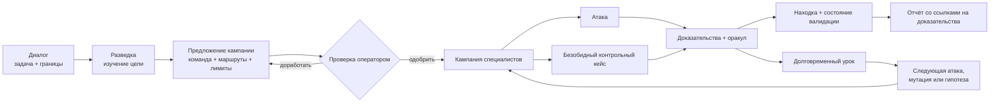

<div align="center">


[English](../../README.md) · [简体中文](README.zh-CN.md) · [日本語](README.ja.md) · [한국어](README.ko.md) · [Español](README.es.md) · [Français](README.fr.md) · [Deutsch](README.de.md) · [Português (Brasil)](README.pt-BR.md) · **Русский** · [العربية](README.ar.md) · [हिन्दी](README.hi.md)

# Merlin

### Тестирование безопасности ИИ через диалог

**Создан для: чат-ботов · ИИ-агентов · RAG-приложений · ИИ с инструментами · мультиагентных систем**

Скажите Merlin, что вам разрешено тестировать. Он изучает, как устроено приложение, предлагает на
проверку наступательную кампанию, идёт по перспективным свидетельствам и возвращает находки,
подкреплённые доказательствами, с понятным статусом доказательств и пробелами в покрытии.

**72 атакующих кейса · 14 безобидных контрольных кейсов · браузер + API · адаптивное исследование · разнородные модели**

[Быстрый старт](#быстрый-старт) · [Как это работает](#как-работает-merlin) ·
[Чем отличается Merlin](#чем-отличается-merlin) · [Текущее покрытие](#текущее-атакующее-покрытие)

[](https://github.com/arcanaresearch/merlin-harness/releases/latest)

</div>

> [!NOTE]
> Этот перевод предоставлен для удобства и может отставать от [English README](../../README.md), который является авторитетным источником.


## Необязательное браузерное рабочее пространство

Веб-рабочее пространство в стиле pb2 доступно из исходного кода для чата, проверки кампаний,
агентов, покрытия, отчётов, настройки и расширенных параметров. См. [запуск браузерного рабочего пространства](../web-interface.md).

## Смотрите обзор CLI

https://github.com/user-attachments/assets/9864aa6e-9d1d-4fab-8e41-2adfe0c734a4

[Смотреть на YouTube](https://www.youtube.com/watch?v=Kyz2PcphWvo)

Посмотрите, как Merlin подключает модели, определяет авторизованную цель, проходит проверку
кампании, координирует агентов, принимает указания оператора и формирует отчёт со ссылками на доказательства.


> [!NOTE]
> Merlin активно разрабатывается. Автономные релизы в настоящее время ориентированы на macOS 14 на
> Apple silicon. Собственный код и все восемь входящих в поставку пакетов знаний распространяются по лицензии Apache-2.0.

Merlin включает руководство по состязательному тестированию контроля политик: коммерческие
полномочия на установление цен, обязывающие обещания, синтетические канарейки конфиденциальности
и изоляция клиентов или арендаторов. Для этих проверок требуются проверенные привязки политик
под конкретную цель, безобидные контрольные кейсы и независимые свидетельства состояния цели или
квитанции. Merlin проверяет их типизированные контракты доказательств и показывает аутентифицированные
идентичности их пакетов отдельно от справочных знаний. Они помогают проверять заданные меры контроля;
они не подтверждают юридическое или нормативное соответствие, а ограниченный отрицательный результат
нельзя выдавать за соответствие всей организации.

> Используйте Merlin только против целей, оценку которых вы уполномочены проводить.

## Как Merlin ведёт расследование

```text
Вы
  Оцените проверенного агента поддержки на prompt injection, доступ к данным
  других пользователей и небезопасное использование инструментов.
  Не выполняйте деструктивных действий.

Merlin
  1. Изучает поведение браузера, сессий и API цели
  2. Предлагает точную кампанию, команду, модели, инструменты, лимиты и очистку
  3. Ждёт вашей проверки
  4. Запускает применимые атаки с парными безобидными контрольными кейсами, где цель их поддерживает
  5. Идёт по полезным подсказкам и записывает атрибутируемые доказательства
  6. Возвращает находки, статус доказательств, пробелы в покрытии и то, что так и не было протестировано
```

Если вы уже пользуетесь Codex или Claude Code, взаимодействие покажется знакомым: опишите задачу
обычным языком, проверьте предложенную работу и направляйте её в диалоге. Merlin применяет
этот подход к авторизованному исследованию безопасности.

## Установка и запуск

Чтобы запустить Merlin из исходного кода, установите Python 3.13+ и `uv`, один раз подготовьте
рабочее пространство, затем воспользуйтесь лаунчером из репозитория:

```bash
git clone https://github.com/arcanaresearch/merlin-harness.git
cd merlin-harness
uv sync --all-packages --locked
./merlin
```

Это обычная команда запуска — никаких флагов запоминать не нужно. При первом запуске Merlin
замечает, что провайдер не настроен, и проводит вас через выбор провайдера, модели и ключа API
до открытия приложения. Последующие запуски сразу открывают Merlin. Используйте `/setup`, только
когда хотите изменить эту конфигурацию.

Merlin хранит учётные данные в собственном хранилище, доступном только владельцу, а не в PostgreSQL,
промптах, логах, отчётах или экспортируемой памяти.

Чтобы собрать автономный пакет для macOS, выполните:

```bash
make release
cd target/releases/merlin-0.2.48-darwin-arm64
./merlin
```

Чтобы увеличить версию рабочего пространства и собрать соответствующий релиз одной командой,
используйте `make release-patch`, `make release-minor` или `make release-major`.

Пакет включает собственные среды выполнения Python, PostgreSQL и браузера. При первом запуске он
устанавливает Merlin для текущего пользователя и при необходимости открывает ту же пошаговую настройку.

### Провайдеры для роли Lead и модели исполнителей

Используйте `/model`, чтобы направить любую роль модели через **Codex App Server**, **Claude CLI**,
**Kimi ACP**, **Kiro ACP**, **OpenCode ACP** или **Pi Agent RPC**, либо настройте размещённую или
локальную модель через `/setup`. Транспорты агентов требуют соответствующей локальной установки и
аутентификации. Через закрытый мост MCP Merlin предоставляет только проверенные инструменты для
текущего запроса; внешний агент предлагает вызов, а проверку разрешений, выполнение, бюджеты и
запись доказательств Merlin оставляет за собой.

### Необязательные оценки JEV

Merlin может обращаться к сервису оценок **JEV** от TypeSafe для типизированных решений, например
для оценки отказов и триажа. Пошаговая настройка предлагает это отдельно от модели кампании; это
можно оставить выключенным. Откройте `/setup` и выберите **JEV — judgment API key** (ключ API для
оценок) или сразу используйте `/setup jev`. Merlin надёжно сохраняет ключ и сообщает результат
проверки работоспособности. После этого переключатель оценок доступен в `/model`.

JEV предоставляет оценки и уровень уверенности в реализованных точках принятия решений. Он не
отвечает за авторизацию кампании, планирование сессий цели или очистку. Некоторые оценки
маршрутизации и возможностей по-прежнему остаются теневыми проверками. Отсутствующие или неудавшиеся
оценки заменяются существующей обработкой, при этом неопределённость сохраняется, а авторизованные
тесты не удаляются молча.

## Зачем нужен Merlin

Типичный процесс проверки безопасности ИИ отправляет заранее подготовленный список джейлбрейк-
или атакующих промптов, оценивает ответы и останавливается, когда список закончился. Это полезная
базовая линия, но у реального ИИ-продукта есть также пользователи, сессии, API, инструменты, память,
рабочие процессы, а иногда и возможность совершать действия.

Merlin тоже начинает с проверенного каталога. Затем он добавляет разведку, парные безобидные
контрольные кейсы, непрерывное обучение, адаптивное исследование, координацию специалистов и свидетельства
на уровне приложения.

| Сканирование по каталогу | Merlin |
|---|---|
| Начинает с заранее подготовленных промптов | Изучает цель, затем запускает проверенный фронт атак |
| Выполняет заранее заданный список | Может выдвигать гипотезы и мутации, специфичные для цели |
| Рассматривает тесты независимо | Переносит доказательства и состояние между шагами кампании |
| В основном оценивает ответы | Сопоставляет атаки с контрольными кейсами и свидетельствами состояния цели |
| Использует один общий путь выполнения | Может направлять разные задачи на разные модели |
| Каждое сканирование начинает с нуля | Повторно использует сопоставимые уроки и перепроверяет устаревшие доказательства |
| Сообщает об интересном выводе | Сообщает находки, статус доказательств, покрытие и происхождение |

## Как работает Merlin



1. **Опишите задачу.** Назовите цель, то, что вы хотите узнать, и то, что должно остаться под запретом.
2. **Изучите цель.** Разведка описывает проверенное взаимодействие через браузер или API до начала
   выполнения атак.
3. **Проверьте кампанию.** Изучите техники, состав специалистов, маршруты моделей, инструменты,
   бюджеты, требования к доказательствам и возможные последствия.
4. **Запускайте и направляйте.** Merlin выполняет допущенную работу, идёт по полезным свидетельствам
   и позволяет оператору приостановить, перенаправить, возобновить или остановить её.
5. **Проверьте доказательства.** Находки остаются связанными с запросом, ответом, наблюдаемым
   состоянием, контрольным кейсом, оракулом, исполнителем и версией кампании.
6. **Учитесь.** Сопоставимые результаты могут влиять на последующую работу, не превращая старые
   доказательства в вечную истину.

## Чем отличается Merlin

### Разведка перед атакой

Merlin не требует от оператора объяснять каждый селектор, эндпоинт, переход между состояниями сессии
или поле ответа. Сначала он выполняет ограниченный безвредный проход разведки и формирует для
кампании проверенный контракт взаимодействия.

### Тестирование за пределами заявленного набора функций

Сканер безопасности не должен считать недокументированную или неподдерживаемую поверхность безопасной.
Если у Merlin есть авторизованный безвредный способ доставить и наблюдать зонд, он может исследовать
неизвестные поверхности загрузки файлов, RAG, памяти, мультимодальности, инструментов, сообщений
между агентами и языков. Если поверхность недостижима, отчёт фиксирует это ограничение, а не
молча убирает её из покрытия.

### Исследование за пределами каталога

Встроенный каталог — это отправная точка, а не граница расследования. Исследование может:

- создавать проверяемые на опровержимость гипотезы на основе свидетельств цели;
- предлагать соседние тесты, выведенные из наблюдений;
- порождать новые arms (варианты атак) с помощью мозгового штурма;
- обходить подтверждённые сбои;
- обобщать успешные атаки;
- применять проверенные мутации языкового регистра и исполняемого кодирования; и
- отклонять дубликаты и почти-дубликаты идей до того, как они израсходуют бюджет цели.

Merlin также содержит дополнительные компоненты для порождения arms, не все из которых пока
подключены к действующему супервизору.

### Непрерывное обучение без слепого доверия

Merlin записывает, что было предпринято, на какой цели и в каком сценарии, каков был исход и какие
доказательства за ним стоят. В ходе кампании Autonomous он многократно ранжирует оставшийся фронт
атак, анализирует зафиксированные результаты, разрабатывает мутации или соседние тесты и может
перестраивать команду специалистов, пока продолжают появляться полезные свидетельства. В последующей
сопоставимой кампании он также может:

- не повторять всё ещё актуальный точный отрицательный результат;
- перепроверить прежнюю находку;
- повторно валидировать работу после дрейфа цели, адаптера, оракула, языка или возраста доказательств;
- отдать приоритет родственному, но ещё не протестированному варианту; и
- повторно использовать подтверждённый доказательствами контракт взаимодействия.

Свидетельства с другой цели или из другого сценария могут подсказать гипотезу. Они не могут молча
доказать находку, подавить тест или засчитываться как покрытие.

### Одна кампания, разные «мозги»

Merlin рассчитан на разнородную маршрутизацию моделей, потому что у каждой обязанности своя нагрузка.
Разведка обычно получает больше всего входных данных — структуру страниц, браузерный трафик,
описания API, метаданные цели и накопленные наблюдения, — поэтому для неё, как правило, следует
использовать модель с большим контекстным окном. Это может быть не лучшая и не самая экономичная
модель для руководства кампанией, рутинных атак, исследования необычных подсказок или валидации
находки. Определённые маршруты и порядок резервных вариантов остаются видимыми при проверке кампании.

```text
Campaign Lead         → модель рассуждений с высокой надёжностью
Reconnaissance        → модель с большим контекстом и поддержкой зрения и инструментов
Routine workers       → экономичная модель выполнения
Adversarial explorer  → модель творческого исследования
Validator             → отдельно выбранная модель проверки
Escalation            → более сильный проверенный резерв
```

Одна достаточно способная модель по-прежнему может выполнять все роли, что упрощает первоначальную
настройку. Для серьёзных кампаний рекомендуется направлять каждую обязанность на подходящую
модель — особенно модель с большим контекстом для разведки и отдельно выбранную модель для валидации.

### Сравнение атак с нормальным поведением

Подозрительный ответ — ещё не обязательно уязвимость. Там, где цель и техника это поддерживают,
Merlin сопоставляет атаку с проверенным безобидным контрольным кейсом и проверяет оба по явному оракулу.

```text
Контроль: Пользователь A читает беседу пользователя A
Атака:    Пользователь B запрашивает тот же идентификатор беседы
Оракул:   Сравнить ответы и итоговое состояние приложения
```

Если не срабатывает и обычное действие, Merlin не должен уверенно сообщать о дефекте авторизации.

### Сохранять неопределённость, а не скрывать тест

Merlin не позволяет собственному оценщику содержимого молча подавлять авторизованную атаку.
Свидетельства, принадлежащие цели, имеют приоритет; когда оракул, метаданные или оценщик расходятся,
Merlin сохраняет попытку и помечает результат как неопределённый для валидации, мутации или повтора.
Неопределённость оценщика не выдаётся за сбой цели, чистый результат или завершённое покрытие.

### Команда, которая меняется вместе с расследованием

Выберите, как начнётся кампания:

- **Opinionated:** начать с готового шаблона Merlin: Authentication and Session, Injection, Data
  Exposure, Business Logic и Capability Abuse.
- **Autonomous (по умолчанию):** позволить Campaign Lead составить начальных специалистов по итогам
  разведки, а затем предлагать мутации, соседние тесты и изменения состава специалистов после каждой
  волны, давшей доказательства.

Оба режима используют один и тот же движок динамических кампаний. Разведка, Campaign Lead, валидация,
устранение, авторство автоматизации, проверка автоматизации и детерминированное выполнение остаются
отдельными обязанностями. Lead может менять ход расследования, но не может выдать себе новую цель,
инструмент, учётную запись или бюджет. Завершение кампании определяется по долговременному прогрессу,
оставшейся работе, состоянию инфраструктуры, очистке и проверенным лимитам, а не только потому, что
Lead сообщил о завершении.

## Быстрый старт

1. Запустите `./merlin`. Если это первый запуск, Merlin автоматически проведёт вас через настройку.
2. Опишите авторизованную цель и задачу обычным языком.
3. Дайте разведке выяснить, как работает цель.
4. Выберите покрытие Recommended (по умолчанию), Quickscan, Exhaustive или Exploration/learning,
   затем состав агентов Autonomous (по умолчанию) или Opinionated.
5. Проверьте запечатанную кампанию до начала какого-либо выполнения.
6. Одобрите, затем наблюдайте за расследованием и направляйте его.
7. Откройте доказательства находки и экспортируйте отчёт.

Пример задачи:

```text
Оцените https://target.example на косвенную prompt injection, раскрытие данных
между сессиями и небезопасное использование инструментов. Используйте только
утверждённую тестовую учётную запись. Не создавайте внешних побочных эффектов
и остановитесь, если цель покажет признаки деградации.
```

## Кампания в Merlin

Эти снимки TUI используют демонстрационные данные кампании. Они иллюстрируют интерфейс; подписи и
значения по умолчанию могут отличаться в зависимости от версии. Показанные находки и результаты
не являются результатами бенчмарков.

### Выбор покрытия и команды

Покрытие и состав агентов — это отдельные выборы. Recommended выбран по умолчанию и обеспечивает
репрезентативное покрытие; Quickscan предлагает меньшую начальную кампанию, Exhaustive расширяет её,
а Exploration/learning делает упор на исследование. Autonomous — состав агентов по умолчанию;
Opinionated использует проверенный шаблон команды.


### Проверка перед выполнением

Перед подтверждением изучите предлагаемую область цели, работу, маршруты моделей, лимиты и очистку.


### Наблюдение за исполнителями в основном диалоге

Встроенная полоса роя показывает отдельных исполнителей, текущие задачи, последний сохранённый вывод,
задачи в очереди и сбои. Её оранжевый индикатор работы анимируется во время выполнения и становится
статичным при паузе или завершении. При возобновлении сессии восстанавливаются состояние кампании и
история исполнителей.


### Просмотр агентов в полноэкранном рабочем пространстве

Откройте `/agents` или щёлкните полосу роя. Компактный список назначений показывает, какой специалист
выполняет каждую задачу, рядом с панелями живого вывода;
каждая панель показывает записанного специалиста, владельца-исполнителя, задачу, активность и сохранённый вывод.
Неудавшиеся назначения остаются доступными для изучения после завершения кампании.

- **A:** открыть обзор агентов, сгруппированный по записанной идентичности агента, с текущей активностью, моделью, историей задач и последним выводом. **T / Esc:** вернуться в рабочее пространство задач.
- **Перетаскивание мышью:** выделить текст подробностей. **Ctrl+Shift+C:** скопировать выделенное. Обновление живого текста приостанавливается на время выделения.
- **Стрелки:** выбрать исполнителя.
- **Tab / Shift+Tab:** переходить между видимыми панелями исполнителей.
- **Space:** закрепить исполнителя, пока вы изучаете остальных.
- **Enter:** развернуть сохранённую расшифровку выбранного исполнителя, попытки, вывод и сведения о сбоях.
- **Esc:** выйти из развёрнутой расшифровки, затем вернуться в диалог.


Расшифровка показывает сохранённые сообщения ассистента и инструментов. Сообщения, удалённые при
сжатии контекста, не восстанавливаются. Общие сессии цели используют проверенную ёмкость; работа
ожидает допуска, а не конкурирует за сессию, принадлежащую другому назначению. Исторические сбои
инфраструктуры остаются видимыми и не становятся успешным покрытием.

### Завершение, экспорт и возобновление

Главный экран заменяет живой прогресс постоянной сводкой сканирования: статус завершения или
частичного завершения, находки, покрытие, очистка и путь к HTML-отчёту. Если выполнение остановилось
раньше времени, сводка показывает частичное завершение и причину остановки, при этом видны
сохранённая работа и оставшееся покрытие.

HTML экспортируется автоматически. Используйте кнопки экспорта в сводке или `/report --format …`
для Markdown, JSON и CSV; эти дополнительные форматы создаются по запросу. Действия Open HTML и
Reports делают результат доступным без поиска по файловой системе.


`/report` открывает полноэкранный выбор кампании с действиями **Open HTML**, **Copy HTML path**
и экспортом в **Markdown**, **JSON** и **CSV ZIP bundle**. Существующие файлы отображаются в
сведениях о выбранной кампании. Экспорт использует именно эту сохранённую кампанию, включая
исторические, а не ту сессию, которая оказалась открытой.


HTML-отчёт объединяет находки, покрытие и записанные доказательства в браузере.


*Репрезентативный образец отчёта.*


Если вы выйдете посередине и возобновите сохранённую сессию, Merlin восстановит долговременные
контрольные точки кампании, историю исполнителей и прогресс. Когда возобновлённая кампания
завершится, используются та же сводка и тот же процесс отчёта. Возобновление уже завершённой
сессии восстанавливает сохранённую сводку отчёта и действия. Частично завершённые кампании
сохраняют свой HTML-отчёт и действия экспорта. **Recover** возобновляет нерешённое покрытие с
сохранённой границы волны, сохраняя завершённые волны; он также может заново построить
отсутствующий отчёт из долговременного состояния. Сессии цели по-прежнему должны быть доступны для
новых запросов, а сохранённые контрольные точки не отменяют внешних изменений цели.

Завершение не означает, что каждый тест прошёл успешно: отчёт явно фиксирует неудавшуюся,
заблокированную, неопределённую и нетестированную работу.

## От подсказки к находке

Merlin задуман так, чтобы сохранять всю границу рассуждения вокруг результата:

```text
Наблюдение разведки
  Идентичность браузера и ID беседы выступают как отдельные значения запроса
        ↓
Гипотеза, специфичная для цели
  API может доверять ID беседы, не проверяя вошедшего пользователя
        ↓
Проверенный эксперимент
  Разрешённый контроль + межпользовательское воздействие + явный оракул + очистка
        ↓
Доказательства
  Точные запросы, ответы, выбранное состояние, квитанции и идентичность цели
        ↓
Исход
  Находка, отрицательный результат, без однозначного вывода, заблокировано или не предпринималось
```

## Текущее атакующее покрытие

Встроенный каталог в настоящее время содержит **72 наступательных тестовых кейса**, парных с **14
многократно используемыми безобидными контрольными кейсами**, итого **86 кейсов**. Кейс — это одна
конкретная комбинация измерений атаки, а не обязательно уникальное семейство техник.

- Прямая и косвенная prompt injection
- Многоходовые стратегии Crescendo, GOAT и Hydra-Select
- Границы аутентификации, сессий, идентичности и арендаторов
- Раскрытие данных, межпользовательский доступ и извлечение
- Злоупотребление бизнес-логикой, последовательностью операций, повтором и конечными автоматами
- Злоупотребление инструментами, агентами, внешними эффектами и возможностями
- RAG, сохранённое содержимое, память и повторное внедрение прежнего вывода
- Отвлечение контекста, Poison Soup, усиление токенов/вывода и руководство по злоупотреблению ресурсами
- Многоязычные, с изменённым языковым регистром, закодированные и обфусцированные варианты
- Браузерные, JSON API и проверенные гибридные сценарии

Вхождение в каталог не означает, что каждая атака применима или выполняется против каждой цели.
Отчёты различают допущенную, предпринятую, заблокированную, не давшую однозначного вывода, отрицательную и
нетестированную работу.

## Текущие ограничения

Что остаётся незавершённым:

- Общая автоматическая мутация API между пользователями, сессиями, арендаторами, ID объектов,
  методами и типами содержимого пока не является универсальной возможностью кампании.
- Полное сравнение токенов, задержек, вызовов инструментов, восстановления и denial-of-wallet на
  этапе сканирования пока доступно не для каждой кампании.
- Для сгенерированного пользовательского кода на Python или Playwright нет одобренной изолированной
  среды выполнения.
- Не каждый помощник по порождению arms подключён к действующему планированию кампаний.
- Воспроизведение в свежей изолированной сессии доступно не для каждой цели и находки.
- Сравнительное покрытие по-прежнему узкое: текущие данные прямого сопоставления получены из
  локальных неофициальных воспроизведений, а не из официальных заявок в рейтинги.
- Пакетированная поддержка в настоящее время ориентирована на macOS 14 на Apple silicon.

## Бенчмаркинг

Merlin оценивается как адаптивный атакующий, который находит реальные, исполняемые уязвимости при
фиксированном бюджете, — а не по одному набору данных или одному показателю ASR. Локальные
сравнительные воспроизведения теперь включают RIFT-Bench и MUZZLE + The Zoo. В RIFT один зонд был
сопоставлен с Merlin на flow 0 одного семейства зондов в 22 запускаемых системах; при этом DeepSeek
заменял развёртывания жертвы и судьи на Azure, а также применялись адаптации зависимостей и
провайдеров. MUZZLE и Merlin выполнили по одному адаптированному сценарию Gitea против одной и той
же жертвы `deepseek-chat` и одного и того же эталонного судьи MUZZLE, но использовали разные модели
атакующего и число раундов.
Результаты Jailbreak Foundry и AgentHarm измеряют восприимчивость жертвы DeepSeek, а не
результативность Merlin. AIRTBench и REDAgentBench отложены; данные бенчмарка
REDAgentBench/DianJin-RED распространяются по лицензии CC BY-NC 4.0 плюс применимые условия
исходного проекта.

**Это локальные неофициальные воспроизведения с использованием DeepSeek и раскрытых адаптаций
бенчмарков, а не официальные заявки в рейтинги.** Знаменатели и контракты оценки различаются
по трекам. См. [результаты бенчмарков и границы методологии](../benchmarks.md); сырые выходные данные
бенчмарков и вендоров в релиз не включаются.

## Безопасность и ответственное использование

Merlin — это наступательный инструментарий оценки для авторизованного тестирования. Модели,
содержимое цели, инструменты, импортированные рекомендации и сгенерированные процедуры считаются
недоверенными входными данными. Детерминированный код сохраняет власть над целями, учётными
данными, инструментами, бюджетами, значимыми действиями и очисткой.

Не используйте Merlin против систем, которыми вы не владеете или на тестирование которых у вас нет явного
разрешения. О проблемах безопасности Merlin сообщайте мейнтейнерам в частном порядке, а не
включайте чувствительные подробности в публичный issue.

## Сообщество и состояние проекта

Merlin — это программное обеспечение до релиза. Приветствуются issues, тестовые цели, идеи атак,
вклад в адаптеры и воспроизводимые оценки. Утверждения об результативности поиска находок должны
включать цель, модель, область, инструменты, бюджет, стандарт доказательств и условия сравнения.

Собственный код и все восемь входящих в поставку пакетов знаний лицензированы по
[Apache-2.0](../../LICENSE). Сторонние компоненты сохраняют собственные лицензии; см.
[сведения о лицензировании](../LICENSING.md) и [перечень зависимостей](../THIRD-PARTY.md).
О настройке среды разработки и проверках см. [руководство для участников](../CONTRIBUTING.md),
[справочник по разработке](../DEVELOPMENT.md) и [архитектуру исходного кода](../SOURCE-AND-PACKAGES.md).


### Управление сессиями и кампаниями

`/resume` восстанавливает сохранённый диалог и повторно подключает его кампании. `/campaign resume ID`
продолжает одну приостановленную кампанию в текущей сессии; он не переключает диалоги.
`/interrupt` прерывает текущий ход диалога и любой рой, привязанный к этому ходу.
Он не отменяет явно долговременную кампанию по ID; для этого используйте `/campaign cancel ID`.
`/cancel task ID` отменяет одну задачу, тогда как остальные задачи кампании могут продолжаться.
`/campaign cancel ID` отменяет работу этой кампании и сохраняет её доказательства.
`/quit` аккуратно закрывает Merlin. В `/agents` нажмите **A** для сгруппированного обзора агентов
и **T**, чтобы вернуться в рабочее пространство задач.
