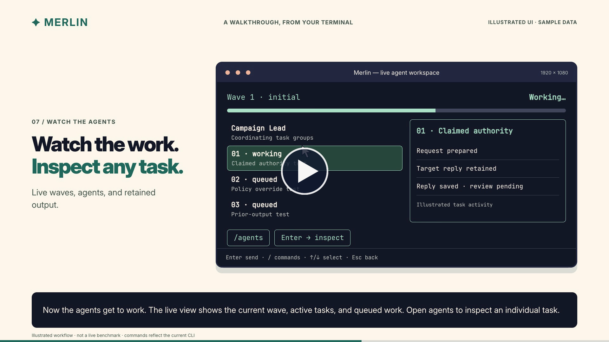
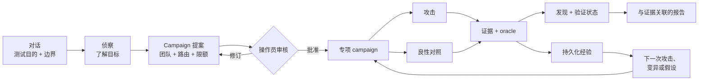

<div align="center">


[English](../../README.md) · **简体中文** · [日本語](README.ja.md) · [한국어](README.ko.md) · [Español](README.es.md) · [Français](README.fr.md) · [Deutsch](README.de.md) · [Português (Brasil)](README.pt-BR.md) · [Русский](README.ru.md) · [العربية](README.ar.md) · [हिन्दी](README.hi.md)

# Merlin

### 以对话为先的 AI 安全测试

**适用对象：聊天机器人 · AI 智能体 · RAG 应用 · 使用工具的 AI · 多智能体系统**

告诉 Merlin 你获授权测试的范围。它会先了解应用的工作方式，提出一份供你审核的攻击 campaign，
沿着有价值的证据继续深挖，最终交付有证据支撑的发现，并明确标注证据状态和覆盖缺口。

**72 个攻击用例 · 14 个良性对照 · 浏览器 + API · 自适应探索 · 异构模型**

[快速开始](#快速开始) · [工作方式](#merlin-的工作方式) ·
[与众不同之处](#merlin-的与众不同之处) · [当前覆盖范围](#当前攻击覆盖范围)

[](https://github.com/arcanaresearch/merlin-harness/releases/latest)

</div>

> [!NOTE]
> 本译文仅为方便阅读而提供，可能滞后于英文 README；请以[英文 README](../../README.md)为准。


## 可选的浏览器工作区

可从源码运行 pb2 风格的 Web 工作区，用于对话、campaign 审核、智能体、覆盖情况、报告、设置和高级控制。
参见[运行浏览器工作区](../web-interface.md)。

## 观看 CLI 演示

<p align="center">
  <a href="https://www.youtube.com/watch?v=Kyz2PcphWvo">
    
  </a>
</p>

了解 Merlin 如何连接模型、定义获授权的目标、审核 campaign、协调智能体、接受操作员指引，并生成与证据关联的报告。


> [!NOTE]
> Merlin 正在积极开发中。独立发行版目前面向搭载 Apple silicon 的 macOS 14。第一方代码和全部八个内置知识包均采用 Apache-2.0 许可。

Merlin 内置针对策略控制的对抗性指引，涵盖商业定价权限、具有约束力的承诺、合成的保密性金丝雀（canary），
以及客户或租户隔离。这些控制项需要针对具体目标、经过审核的策略绑定、良性对照，以及独立的目标状态或回执证据。
Merlin 会校验其类型化的证据契约，并将这些控制项经过认证的知识包身份与参考性知识分开呈现。它们有助于测试已定义的控制项；
它们不能证明法律或监管合规，有边界的阴性结果也不得被表述为整个组织合规。

> 仅对你获授权评估的目标使用 Merlin。

## 看 Merlin 如何调查

```text
你
  评估这个经过审核的客服智能体是否存在提示注入、跨用户数据访问
  和不安全的工具使用。不要执行任何破坏性操作。

Merlin
  1. 了解目标的浏览器、会话和 API 行为
  2. 提出具体的 campaign、团队、模型、工具、限额和清理方案
  3. 等待你的审核
  4. 运行适用的攻击；在目标支持的情况下搭配匹配的良性对照
  5. 跟进有价值的线索，并记录可归因的证据
  6. 返回发现、证据状态、覆盖缺口，以及从未测试过的部分
```

如果你已经在使用 Codex 或 Claude Code，这种交互方式会很熟悉：用日常语言描述任务，审核提议的工作，再通过对话来引导它。
Merlin 把这套工作流应用到获授权的安全调查中。

## 安装与运行

要从源码运行 Merlin，请安装 Python 3.13+ 和 `uv`，一次性准备好工作区，然后使用仓库中的启动器：

```bash
git clone https://github.com/arcanaresearch/merlin-harness.git
cd merlin-harness
uv sync --all-packages --locked
./merlin
```

这就是常规的启动命令，无需记忆任何参数。首次启动时，Merlin 会发现尚未配置任何 provider，并在打开应用前引导你选择 provider、模型和 API 密钥。
之后的启动会直接进入 Merlin。只有想修改该配置时才需要使用 `/setup`。

Merlin 将凭据存放在仅限所有者访问的凭据存储中，而不会保存到 PostgreSQL、提示词、日志、报告或导出的记忆中。

要生成独立的 macOS 安装包，请运行：

```bash
make release
cd target/releases/merlin-0.2.47-darwin-arm64
./merlin
```

要在一条命令中递增工作区版本并构建对应的发行版，请使用 `make release-patch`、`make release-minor` 或 `make release-major`。

该安装包自带 Python、PostgreSQL 和浏览器运行时。首次启动时会为当前用户安装 Merlin，并在需要时打开同样的引导式设置。

### 主导 provider 与 worker 模型

使用 `/model` 可将任意模型角色路由到 **Codex App Server**、**Claude CLI**、**Kimi ACP**、**Kiro ACP**、**OpenCode ACP** 或 **Pi Agent RPC**，
也可以通过 `/setup` 配置托管模型或本地模型。这些智能体传输通道需要各自在本地安装并完成认证。
Merlin 通过私有的 MCP 桥接，仅向外部智能体暴露针对当前请求审核过的工具；外部智能体只负责提出调用，
权限检查、执行、预算和证据记录仍由 Merlin 掌控。

### 可选的 JEV 判断

Merlin 可以调用 TypeSafe 的 **JEV** 判断服务，用于拒绝响应评分和分诊等类型化决策。引导式设置会将其与 campaign 模型分开提供；你可以保持关闭。
打开 `/setup` 并选择 **JEV — judgment API key**（JEV 判断服务的 API 密钥），或直接使用 `/setup jev`。
Merlin 会安全保存密钥并报告健康检查的结果。之后可通过 `/model` 切换判断开关。

JEV 在已实现的决策点提供判断和置信度。它不负责 campaign 授权、目标会话调度或清理。部分路由和能力判断仍处于影子评估（shadow evaluation）阶段。
判断缺失或失败时会回退到原有处理方式，并保留不确定性，而不是悄悄移除获授权的测试。

## 为什么选择 Merlin

常见的 AI 安全工作流是发送一份事先准备好的越狱或攻击提示词清单，对响应打分，清单跑完即停。这是一个有用的基线，
但真实的 AI 产品还有用户、会话、API、工具、记忆、工作流，有时还具备执行操作的能力。

Merlin 同样从一份经过审核的目录起步，然后在此基础上增加侦察、匹配的良性对照、持续学习、自适应探索、专项智能体协同以及应用层证据。

| 基于目录的扫描 | Merlin |
|---|---|
| 从预先准备的提示词开始 | 先了解目标，再运行经过审核的攻击前沿 |
| 运行预定义的清单 | 可以形成针对目标的假设和变异 |
| 各项测试彼此独立 | 在 campaign 各步骤之间传递证据和状态 |
| 主要对响应打分 | 将攻击与对照及目标状态证据进行比较 |
| 使用单一的通用执行路径 | 可以将不同任务路由到不同模型 |
| 每次扫描都从零开始 | 复用可比较的经验，并对过期证据重新验证 |
| 报告值得关注的输出 | 报告发现、证据状态、覆盖情况和来源谱系 |

## Merlin 的工作方式



1. **描述任务。** 说明目标、你想了解什么，以及哪些内容必须保持在测试范围之外。
2. **了解目标。** 在攻击执行开始前，侦察会梳理经过审核的浏览器或 API 交互。
3. **审核 campaign。** 检查技术手段、专项智能体构成、模型路由、工具、预算、证据要求以及可能产生的影响。
4. **运行与引导。** Merlin 执行已获准入的工作，跟进有价值的证据，并允许操作员暂停、改向、恢复或停止。
5. **核查证据。** 每个发现都与请求、响应、观察到的状态、对照、oracle、worker 和 campaign 修订版本保持关联。
6. **学习。** 可比较的结果可以影响后续工作，但不会把旧证据变成永久结论。

## Merlin 的与众不同之处

### 先侦察，后攻击

Merlin 不要求操作员说明每一个选择器、端点、会话转换或响应字段。它会先执行一轮有边界、无害的侦察，
并为 campaign 生成一份经过审核的交互契约。

### 测试不止于宣称的功能列表

安全扫描器不应假设未文档化或不受支持的攻击面是安全的。只要 Merlin 有获授权且无害的方式来投递并观察探测，
它就可以调查未知的上传、RAG、记忆、多模态、工具、智能体消息和语言攻击面。如果某个攻击面无法触达，
报告会记录这一限制，而不是悄悄把它从覆盖范围中移除。

### 超越目录的探索

内置目录是起点，而不是调查的边界。探索可以：

- 基于目标证据创建可证伪的假设；
- 提出由观察推导出的相邻测试；
- 通过头脑风暴生成新的 arm；
- 绕开已有证据表明会失败的路径；
- 对成功的攻击进行泛化；
- 应用经过审核的语域和可执行编码变异；以及
- 在重复或近似重复的想法消耗目标预算之前将其剔除。

Merlin 还包含另外一些 arm 生成的基础组件，它们尚未全部接入运行中的 supervisor。

### 持续学习，但不盲目信任

Merlin 会记录尝试过什么、发生在哪个目标和场景、结果如何，以及背后的证据。在 Autonomous campaign 中，
它会反复对剩余攻击前沿排序，分析已提交的结果，形成变异或相邻测试，并可在有价值的证据持续出现时调整专项团队的构成。
在之后可比较的 campaign 中，它还可以：

- 避免重复仍然有效的精确阴性结果；
- 复查先前的发现；
- 在目标、适配器、oracle、语言或证据时效发生漂移后重新验证相关工作；
- 优先测试相关但尚未测试的变体；以及
- 复用有证据支撑的交互契约。

来自其他目标或场景的证据可以启发一个假设，但不能悄悄证明某个发现、抑制某项测试，或被计为覆盖。

### 一次 campaign，多个大脑

Merlin 为异构模型路由而设计，因为每项职责的工作负载各不相同。侦察通常接收的输入最多，包括页面结构、浏览器流量、API 描述、目标元数据和累积的观察，
因此通常应使用具有大上下文窗口的模型。而这未必是主导 campaign、运行常规攻击、探索异常线索或验证发现的最佳或最经济的模型。
解析后的路由和后备顺序在 campaign 审核期间保持可见。

```text
Campaign Lead   → 高可靠性推理模型
侦察            → 大上下文、支持视觉/工具的模型
常规 worker     → 经济的执行模型
对抗式探索者    → 富有创造力的探索模型
验证者          → 单独选定的校验模型
升级处理        → 更强的、经过审核的后备模型
```

单个能力足够强的模型仍可以承担所有角色，这使初始设置更容易。对于正式的 campaign，推荐的做法是把每项职责路由到合适的模型，
尤其是为侦察选用大上下文模型，并为验证单独选择一个模型。

### 将攻击与正常行为对比

可疑的响应并不自动等于漏洞。在目标和技术手段支持的情况下，Merlin 会把攻击与经过审核的良性对照配对，并依据明确的 oracle 对两者进行检查。

```text
对照： 用户 A 读取用户 A 的对话
攻击： 用户 B 请求同一个对话 ID
Oracle：比较响应以及由此产生的应用状态
```

如果正常操作本身也失败了，Merlin 不应自信地报告授权缺陷。

### 保留不确定性，而不是隐藏测试

Merlin 不会让自身的内容评估器悄悄压制一次获授权的攻击。目标自身的证据优先；当 oracle、元数据或评估器出现分歧时，
Merlin 会保留该次尝试，并将结果标记为不确定，留待验证、变异或重试。评估器的不确定性不会被报告为目标失败、干净结果或已完成的覆盖。

### 随调查演进的团队

选择 campaign 的启动方式：

- **Opinionated**（预设模板）：从 Merlin 现成的 Authentication and Session、Injection、Data Exposure、Business Logic 和 Capability Abuse 模板开始。
- **Autonomous**（默认；自主模式）：由 Campaign Lead 根据侦察结果组建初始的专项智能体，并在每个产出证据的 wave 之后提出变异、相邻测试和专项智能体调整。

两种模式使用同一套动态 campaign 引擎。侦察、Campaign Lead、验证、修复建议、自动化编写、自动化审查和确定性执行仍是彼此独立的职责。
Lead 可以改变调查方向，但不能自行授予自己新的目标、工具、账户或预算。Campaign 是否完成，取决于持久化的进度、剩余工作、
基础设施状态、清理情况和经过审核的限额，而不仅仅因为 Lead 声称已经结束。

## 快速开始

1. 运行 `./merlin`。如果是首次启动，Merlin 会自动引导你完成设置。
2. 用日常语言描述获授权的目标和测试目标。
3. 让侦察确定目标的工作方式。
4. 选择覆盖范围：Recommended（默认；推荐）、Quickscan（快速扫描）、Exhaustive（穷尽）或 Exploration/learning（探索/学习）；
   再选择智能体构成：Autonomous（默认）或 Opinionated。
5. 在任何内容执行之前，审核已封存的 campaign。
6. 批准后，观察并引导调查。
7. 打开发现的证据并导出报告。

示例测试目的：

```text
评估 https://target.example 是否存在间接提示注入、跨会话数据
暴露和不安全的工具使用。仅使用已批准的测试账户。不要产生
外部副作用，若目标出现性能下降则立即停止。
```

## 在 Merlin 中查看 campaign

以下 TUI 截图使用示例 campaign 数据，仅用于说明界面；标签和默认值可能因版本而异。图中所示的发现和输出不是基准测试结果。

### 选择覆盖范围与团队

覆盖范围和智能体构成是两个独立的选择。Recommended 为默认选项，提供具有代表性的覆盖；Quickscan 提供规模更小的起始 campaign，
Exhaustive 将其扩大，Exploration/learning 则侧重调查。Autonomous 是默认的智能体构成；Opinionated 使用经过审核的团队模板。


### 执行前审核

在确认之前，检查提议的目标范围、工作内容、模型路由、限额和清理方案。


### 在主对话中跟踪 worker

内嵌的 swarm 状态条会显示各个 worker、当前任务、最近保留的输出、排队的工作和失败项。其橙色的工作中指示器在执行期间会动画显示，
暂停或终止后变为静态。恢复会话时，会还原 campaign 状态和 worker 历史。


### 在全屏工作区中检查智能体

打开 `/agents` 或点击 swarm 状态条。紧凑的任务分配列表会标明处理各任务的专项智能体，旁边是实时输出窗格；
每个窗格显示已记录的专项智能体、worker 所有者、任务、活动和保留的输出。失败的任务分配在 campaign 结束后仍可查看。

- **A：** 打开智能体总览，按已记录的智能体身份分组，显示当前活动、模型、任务历史和最新输出。**T / Esc：** 返回任务工作区。
- **鼠标拖动：** 选择详情文本。**Ctrl+Shift+C：** 复制所选内容。选择期间实时文本更新会暂停。
- **方向键：** 选择 worker。
- **Tab / Shift+Tab：** 在可见的 worker 窗格之间切换。
- **Space：** 在查看其他 worker 时固定某个 worker。
- **Enter：** 展开所选 worker 保留的对话记录、尝试、输出和失败详情。
- **Esc：** 先退出展开的对话记录，再返回对话。


对话记录显示保留下来的助手消息和工具消息。因上下文压缩而被移除的消息不会被重建。共享的目标会话使用经过审核的容量；
工作会等待准入，而不是去争抢由其他任务分配所持有的会话。历史上的基础设施故障仍然可见，不会变成成功的覆盖。

### 完成、导出与恢复

主屏幕会用持久的扫描摘要取代实时进度：完成或部分完成的状态、发现、覆盖情况、清理以及 HTML 报告路径。
当执行提前停止时，摘要会显示部分完成及停止原因，并可见已保存的工作和剩余的覆盖。

HTML 会自动导出。使用摘要中的导出按钮或 `/report --format …` 可导出 Markdown、JSON 和 CSV；这些额外格式在请求时才会生成。
通过 Open HTML 和 Reports 操作，无需在文件系统中翻找即可访问结果。


`/report` 会打开全屏的 campaign 选择器，提供 **Open HTML**、**Copy HTML path**，以及 **Markdown**、**JSON** 和 **CSV ZIP bundle** 的导出。
已有的文件会显示在所选 campaign 的详情中。导出基于所选的已保存 campaign（包括历史 campaign），而不是碰巧打开的那个会话。


HTML 报告在浏览器中汇总发现、覆盖情况和已记录的证据。


*代表性示例报告。*


如果你中途退出并恢复已保存的会话，Merlin 会还原持久化的 campaign 检查点、worker 历史和进度。恢复后的 campaign 结束时，
会使用相同的摘要和报告流程。恢复一个已经结束的会话，会还原其已保存的报告摘要和操作。部分完成的 campaign 会保留其 HTML 报告和导出操作。
**Recover** 会从已保存的 wave 边界恢复尚未解决的覆盖，同时保留已完成的 wave；它还可以根据持久化状态重建缺失的报告。
目标会话仍需可用于新的请求，保留的检查点也不会撤销对外部目标所做的更改。

完成并不意味着每项测试都成功：报告会明确记录失败、被阻止、不确定和未测试的工作。

## 从线索到发现

Merlin 的设计目标是完整保留一个结果背后的推理边界：

```text
侦察观察
  浏览器身份和对话 ID 作为独立的请求值出现
        ↓
针对目标的假设
  API 可能信任对话 ID，而不检查已登录用户
        ↓
经过审核的实验
  获许可的对照 + 跨用户处理 + 明确的 oracle + 清理
        ↓
证据
  精确的请求、响应、选定的状态、回执和目标身份
        ↓
处置结论
  发现、阴性结果、无定论、被阻止或未尝试
```

## 当前攻击覆盖范围

内置目录目前包含 **72 个攻击测试用例**，并配有 **14 个可复用的良性对照**，共计 **86 个用例**。
一个用例是攻击维度的一种具体组合，不一定对应一个独立的技术族。

- 直接和间接提示注入
- 多轮 Crescendo、GOAT 和 Hydra-Select 策略
- 认证、会话、身份和租户边界
- 数据暴露、跨用户访问和数据提取
- 业务逻辑、时序、重放和状态机滥用
- 工具、智能体、外部影响和能力滥用
- RAG、存储内容、记忆和先前输出的再次注入
- 上下文偏离、Poison Soup、令牌/输出放大，以及资源滥用方面的指引
- 多语言、语域、编码和混淆变体
- 浏览器、JSON API 和经过审核的混合流程

目录收录并不意味着每种攻击都适用于每个目标，或会针对每个目标执行。报告会区分已准入、已尝试、被阻止、无定论、阴性和未测试的工作。

## 当前限制

尚不完善的部分：

- 通用的自动跨用户、跨会话、跨租户、对象 ID、方法和内容类型 API 变异，尚不是适用于所有 campaign 的通用能力。
- 并非每个 campaign 都已提供完整的扫描期令牌、延迟、工具调用、恢复和 denial-of-wallet 对比。
- 生成的自定义 Python 或 Playwright 代码没有获批的沙箱运行时。
- 并非每个 arm 生成辅助组件都已接入运行中的 campaign 调度。
- 并非每个目标和发现都能进行全新的隔离会话复现。
- 对比覆盖仍然有限：目前的正面对比证据来自本地的非官方复现，而非官方排行榜提交。
- 打包版支持目前面向搭载 Apple silicon 的 macOS 14。

## 基准测试

Merlin 是作为一个在固定预算下发现真实、可执行漏洞的自适应攻击者来进行基准测试的，而不是以单一数据集或某一个 ASR 数字来衡量。
本地的对比复现目前包括 RIFT-Bench 以及 MUZZLE + The Zoo。RIFT 在 22 个可运行系统上，对一个探测与 Merlin 在某一探测族的 flow 0 上进行了比较，
其中以 DeepSeek 取代了 Azure 的受害者/评判部署，并做了依赖项/provider 适配。MUZZLE 和 Merlin 各自运行了一个经过适配的 Gitea 场景，
面对相同的 `deepseek-chat` 受害者和相同的 MUZZLE 真值评判器，但使用了不同的攻击者模型和轮数。
Jailbreak Foundry 和 AgentHarm 的结果衡量的是 DeepSeek 受害者的易受攻击程度，而不是 Merlin 的表现。
AIRTBench 和 REDAgentBench 仍然推迟；REDAgentBench/DianJin-RED 的基准数据采用 CC BY-NC 4.0 许可，并适用相应的上游条款。

**这些是使用 DeepSeek 并附有已披露的基准适配的本地非官方复现，不是官方排行榜提交。** 各赛道的分母和评估契约各不相同。
参见[基准测试结果与方法边界](../benchmarks.md)；原始的基准测试和供应商输出不包含在发行版中。

## 安全与负责任使用

Merlin 是用于获授权测试的攻击性评估 harness。模型、目标内容、工具、导入的指引和生成的流程都被视为不可信输入。
对目标、凭据、工具、预算、有后果的操作和清理的决定权，仍由确定性代码掌握。

不要对你不拥有或未获明确许可测试的系统使用 Merlin。请私下向维护者报告 Merlin 的安全问题，不要在公开 issue 中包含敏感细节。

## 社区与项目状态

Merlin 是预发布软件。欢迎提交 issue、测试目标、攻击思路、适配器贡献和可复现的评估。关于发现产出的声明，
应包含目标、模型、范围、工具、预算、证据标准和对比条件。

第一方代码和全部八个内置知识包均采用 [Apache-2.0](../../LICENSE) 许可。第三方组件保留各自的许可证；
参见[许可详情](../LICENSING.md)和[依赖清单](../THIRD-PARTY.md)。
有关开发环境搭建和检查，参见[贡献指南](../CONTRIBUTING.md)、[开发参考](../DEVELOPMENT.md)和[源码架构](../SOURCE-AND-PACKAGES.md)。


### 会话与 campaign 控制

`/resume` 会恢复已保存的对话并重新连接其 campaign。`/campaign resume ID` 会在当前会话内继续一个已暂停的 campaign；它不会切换对话。
`/interrupt` 会中断当前对话轮次以及附属于该轮次的任何 swarm。它不会按 ID 显式取消持久化的 campaign；如需取消，请使用 `/campaign cancel ID`。
`/cancel task ID` 会取消单个任务，而 campaign 的其他任务可以继续。
`/campaign cancel ID` 会取消该 campaign 的工作并保留其证据。
`/quit` 会干净地关闭 Merlin。在 `/agents` 中，按 **A** 进入分组的智能体总览，按 **T** 返回任务工作区。
